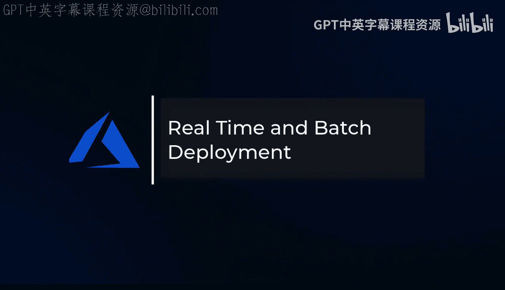
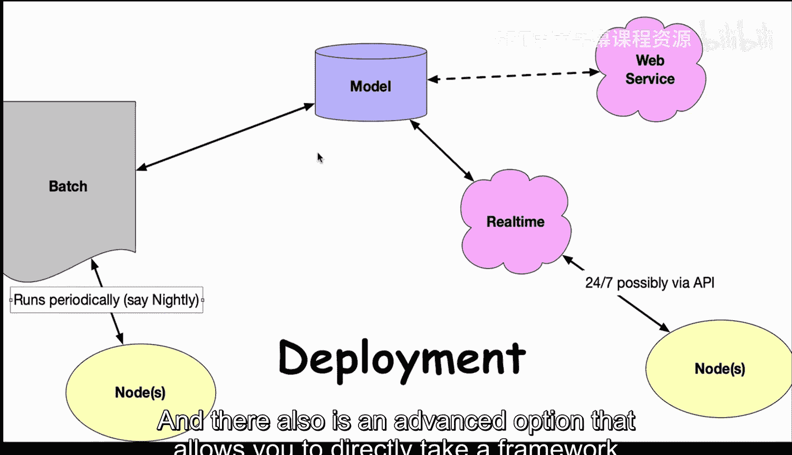

# 杜克大学｜机器学习运维｜DevOps⧸DataOps、Azure、MLFlow和抱脸｜MLOps ｜ Machine Learning Operations p134 57_05_04_实时与批处理部署.zh_en -BV1yE421c7uA_p134-

When you're deploying models via Azure Ml Studio， a couple of options include batch in real time。

 There also is the ability to deploy directly as a web service and essentially abstract away some of the complexity with packaging a model。

 in the time that you're doing a batch。Often you're going to be periodically running it。

 So let's say once a night you would go through and do credit card scoring in the case of realtime you would do this at a 247 possibility so you would go through and have some endpoint deployed and continuously put packages into this realtime endpoint so really there's a couple of key options and then there's a peripheral option which packages the entire service let's go ahead and take a look at how this would work So if we go over to Azure ML studio here and we dive into the model prediction interface one of the things that we see here is that theres deployed to realtime。

Deploy to batch and deploy to service。 So this is only for models that are based on frameworks like。

 for example， PsyitLn or Pytorch。 If we go through and we select deploy to batch。

 it ask you for some options， you then go through， configure it and it goes and creates the service。

 We can actually look at a existing endpoint here， and this is where they would show up if your realtime endpoints are registered。

 you would put them here if the batch endpoints are registered。

 they would put them here and you can see I created one earlier。

 and this one is able to be run periodically， if I want to create a job against it。

 and it's designed to run on a scheduled point versus the other type of endpoint。

 which is the realtime endpoint， you would set this up so that would run and constantly receive API request from a client。

 So in a nutshell， there are a couple key ways to deploy on Azure Ml Studio and they're also is an advanced option。

That allows you to directly take a framework and deploy it into production。

