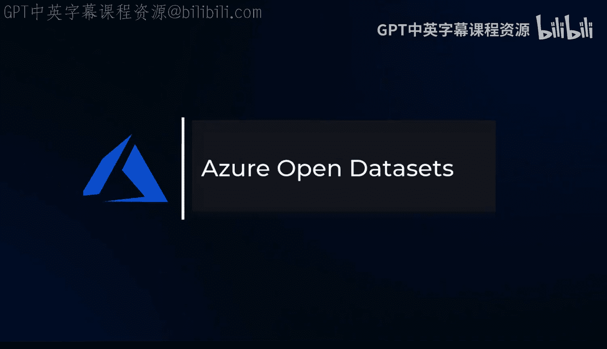
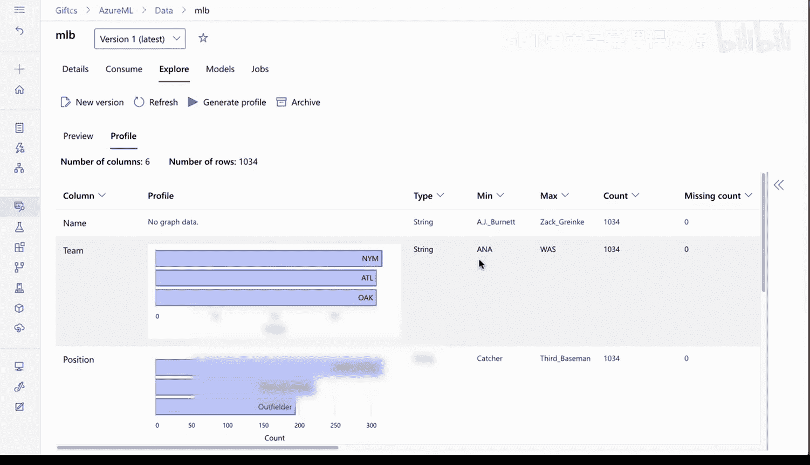

# 杜克大学｜机器学习运维｜DevOps⧸DataOps、Azure、MLFlow和抱脸｜MLOps ｜ Machine Learning Operations p135 58_05_05_Azure开放数据集.zh_en -BV1yE421c7uA_p135-

Azure has a sophisticated way of managing data sets inside of Azure Mach learning Studio。

 If I go over to the data tab here on the left， you can see that I have an existing data set that's already inside of the data management system。

And if I want to create a new one， we can go through here and select new asset。

 We'll call this test asset always a good idea to put a description。 This is a test with。MLB data。

And then it's up to us to decide what type we want to put into the system。 Is it a file。

 a folder or a table， I'm going to go ahead and select file。And once I select next。

 there are three different choices here。 so from a UI。

 this could be a data asset that's providing a web URL， which is a great way to actually ingest data。

 you can also select existing storage so if you have Azure storage where there are some maybe petabytes of data that you need to process you scroll through there and find some of that or a local file right if you just want to test out a workflow。

And I'm going to go ahead and select this from local file。 And when I go next。

 it's going to allow me to choose where I'd like to store that。 if I select Workspace blob here。Now。

 all I have to do is upload a file to this location。 Let's go ahead and select upload file。

 I'm going to grab。A data set I have here that is the height and weight of major League Base players。

 And then once I say next， I'm able to actually create this asset， right。

 so now we can see that I can view my new data here。

And scroll through and explore it and look at different columns， for example。

 and we can see here that with column headers here， if I toggle this。

 the data looks a lot more reasonable and I can do other operations with this particular data。

 So it's a very sophisticated way to ingest assets into your Azure machine learning process。

 Now if I go back to data here， another really interesting thing you can do is you can say generate profile and I've already done this。

 So let's go ahead and see how this works。 if I say compute instance， for example。

 I can pick a running instance like this one right here and say generate this and it would go through and essentially build out a profile of this data and since I've already done this。

 look， I can go to view profile and what's useful about this is I get a useful visualization that shows me essentially exploratory data analysis for me。

 So I can go through here and look at the columns。I can look at what type it is， look at the counts。

 look at the positions， look at histograms that show me the distribution of the data in height and weight。

 etcter， so this is an invaluable resource as you're getting started with Azure machine learning is to first ingest the data set also go through and profile it and then you have a better understanding of how to create a machine learning model。

