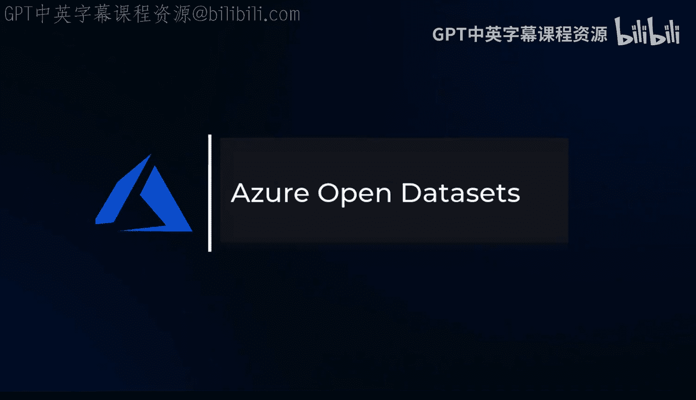
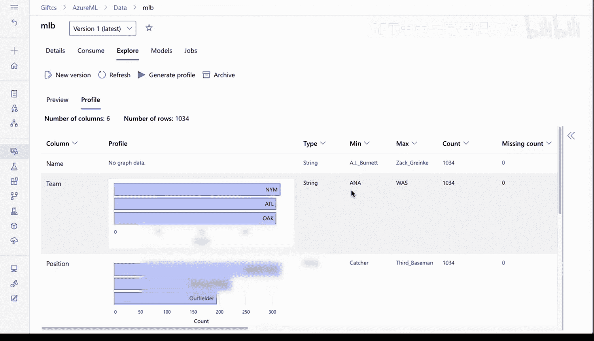

# 机器学习运维：第58章：在Azure机器学习工作室中管理数据集

## 概述
在本节课中，我们将学习如何在Azure机器学习工作室中管理数据集。我们将涵盖创建新数据资产、上传本地文件、以及利用内置工具生成数据概况报告等核心操作。这些步骤是构建机器学习工作流的基础。

---

Azure机器学习工作室提供了一套复杂的数据集管理方式。

如果点击左侧的“数据”标签页，可以看到系统中已存在一个数据集。

若要创建新数据集，可以点击“新建资产”。

我们将此资产命名为“测试资产”。添加描述是一个好习惯，例如“这是一个使用MLB数据的测试”。

接下来需要决定要存入系统的数据类型。是文件、文件夹还是表格？这里我们选择“文件”。

点击“下一步”后，会出现三个不同的选项。

从用户界面看，数据资产可以来自一个网络URL，这是获取数据的有效方式。

也可以选择现有存储。如果你在Azure存储中拥有需要处理的海量数据（例如PB级别），可以在此处浏览并选择。

或者，你也可以选择本地文件，这非常适合用来测试工作流。

我们将选择“从本地文件”上传。

点击“下一步”后，系统会让我们选择存储位置。我们选择“工作区Blob存储”。

现在，只需将文件上传到此位置。点击“上传文件”。

我将选择一个包含美国职业棒球大联盟球员身高和体重的数据集。

点击“下一步”后，就可以创建这个资产了。

现在，我们可以查看新上传的数据。

我们可以滚动浏览、探索数据并查看不同的列。例如，通过切换表头显示，数据会看起来更清晰，我们也可以对此数据进行其他操作。

这是一种将资产导入Azure机器学习流程的非常成熟的方式。

回到“数据”主页面，另一个非常有趣的功能是“生成概况”。我已经预先执行了这个操作。

让我们看看它是如何工作的。例如，我可以选择一个正在运行的“计算实例”，然后点击“生成”。系统将遍历数据并构建一个数据概况报告。

由于我已经执行过此操作，我可以点击“查看概况”。这个功能的价值在于，它能为我提供一个有用的可视化报告，本质上就是为我完成了探索性数据分析。

我可以在这里查看各个列，查看数据类型、计数、位置，以及显示身高和体重数据分布的直方图等。

因此，在开始使用Azure机器学习时，一个非常宝贵的资源是：首先导入数据集，然后生成并查看数据概况报告。这样你就能更好地理解如何创建机器学习模型。

---

## 总结
本节课我们一起学习了在Azure机器学习工作室中管理数据集的核心流程。我们掌握了如何创建新的数据资产、从本地文件上传数据，以及如何使用“生成概况”功能来快速获得数据的可视化分析报告。这些步骤是准备数据和理解数据特征的关键，为后续构建机器学习模型奠定了坚实的基础。