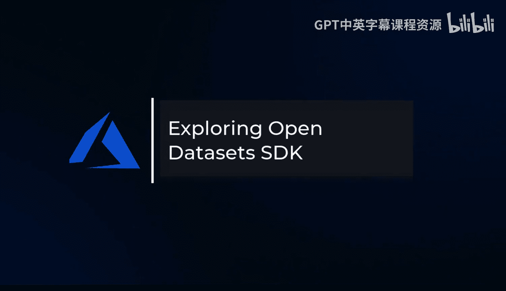
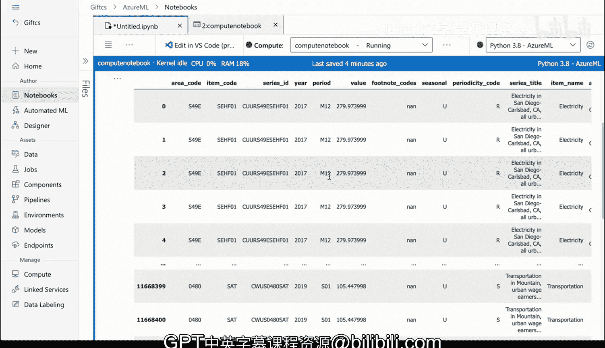

# 杜克大学｜机器学习运维｜DevOps⧸DataOps、Azure、MLFlow和抱脸｜MLOps ｜ Machine Learning Operations p136 59_05_06_探索开放数据集SDK.zh_en -BV1yE421c7uA_p136-

One of the great things about the Azure open datasets is that you can register them inside of Azure ML Studio and then explore them with code using the Python SDK。

 so let's go ahead and take a look at a open dataset that I've been able to connect into Azure ML Studio and you can see here there's a lot of really nice things I can do just from the GuUI。

 I can look at the total size of the files， for example， I could profile it if I needed to。

 I could do a basic exploration， it'll give me a quick preview here， for me to take a look at it。

 but I also can import it if I select consume And if I go to consume here notice that does give me a code example so that I can just grab this and then put this into a notebook so I've already done that I've selected copy here and then if we go over to notebooks。

You can see that。This notebook has that code sample loaded for me。

 And so what I can do now is once I run this cell and you can see that the cell has been loaded。

I'm able to actually get this visualization where it shows me inside of the code cell exactly what's happening and I could scroll through here and do whatever that is I needed to do。

 maybe run some descriptive statistics or plot it with a library like Seaborn or Maplloot Lib and so there's a great way to integrate inside of the notebooks by just doing a cut and paste from the registered dataset。

