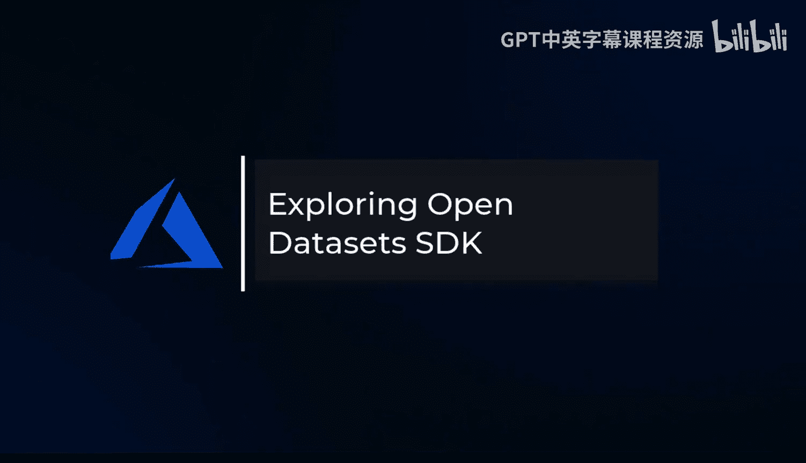
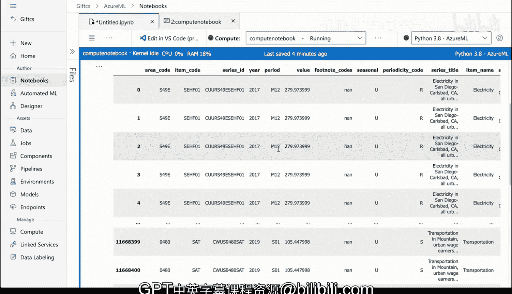

# 机器学习运维：第136课：探索开放数据集SDK 📊

在本节课中，我们将学习如何利用Azure开放数据集，并将其集成到Azure ML Studio中。我们将通过Python SDK来探索和操作这些数据集，从而为后续的机器学习任务做好准备。

## 注册与探索数据集

Azure开放数据集的一个显著优势是，您可以在Azure ML Studio中注册它们，然后使用Python SDK通过代码进行探索。

上一节我们介绍了Azure开放数据集的概念，本节中我们来看看如何在Azure ML Studio中实际操作一个已连接的数据集。从图形用户界面（GUI）中，您可以执行许多便捷的操作。

以下是您可以在GUI中执行的主要操作：
*   查看文件的总大小。
*   在需要时对数据集进行分析。
*   进行基本探索，系统会在此处提供快速预览以供查看。

## 在代码中使用数据集

除了通过界面探索，您还可以将数据集导入到代码环境中。如果您选择“使用”（consume）选项，系统会提供一个代码示例。

以下是获取和使用代码示例的步骤：
1.  在数据集页面选择“使用”选项卡。
2.  复制提供的代码示例。
3.  将代码粘贴到您的笔记本（Notebook）中。

我已经完成了上述操作，将代码复制并加载到了这个笔记本中。现在，一旦我运行这个代码单元，就能在代码单元格内直接看到可视化的结果。

## 在笔记本中进行数据分析

运行该单元后，我能够获取可视化展示，并在代码单元格内查看具体发生的情况。我可以在此滚动浏览，并执行任何需要的操作。

以下是您可以在笔记本中进行的后续分析示例：
*   运行一些描述性统计。
*   使用诸如Seaborn或Matplotlib之类的库进行绘图。

通过从已注册的数据集中复制粘贴代码，这是在笔记本中进行集成的绝佳方式。

## 课程总结

本节课中，我们一起学习了如何在Azure ML Studio中注册开放数据集，并通过GUI和Python SDK两种方式对其进行探索。我们掌握了将数据集代码集成到Jupyter Notebook中的方法，为后续的数据分析和模型开发奠定了坚实的基础。利用这些技能，您可以高效地利用丰富的Azure开放数据资源。