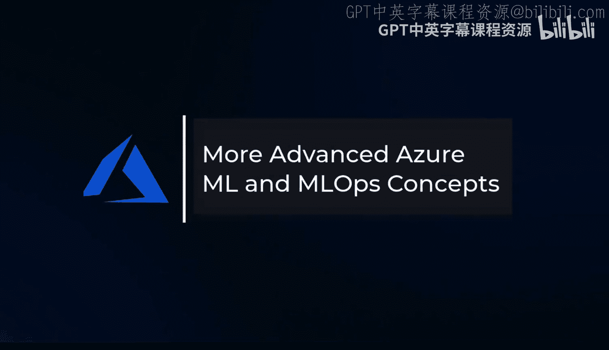

# 杜克大学｜机器学习运维｜DevOps⧸DataOps、Azure、MLFlow和抱脸｜MLOps ｜ Machine Learning Operations p137 60_05_02_进阶Azure ML与MLOps概念.zh_en -BV1yE421c7uA_p137-

Now that we have a good understanding of some of the things that you'll need to learn in order to get certified and how some of the certifications like AI fundamentals are related to MLOps tangentially。

 but not specifically， and you've been able to do a little bit of work with open datas will dive a little bit deeper into some of the other components within Azure that are very interesting and can be very good to perform more advanced operations within the Azure ecosystem will go a little bit on resources and usage and CPUU components versus GPU components and compute systems within the Azure machine learning studio service。

 those again are very useful to get a solid knowledge and in fact those also come in the AI fundamentals in the Azure AI fundamental certification。

If you choose to expand a little bit of your knowledge by taking that certification， all in know。

 I think all of these components and services from within Azure are very useful and some of these concepts are again not super specific to Azure but can be applied elsewhere。

