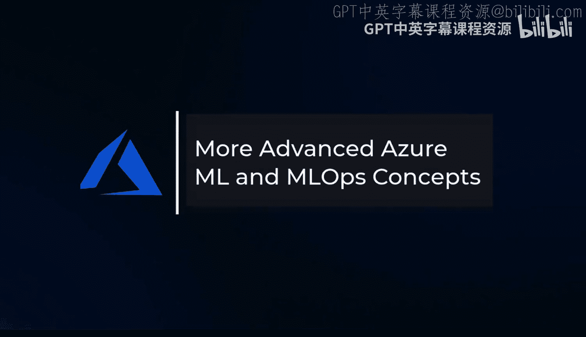

# 机器学习运维：137：进阶Azure ML与MLOps概念

在本节课中，我们将深入学习Azure机器学习平台中的一些高级组件与核心概念。这些知识对于在Azure生态系统中执行更复杂的操作至关重要，并且与多项认证考试内容相关。

上一节我们介绍了认证路径以及与MLOps相关的AI基础概念。本节中，我们将更深入地探讨Azure机器学习工作室服务中的一些其他组件。

## 计算资源：CPU与GPU

理解Azure机器学习中的计算资源是高效运行工作负载的关键。以下是两种主要计算组件的对比：

*   **CPU组件**：通用计算单元，适合处理逻辑操作、数据预处理和传统机器学习任务。
*   **GPU组件**：专为并行处理设计的计算单元，特别适合深度学习模型训练和推理等计算密集型任务。

## Azure机器学习工作室服务

Azure机器学习工作室提供了一个集成环境来管理机器学习生命周期。其计算系统允许你根据任务需求灵活配置和选择计算资源。

这些关于资源和计算组件的知识非常实用，能帮助你打下坚实的基础。事实上，这些内容也包含在Azure AI基础认证中。

如果你选择通过考取该认证来扩展知识面，所有这些Azure内部的组件和服务都将非常有用。需要指出的是，其中一些概念并非Azure特有，同样可以应用于其他平台。

本节课中，我们一起学习了Azure机器学习中关于计算资源（CPU与GPU）的核心区别，以及Azure机器学习工作室服务的基本架构。理解这些概念有助于你更有效地在云平台上管理和执行机器学习工作流。