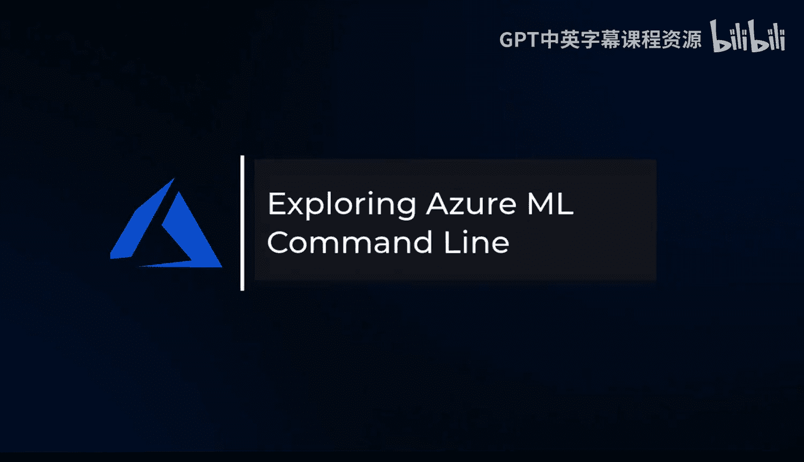
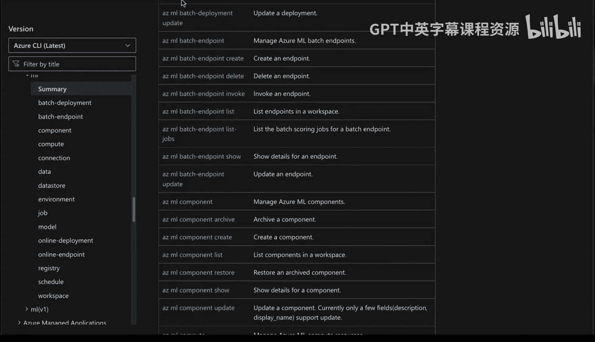
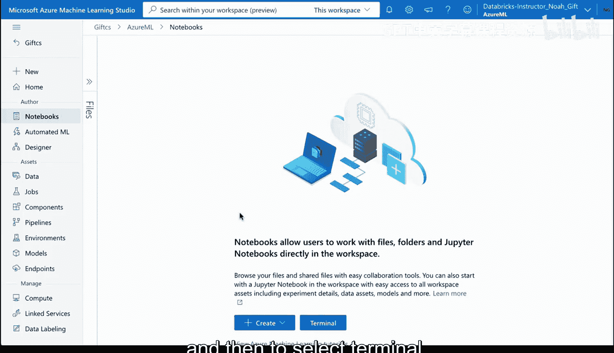
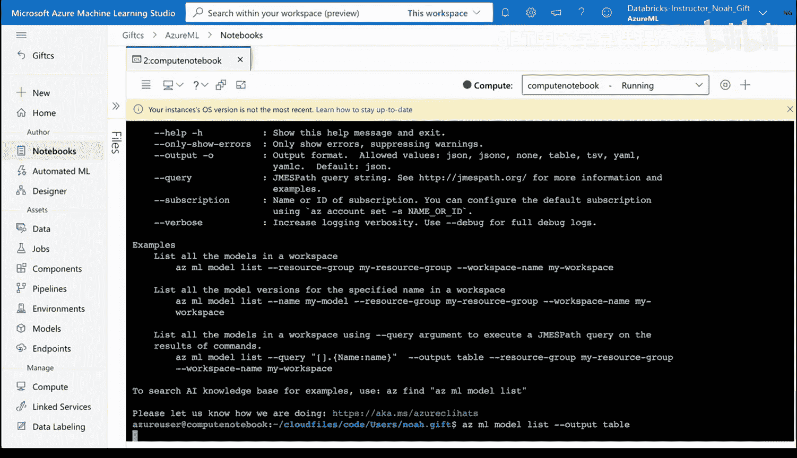

# 杜克大学｜机器学习运维｜DevOps⧸DataOps、Azure、MLFlow和抱脸｜MLOps ｜ Machine Learning Operations p138 61_05_03_探索Azure ML命令行.zh_en -BV1yE421c7uA_p138-

Azure M Ci extension version 2 has many commands that allow you to efficiently interrogate the entire product。

 Let's take a look at some of these commands。 For example。

 managed Azure M batch deployments delete deployments， list deployments。

 there's a whole list of operations that are in many cases much more simple to investigate than to click on a GuI。

 let's go ahead and play around with this ourselves。 So if I go over to Azure M Studio。

 an easy way to get to the Ci and get everything hooked in is to be logged into your workspace and then to select terminal。

 we go ahead and we select terminal right here。

We get this welcome to Azure Mach learning terminal。

 which is really nice because we can immediately start playing around with this interface。

 So the way that you can start is type an A Z MLl。😊，D help。

 And this gives you a list of all of the commands that are at your disposal。

 You can see the subgroups here are things like batch deployment， compute， data sets， jobs， models。

 right， So you're able to integrate all these different systems and really quickly get in into the details of what is actually happening in Azure M studio。

 So let's go ahead and play around first with a the datas， right。

 that would be a good one to play around with if I type in A Z。😊，Ml data。List， help。

This gives me a menu that is able to show the different outputs that are available。

 notice that I could query if I wanted to， the different data sets and find out some information about it。

 I can get the output as Jason， I can get it out as a table or Yaml file。

Let's go ahead and select table here， so I'm going to go ahead and do the up arrow and then change this to output。

And then， do table。And then once we dive into this。

 one of the things that's interesting is that I am able to see all of the different data sets that I have at my disposal。

 And if I wanted to do further operations and interrogate those， I could go ahead and do that。

 We can also go back to where we started。😊，And then explore some other resource， for example。

 if I wanted to look at how many models were deployed on my system or registered。

 I could actually take a look at that as well and do DS help。And from here。

 we're able to see the different commands that are available so I could archive a model。

 create a model， download a model， list the model， restore， show， update。 In fact。

 let's go ahead and list the models。 Let's go ahead and do list。D help。

 And once we go ahead and we look at the help menu， you can see that again， I have that same format。

 so I can go ahead and do the output。And do table and we can take a look at the models that are actually registered in our system。

There we go。 We have lots of different models here that I can take a look at and do different operations with。

 So if you're going to interrogate by the CI， one of the best places to do this is by using the compute notebooks。

 opening up a terminal and getting it right to work。

