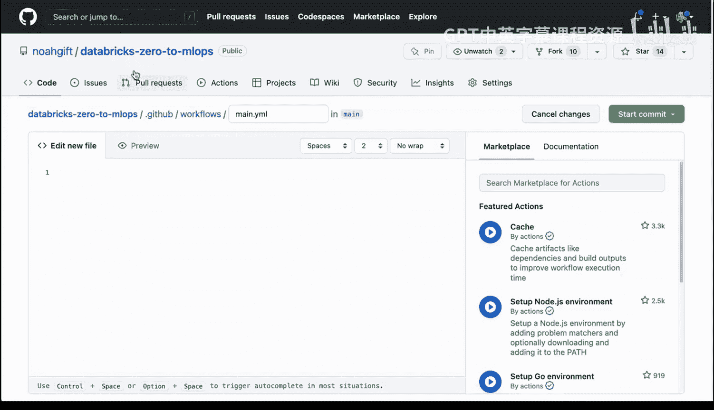
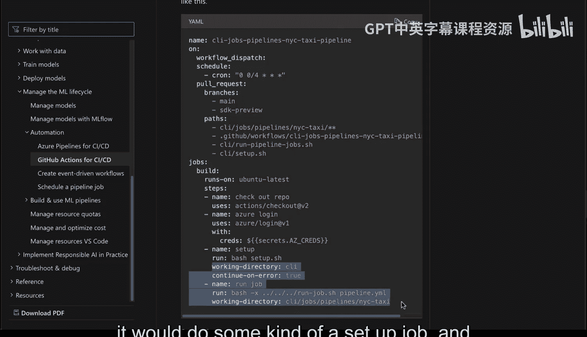

# 杜克大学｜机器学习运维｜DevOps⧸DataOps、Azure、MLFlow和抱脸｜MLOps ｜ Machine Learning Operations p139 62_05_04_使用GitHub触发Azure ML.zh_en -BV1yE421c7uA_p139-

One of the more interesting things that you can do is use GiHub as a general worker form to create actions that get deployed into Azure Ml Studio and because both products have great integration with each other One of the things you can do is hook up Github via secrets So C your credentials via Azure Ml Studio hook those into the Github actions ecosystem and then configure a job using the Github actions Yaml format。

 All right， let's go ahead and take a look at how that would work。

 So first step we have a repo here that I use for certain operations and let's pretend that this is the repo that would be communicating with Azure ML Studio All I would need to do is scroll down to the settings section right here and notice that under secrets under actions I could create a new repository secret and this could be for example。

 my Azure credentials and I would put that secret right in here。Once I've got that。

 then I can refer to it in my actions file， and if I go to actions here。

 you can see how it's very simple to create a new workflow。

And it's really a Yamlbased workflow here and you would put this into this environment and then say start commit。

 So it's a twostep process。 First， the credentials second， the configuration file。

 So if we go to Github here。 let's take a look at how it would actually integrate with the Azure Ci So what you need to do is create the credentials right here。

 and this is where those credentials would get hooked into Github and then if you scroll down right here。

 you would put those secrets in like I referred to before。

 So first create the credentials that put them into the secrets Next up。

 what we could do is we could take a look at the Yaml file here and notice how you would refer to the pipeline that you wanted to deploy you would create a schedule you would decide what are the paths that would need to be worked on and then also you would create what it is that you're going to do。

 So in this case it would use those credentials that we had set up。

It would do some kind of a setup job， and then it could run that particular pipeline。

 So a very powerful setup to use GitHub as really the worker that does all of the tasks that you care about。

 you can see here that it's really a tight integration between Gitthub and Azure Eml Studio。

