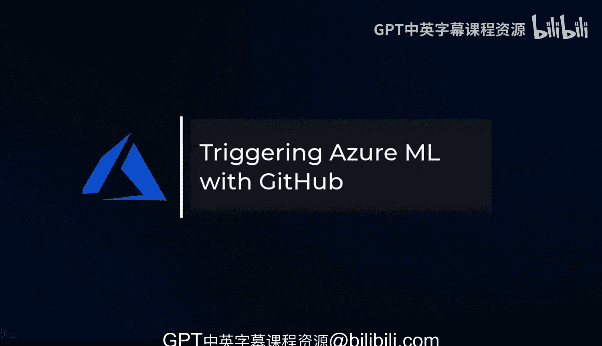
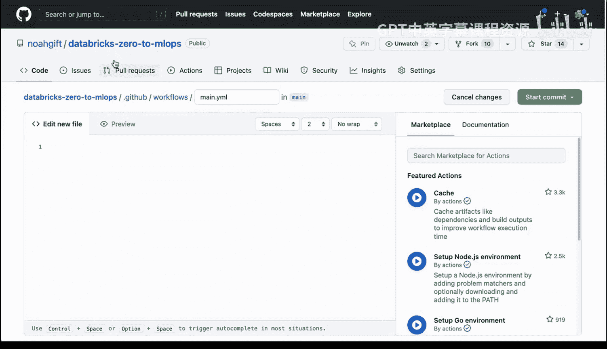
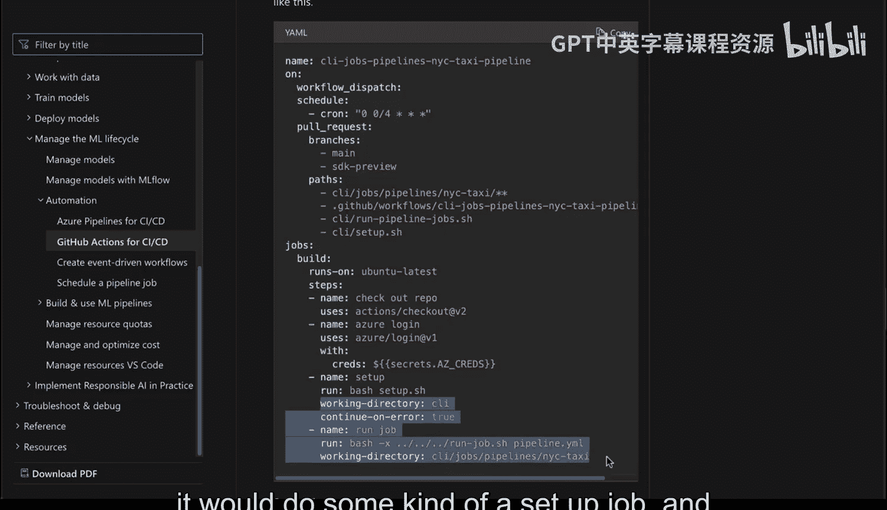
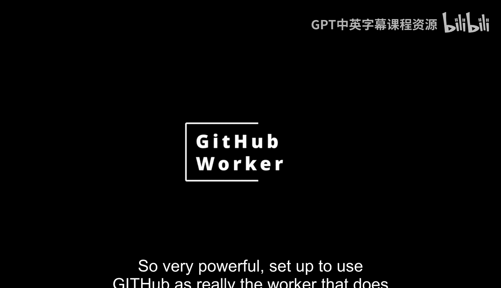
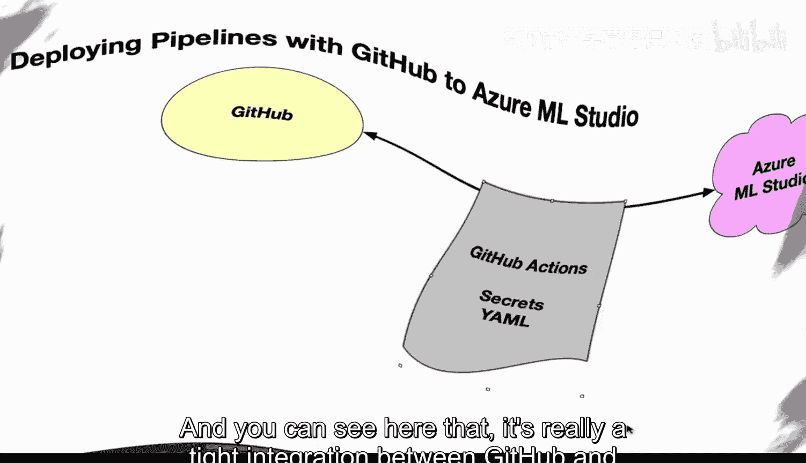

# 杜克大学｜机器学习运维｜MLOps：139：使用GitHub触发Azure ML工作流 🚀



在本节课中，我们将学习如何利用GitHub Actions作为自动化工作流引擎，来触发和部署Azure Machine Learning Studio中的任务。我们将重点介绍如何安全地配置凭据，并编写YAML工作流文件来实现两者的紧密集成。

---

## 概述

Azure ML Studio与GitHub都提供了出色的集成能力。一个非常实用的功能是，你可以将GitHub配置为一个通用的“工作者”，通过它创建并执行能够部署到Azure ML Studio中的自动化操作。实现这一点的核心在于，通过GitHub的“Secrets”功能安全地存储Azure ML的凭据，然后在GitHub Actions的YAML配置文件中引用这些凭据，从而配置并运行特定的任务。

上一节我们介绍了MLOps中持续集成与部署的基本概念，本节中我们来看看如何具体使用GitHub和Azure ML来实现自动化。

## 分步教程

### 第一步：在GitHub仓库中配置Azure凭据

首先，你需要一个用于与Azure ML Studio通信的代码仓库。在仓库的设置中，你可以找到配置机密信息的地方。

以下是具体操作步骤：

1.  进入你的GitHub仓库页面。
2.  点击顶部的 **“Settings”** 选项卡。
3.  在左侧边栏中，找到 **“Secrets and variables”** 下的 **“Actions”** 选项。
4.  点击 **“New repository secret”** 按钮。
5.  这里可以创建新的机密信息，例如你的Azure认证凭据。为它命名（如 `AZURE_CREDENTIALS`）并将凭据内容粘贴进去。

完成这一步后，你就安全地将Azure ML的访问密钥存储在了GitHub中，并可以在工作流文件中引用它。

### 第二步：创建GitHub Actions工作流文件

配置好凭据后，下一步是创建定义自动化任务的工作流配置文件。这个文件使用YAML格式。

以下是创建和配置工作流文件的流程：

1.  在仓库顶部导航栏中，点击 **“Actions”** 选项卡。
2.  点击 **“New workflow”** 按钮，或手动在仓库的 `.github/workflows/` 目录下创建一个新的YAML文件（例如 `azure-ml-pipeline.yml`）。
3.  在这个YAML文件中，你需要定义几个关键部分：
    *   **触发条件**：指定工作流何时运行（例如，定时计划、代码推送等）。
    *   **任务**：定义一个或多个任务（jobs）。其中一个关键任务会使用第一步设置的凭据。
    *   **步骤**：在任务中定义具体的步骤，例如设置环境、登录Azure、运行特定的Azure ML管道。

这是一个简化的YAML结构示例：

```yaml
name: Trigger Azure ML Pipeline

on:
  schedule:
    - cron: '0 8 * * 1' # 每周一早上8点运行
  push:
    paths:
      - 'src/**' # 当src目录下的代码有推送时也触发

jobs:
  deploy:
    runs-on: ubuntu-latest
    steps:
    - name: Checkout code
      uses: actions/checkout@v2

    - name: Login to Azure
      uses: azure/login@v1
      with:
        creds: ${{ secrets.AZURE_CREDENTIALS }} # 引用GitHub Secrets中的凭据

    - name: Run Azure ML Pipeline
      run: |
        # 此处添加运行你的Azure ML管道的命令
        echo "Triggering pipeline..."
```

在这个配置中，`${{ secrets.AZURE_CREDENTIALS }}` 就是引用你在第一步设置的机密信息。工作流会根据`schedule`（定时计划）或代码`push`事件自动触发，执行登录Azure并运行指定管道的任务。

### 第三步：集成与执行



将上述YAML文件提交到仓库后，GitHub Actions就会开始监控你设定的触发条件。一旦条件满足，它会自动启动一个虚拟机环境，执行你定义的任务：使用安全的凭据连接到你的Azure ML工作区，并触发指定的机器学习管道。

这种模式非常强大，它使得GitHub成为了一个中心化的自动化控制台。你可以管理代码、跟踪变更，并直接从这里驱动云端复杂的ML工作流，实现了开发（Dev）与运维（Ops）在机器学习项目中的流畅衔接。

---



## 总结





本节课中我们一起学习了如何搭建GitHub与Azure Machine Learning Studio之间的自动化桥梁。关键步骤包括：**1）** 在GitHub仓库的Secrets中安全存储Azure凭据；**2）** 编写一个YAML格式的GitHub Actions工作流文件，定义触发条件和具体任务；**3）** 在工作流中引用存储的凭据来认证并触发Azure ML中的管道。通过这种集成，你可以轻松实现机器学习工作流的持续集成与部署（CI/CD），提升运维效率。