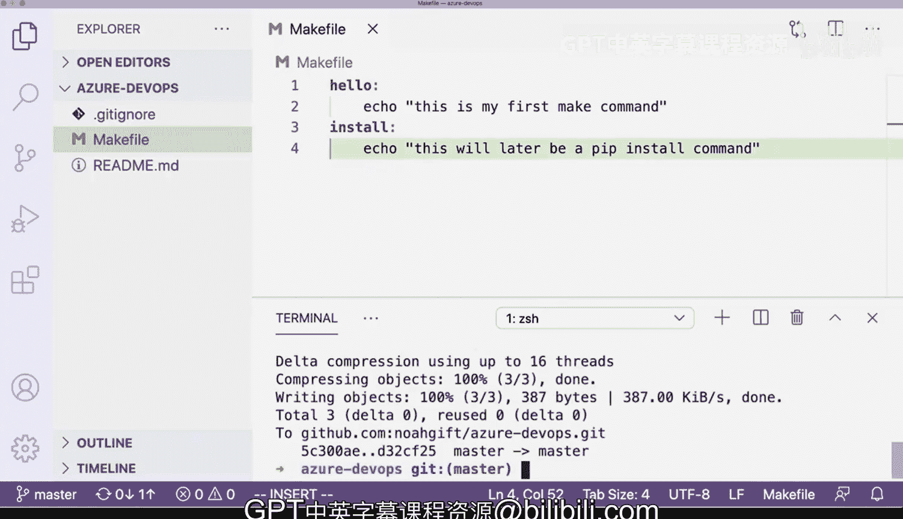

# 杜克大学｜机器学习运维｜DevOps⧸DataOps、Azure、MLFlow和抱脸｜MLOps ｜ Machine Learning Operations p14 21_01_08_Makefile入门.zh_en -BV1yE421c7uA_p14-

Let's talk through what it's like to create a make file， what it's used for。

 and how to run some commands。 So first if you type in the word which make in a terminal。

 in this case， I have a terminal open in Vi Studio code。

You can see that it's installed on my machine in the user bin make directory What's nice about the make command is that it's installed on most Unix type machine So OS10 Linux all of them that have this UniX underpinning have the make command either installed or it's really easy to install it and you can use this to set up build steps in your project So what we'll do next is use a command called touch to make an empty file called make fileile notice that the make fileile itself has to be called a very specific name and the uppercase in is important so we go ahead and do that and now see that the make file is now in my location in the git repository that I've checked out if I hover over it I can select it and now what's great about this editing process is I can put in a command so maybe what I'll first do is type in the word hello。

And I'll make a hello type command so what I'll do is I'll type in echo。

 this is my first make command。And then I'll go ahead and save this。And then if I type in make hello。

I'll be able to print this out so that's what's great about a make file is you can put anything you want into it and it encapsulates it and hide some of the complexity so for example。

 later what we'll do is we'll get into some installation steps and we'll go through and say install and then I could put in some other command right and and i'll just for now say。

😊，Maybe。This will later be。A Pip install command。I'll go ahead and save this and then type in make install and you can see that it's pretty much ready to go。

Great， so what I typically would do in this next step here is go gi add， make file。Commit this。

Say adding a。Make file。Push this and now I've got a make file set up and I can start building on this in later steps。

