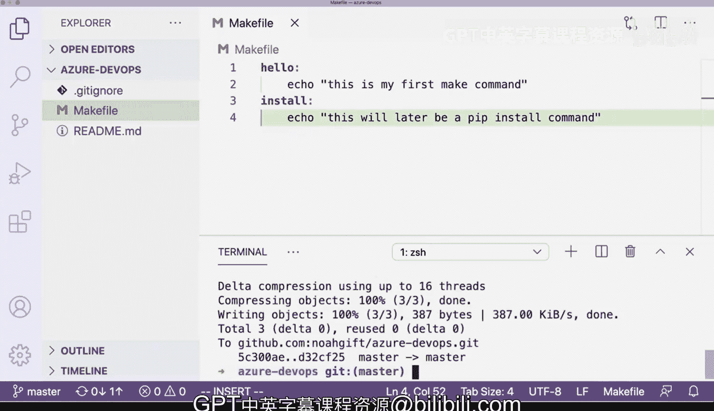

# 机器学习运维：P14：Makefile入门


## 概述
在本节课中，我们将要学习如何创建和使用一个名为 `Makefile` 的文件。`Makefile` 是一个用于自动化执行一系列命令的工具，它可以帮助我们封装复杂的构建步骤，使项目管理和部署变得更加简单和一致。

## 什么是Makefile？
`Makefile` 是一个包含了一系列规则的文件，这些规则定义了如何编译和构建项目。它通常用于自动化软件构建过程，但也可以用于执行任何你希望自动化的任务序列。

## 检查Make命令
首先，我们需要确认 `make` 命令是否已经安装在你的计算机上。你可以在终端中输入以下命令来检查：

```bash
which make
```

如果 `make` 已经安装，终端会显示其安装路径，例如 `/usr/bin/make`。`make` 命令在大多数基于Unix的系统（如macOS和Linux）上都是预装的，或者可以很容易地安装。

## 创建Makefile
接下来，我们将创建一个空的 `Makefile`。请注意，文件名必须精确地命名为 `Makefile`，区分大小写。我们可以使用 `touch` 命令来创建这个文件：

```bash
touch Makefile
```

执行此命令后，你会在当前目录下看到一个名为 `Makefile` 的新文件。

## 编写第一个Make规则
现在，让我们打开 `Makefile` 并添加我们的第一个规则。规则的基本格式是：

```
目标: 依赖
    命令
```

例如，我们可以创建一个名为 `hello` 的目标，它执行一个简单的 `echo` 命令：

```makefile
hello:
    echo "This is my first make command."
```

保存文件后，在终端中运行 `make hello` 命令，你将看到输出的文本。

## 添加更多规则
`Makefile` 的强大之处在于你可以定义多个规则来组织不同的任务。例如，我们可以添加一个 `install` 规则，用于安装项目依赖。

以下是添加 `install` 规则的示例：

```makefile
install:
    # 这里将来可以替换为 pip install 等安装命令
    echo "This will later be a pip install command."
```

保存后，运行 `make install` 即可执行该规则下的命令。

## 使用Makefile管理项目
一旦你的 `Makefile` 设置完成，你可以将其添加到版本控制系统中，以便与团队成员共享。以下是常用的Git命令：

```bash
git add Makefile
git commit -m "Adding a Makefile"
git push
```

这样，你就为项目设置了一个基础的自动化构建脚本，可以在后续开发中不断扩展和完善。



## 总结
本节课中我们一起学习了 `Makefile` 的基础知识。我们了解了如何检查 `make` 命令、创建 `Makefile` 文件、编写简单的规则以及如何运行这些规则。`Makefile` 是一个强大的工具，能够帮助我们自动化重复性任务，提高开发效率。在后续的课程中，我们将基于此基础，探索更复杂的构建和部署自动化流程。