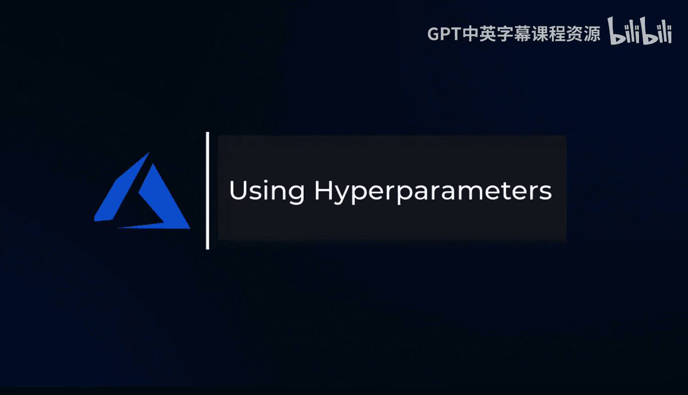
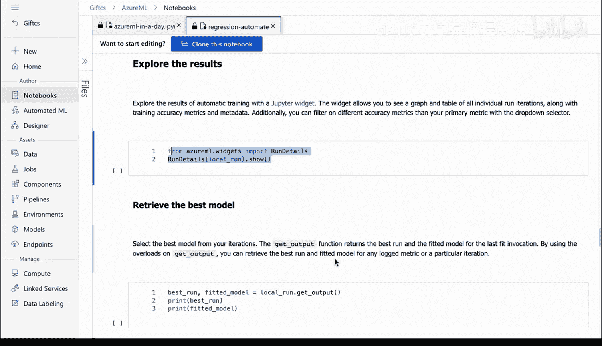

# 杜克大学｜机器学习运维｜DevOps⧸DataOps、Azure、MLFlow和抱脸｜MLOps ｜ Machine Learning Operations p140 63_05_05_使用超参数.zh_en -BV1yE421c7uA_p140-

Here is a SD K version1 example notebook that I'm going to share a few ideas about in terms of hyperparameter settings。

 and notice here that it calls that out at the very beginning。And at the start。

 there's some basic imports here， like importing pandas and the Azure SD K V1。

 And once the data is pulled into pandas， it's cleaned。Finally， the workspace is configured。

The data is then put into a test in train splits。 So nothing different than a traditional machine learning model yet。

 But here's where things get interesting is that if we select the automatically train model option right here。

 one of the things that we can do here is actually take a look at the training settings that are important to pay attention to。

 So when you're setting up automatic hyperparameter tuning， there are a few things to be aware of。

 So one of them is iteration time out in minutes。 And so this would be the time that is spent in each iteration So you have to decide how long you'd like the compute to run to find different hyperparameter。

 you also can have an experiment time out itself。 So what's the maximum amount of time that all of the different experiments that you're running the iterations So the different hyperparameter tuning jobs will take and then are you able to have early stopping。

 So once you've got a good enough score for。ExampJust you call it a day and then use that particular set of hyperparameters。

 And then what is the metric that you're using to optimize。 So in this case。

 in this particular tutorial that're using spearman correlation And so this is the best fit model that would be chosen on that automatic run in this particular property feturization you can use auto and this will handle missing data and convert things to text and numeric and then what kind of verbosity do you want So do you want to have a lot of instrumentation in your code you can see what's going on and then also hyper parameters that you can select include cross validations So if we go through here and we put all those autom settings together they would be assigned to a dictionary。

And then all you need to do is push this into your training job and configure it。

 And once you've got this training job running， this will show up as an experiment and once it's complete you'll be able to go back and look at the experiments and find the best model。

 So really the idea with hyperparameter tuning is a lot of it is manual tedious work that you don't necessarily want to spend your time focused on and you can actually call it via the SDK and have Azure itself go through and pick the best hyperparameters and then those will show up in your experiments tab and you can take a look at what it is that you're doing and pick the correct experimental run and then deploy that model。

