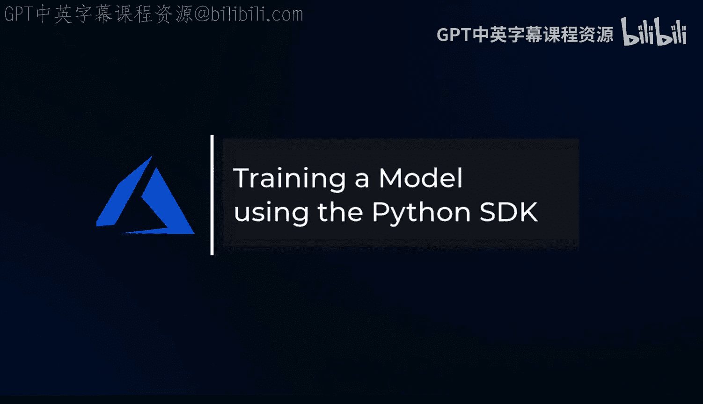
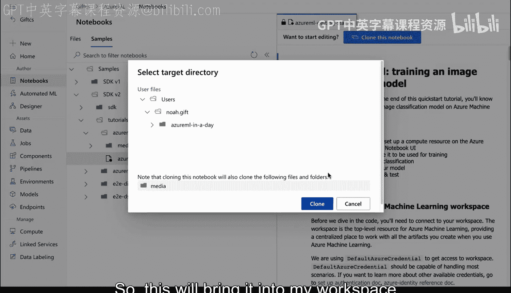
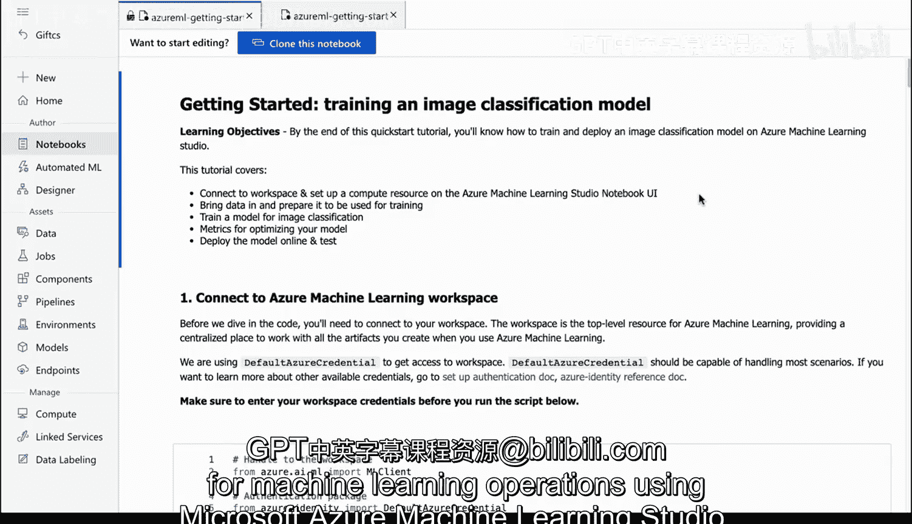

# 杜克大学｜机器学习运维｜DevOps⧸DataOps、Azure、MLFlow和抱脸｜MLOps ｜ Machine Learning Operations p141 64_05_06_使用Python SDK训练模型.zh_en -BV1yE421c7uA_p141-

Let's take a look at the Python SD K， which is a really powerful way to do machine learning on Azure M L Studio。

 because you can control whatever it is you want to do with the Python language and add additional power to your experiments。

 If we go ahead and select start。One of the things that we can do is look at our workspace here and notice that。

I've got an existing notebook， but I could load a sample notebook as well。

 and if we notice in this particular sample directory here。

 we've got a bunch of different things that we could pull from so we could look at the SDKV1 or the SDKV2。

 look at tutorials， etc。So in this example， what I'm going to do is I'm going to go to Azure ML getting started。

And I'm going to select this notebook， and then I'm going to click on clone this notebook。

 So this will bring it into my workspace so that I can play around with it。 Oh， look。

 I've already got it inside of my workspace so I don't need to actually do anything at all。

 So if I go back here and I do a refresh we see that in fact。

This notebook is already here。 So now that I've got the notebook， what I can do is close this window。

And once this window is open。I can also tweak things a little bit， for example。

 maybe add a comment or change to focus mode。 And there's a few key items here to consider that are important。

 The first thing is that we need to actually be able to enter our credentials below。

 So let's go ahead and do this and a few things to point out is that you will need to put in your credentials inside of this particular location。

 Once I've done this， I'm going to go ahead and run this。And then next， if I scroll down。

The idea here is just because that we're running in a notebook。

 it doesn't mean that we can't pull it into a script and run it more as application code。

 so in this case。We're going to make a directory for source and then we're going to use this kman called write fileile。

 which what it does is it will take whatever is in the cell and itll write it out to a script。

 In this case it'll be this main doi script。 You can see it uses the Python standard library for argument parsing to build a chimean tool It has pandas。

 we also use MLflow and experiment tracking tool that allows us to capture things like the experiment tracking parameters for example。

 accuracy。And then we use a standard psyic learn model。 if we scroll down here to the very bottom。

 one of the things that we can do is do a shift return。

Once we scroll down here now the next thing that we're going to do is configure this job command and we can import the libraries for Azure so in this case this is the SDK so Azure AI。

 Ml we're going to import a command and we're going to import an input and then notice in this command right here that we're able to say we want this UI file here's the path right here where the data set would live and we can decide how we want to tweak things so it's very easy in this scenario to tune things and say I want to testtrain ratio of 0。

1 versus 0。2 I want to tweak the learning rate example as well。

 and then finally all of this just makes it so that we can reproduce our experiment again because it's all been written out as a application file。

All right， now we're ready to go。 So if we want to go through here and submit the job。

 all we need to do now is do M L client。Dot create or update job。

 Now what's important to be aware of in this scenario is that it is going to use your subscription ID。

 And so you have to have those parameters successfully inside of there。

 So since I've already run this， I won't run it again。 But what we can do is see that in fact。

 the results of the training job experiment using MLflow are able to link everything into there together and now we can look at the results of the training job。

 So let's go ahead and pull up that result。And what's really powerful about this type of workflow is that now I can actually look in and see exactly the command that I can run to reproduce this particular experiment。

 I also can look at the name of the experiment， I can look at the environment， for example。

 if we click on this link right here。What's really awesome is that it shows us that this Docker file is absolutely reproducible step by step。

 because we're pulling from a base model， it shows us the installation commands that we're running。

 the variables that we're running， the dependencies that we're running。

 and also the environmental variables that are running。Also really。

 really helpful for us when we're trying to reproduce our particular example。

And then in addition to that， if I want to go through here and look at the metrics。

 we can see all of the performance metrics here， training accuracy， the F1 score。

 we can also look at different images here， potentially some visualizations that show us how well our model was able to be used and then finally we could go through here。

Look at the code itself。 right， So we actually have this reproducible thing that will allow us to run it in the future。

 So very， very powerful interface that we get just by running a few lines of code。

 One last thing that I'll mention here is that if we also want to scroll down。😊。

One of the things that we could do is we could deploy this model as an online endpoint and it will take just a very small amount of code if we wanted to do that。

 and then we could test this out and even run a dictionary right here that actually invoke our model and put it up into production。

 Finally， if you want to clean it up， you can clean it up。

 So I think one of the better ways to get started with this interface here is to actually use the sample tutorial for version 2 of the SDK and it will walk you through step by step of how to create reproducible workflows for machine learning operations using Microsoft to Azure machine learning studio。

