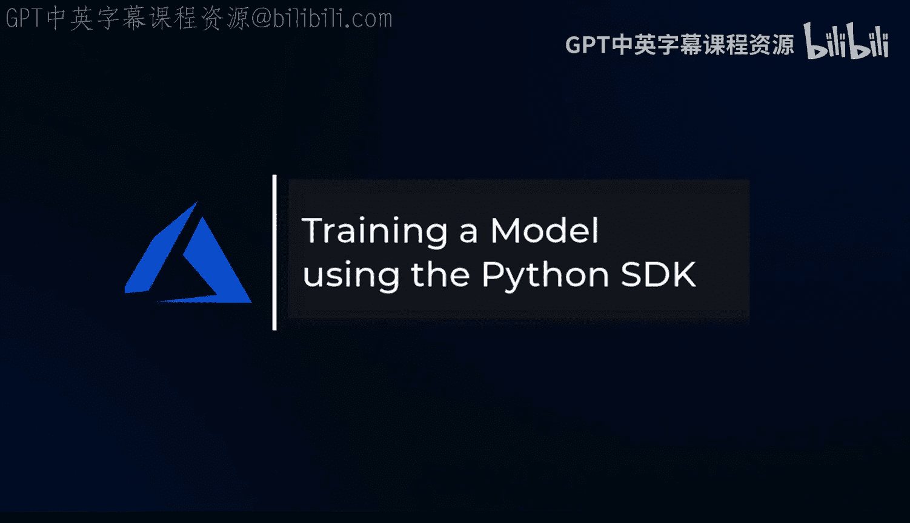
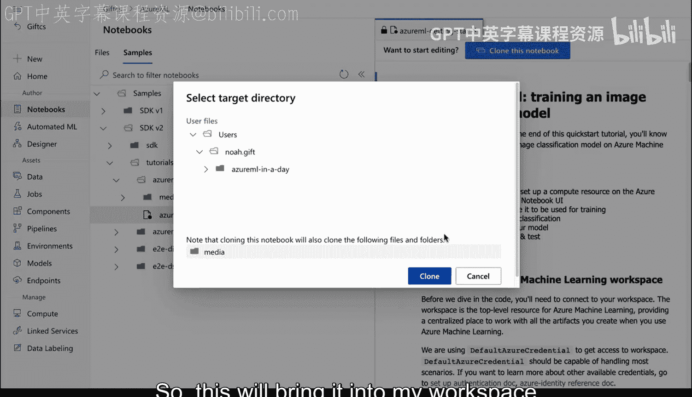
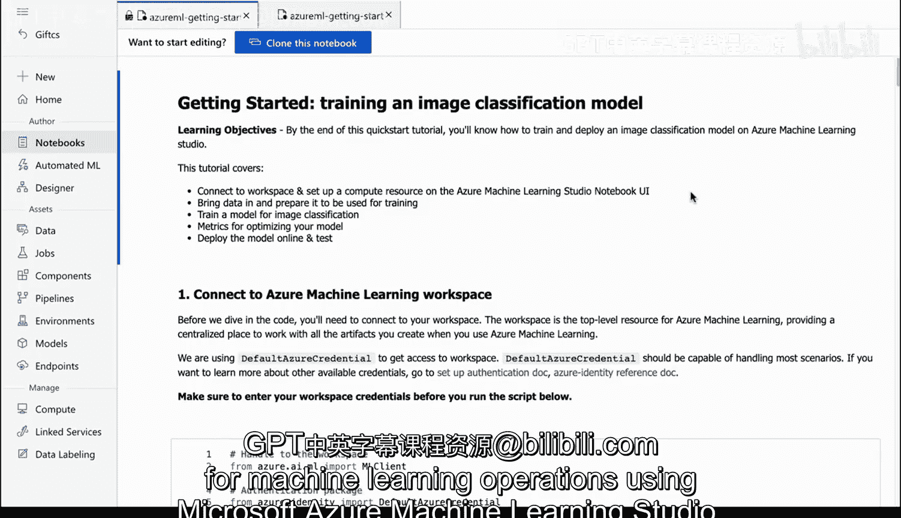

# 机器学习运维：第141课：使用Python SDK训练模型



在本节课中，我们将学习如何在Azure机器学习工作室中使用Python SDK来训练机器学习模型。Python SDK提供了强大的控制能力，允许你使用Python语言灵活地设计和增强你的实验。

## 概述

我们将通过一个示例笔记本，演示如何从配置环境、编写训练脚本，到提交训练作业并查看结果的完整流程。你将了解到如何创建可复现的机器学习工作流。

## 使用Python SDK进行实验

上一节我们介绍了Python SDK的概览，本节中我们来看看如何具体操作。首先，我们需要在Azure机器学习工作室中打开或克隆一个示例笔记本。


在工作室中，你可以查看现有的笔记本，也可以加载示例笔记本。在示例目录中，提供了SDK V1、SDK V2以及各种教程的笔记本。



以下是操作步骤：
1.  导航到“Azure ML入门”部分。
2.  选择一个示例笔记本，例如入门教程。
3.  点击“克隆此笔记本”，将其复制到你的工作区中。

克隆完成后，刷新页面即可在工作区看到该笔记本。现在，你可以关闭克隆窗口并打开笔记本进行编辑。

## 配置环境与认证

打开笔记本后，首先需要配置环境并完成身份认证，以确保SDK可以访问你的Azure资源。

以下是需要完成的关键步骤：
*   在指定单元格中输入你的Azure订阅凭证（例如订阅ID、资源组等）。
*   运行该单元格以建立连接。

配置完成后，即可运行后续的代码单元格。

## 编写与组织训练代码

虽然我们在笔记本中操作，但代码可以轻松地转换为独立的应用程序脚本。这有助于代码的模块化和复用。

接下来，我们将创建一个目录来存放源代码，并使用一个命令将笔记本单元格中的代码写入到脚本文件中。

```python
# 示例：使用 writefile 魔术命令将代码写入脚本
%%writefile ./src/main.py
import argparse
import pandas as pd
import mlflow
from sklearn.ensemble import RandomForestClassifier
# ... 其余训练代码
```

这段代码会生成一个名为 `main.py` 的脚本。该脚本使用Python标准库进行参数解析，利用pandas处理数据，集成MLflow来跟踪实验参数（如准确率），并使用scikit-learn构建模型。

## 配置并提交训练作业

现在，我们将使用Azure ML SDK来配置一个训练命令，并提交作业到云端执行。

首先，导入必要的SDK模块。

```python
from azure.ai.ml import MLClient, command, Input
```

然后，配置作业命令。你可以在此指定训练脚本的路径、输入数据集的位置，并灵活调整超参数。

```python
# 配置作业
job = command(
    code="./src", # 源代码目录
    command="python main.py --train_ratio 0.2 --learning_rate 0.01", # 运行命令及参数
    inputs={
        "input_data": Input(type="uri_file", path="<你的数据集路径>")
    },
    environment="AzureML-sklearn-1.0-ubuntu20.04-py38-cpu:1", # 训练环境
    compute="cpu-cluster", # 计算目标
    display_name="my_training_job"
)
```

通过调整 `command` 中的参数（如 `train_ratio` 或 `learning_rate`），你可以轻松进行实验调优。所有配置都被记录，确保了实验的完全可复现性。

配置完成后，使用ML客户端提交作业。

```python
ml_client.jobs.create_or_update(job)
```

提交作业需要你的订阅信息已正确配置。作业提交后，你可以在Azure机器学习工作室中监控其状态。

## 查看结果与分析实验

作业完成后，我们可以详细查看实验结果。这种工作流的强大之处在于，所有细节都被完整记录和链接。

你可以查看运行该实验的确切命令、实验名称以及所使用的环境。点击环境链接，可以查看用于构建训练环境的Dockerfile。它展示了从基础镜像、安装命令、依赖项到环境变量的每一步，这对于复现实验至关重要。

此外，在“指标”选项卡中，可以查看所有性能指标，如训练准确率和F1分数。还可能有一些可视化图表，帮助你评估模型性能。在“代码”部分，你可以回顾本次运行所使用的具体代码。

## 模型部署与清理（可选）

最后，如果你希望将训练好的模型投入实际使用，可以将其部署为在线端点。

以下是部署模型的基本代码框架：

```python
# 部署模型为在线端点（示例代码）
# from azure.ai.ml.entities import ManagedOnlineEndpoint, ManagedOnlineDeployment
# ... 配置端点和部署
# ml_client.online_endpoints.begin_create_or_update(endpoint)
# ml_client.online_deployments.begin_create_or_update(deployment)
```

部署完成后，你可以通过发送请求来测试端点。如果不再需要相关资源，记得运行清理代码来删除端点和模型，以避免产生不必要的费用。

## 总结

本节课中我们一起学习了使用Azure机器学习Python SDK训练模型的完整流程。我们从打开示例笔记本开始，逐步完成了环境认证、代码编写、作业配置与提交、结果分析等步骤。关键点在于，通过代码定义整个流程，我们获得了高度可控和完全可复现的机器学习实验能力。对于初学者，强烈建议从SDK V2的示例教程开始，它能一步步指导你如何利用微软Azure机器学习工作室构建可复现的机器学习运维工作流。



