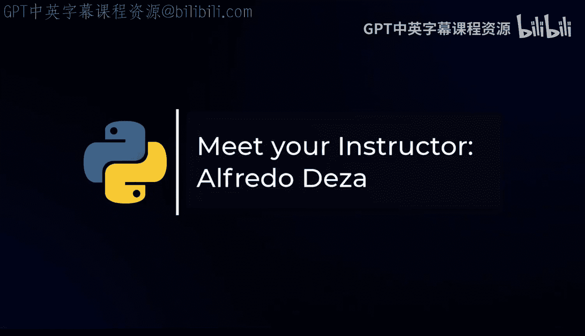

# 杜克大学｜机器学习运维｜DevOps⧸DataOps、Azure、MLFlow和抱脸｜MLOps ｜ Machine Learning Operations p142 01_01_01_认识你的课程讲师-Alfredo-Deza.zh_en -BV1yE421c7uA_p142-

Welcome to this course where we will cover MLOs platforms。

 so specifically some of the open source MLOp platforms and we'll start with MLflow。

 which is a powerful platform that allows you to deploy your models and capture all of the metrics。

 all of the things that happens while you're building while you're training your models and then deploying them。

 it gives you a normalized way of deployment and reproducible environment。

 we'll see everything that you have to do in order to have these reproducible environments regardless of the cloudown provider。

 Azure or GCP or even AWS it will essentially work anywhere that's a powerful thing right there that you might be interested in exploring then it will move on to hugging face although hugging face。

 the actual platform， the services the Huging face provides are not open source their libraries are will'll look at。

formers willll look at datas and we'll see how to interact with that to get off the shelf。

 modelss are pretrained and we'll interact with them， we'll see how to deploy them。

 how to package them， how to push them to other cloud providers like like Azure and use different container registries and finally we'll see a little bit of Onx as well which is a different way。

 a different format that you can export and import to and from these Onx format which allows you to produce a model in a different framework like say Tensorflow and then get it onto Onx and put it into other devices that might not have everything you need for say Tensorflow。

 So it gives you another way to normalization， which is a powerful concept in machine learning operations as well in machine learning in general so we'll additionally cover some advanced hugging face applications。

things like fine tuning and even using GPU like using off theshe models and fine tuning them。

 making some slight changes and adapting that to a new purpose and all of that will allow you to interact with all of these and gain some powerful knowledge to have normalized deployments interact with powerful models that are existing today produced by very important companies and give you flexibility to deployment anywhere and that deployment can happen with OnX or other registries or other cloud providers in essence these course will allow you to do many different things related to machine learning operations and I'm excited that you're here so let's go through all of those and hopefully by the end of it you feel confident enough to interact with all of these technologies and start applying them in your day today with machine learning。

