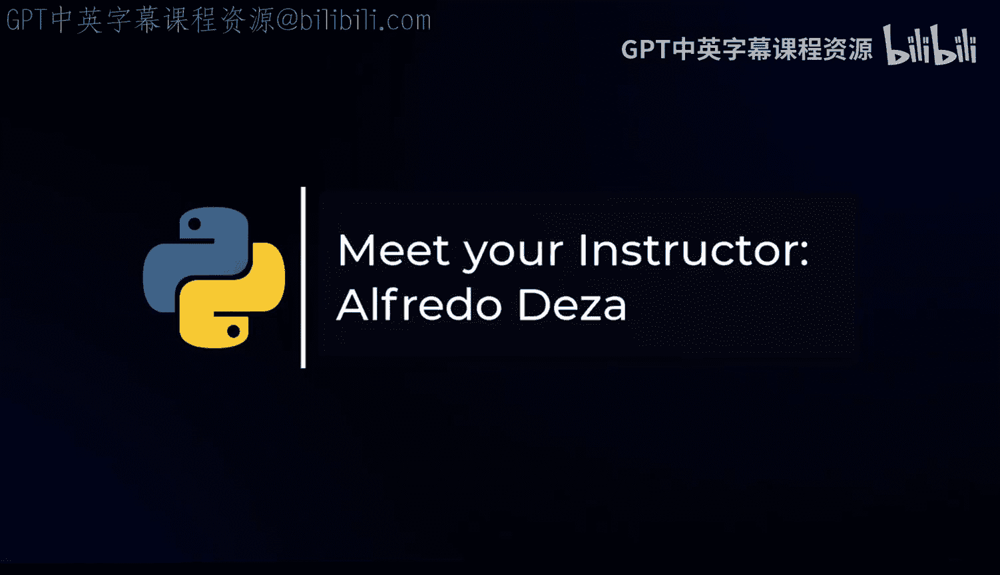

# 机器学习运维课程：01：认识你的课程讲师 🧑‍🏫

在本课程中，我们将学习机器学习运维平台。具体来说，课程将涵盖一些开源的MLOps平台。我们将从MLflow开始，这是一个强大的平台，允许你部署模型，并捕获在构建、训练模型以及部署过程中发生的所有指标和事件。它提供了一种标准化的部署方式和可复现的环境。

我们将学习如何创建这些可复现的环境，无论使用哪个云服务提供商，例如Azure、GCP或AWS，它都能正常工作。这是一个强大的特性，值得深入探索。

接下来，课程将转向Hugging Face。虽然Hugging Face平台本身的服务并非开源，但其库是开源的。我们将学习Transformers和Datasets库，并了解如何与它们交互以获取现成的预训练模型。我们将学习如何部署、打包这些模型，并将其推送到其他云提供商，例如Azure，并使用不同的容器注册表。

最后，我们还将简要了解ONNX。这是一种不同的格式，你可以将模型导出为ONNX格式或从该格式导入。这允许你在一个框架（例如TensorFlow）中生成模型，然后将其转换为ONNX格式，并部署到其他可能没有TensorFlow等完整环境的设备上。这提供了另一种标准化的方式，这在机器学习运维乃至整个机器学习领域都是一个强大的概念。

此外，课程将涵盖一些高级的Hugging Face应用，例如微调，以及使用GPU运行现成模型并对其进行微调，进行一些细微的修改以适应新的用途。

所有这些内容将使你能够与这些技术交互，并获得强大的知识，以实现标准化的部署，与当今由重要公司开发的强大现有模型进行交互，并为你提供在任何地方部署的灵活性。这种部署可以通过ONNX、其他注册表或其他云提供商来实现。

本质上，本课程将使你能够完成许多与机器学习运维相关的不同任务。很高兴你能在这里，让我们一起学习。希望在课程结束时，你能有足够的信心与所有这些技术交互，并开始在日常的机器学习工作中应用它们。

---

本节课中，我们一起认识了课程讲师，并概述了本课程的核心内容：我们将学习MLflow、Hugging Face和ONNX等关键MLOps平台与技术，目标是掌握标准化模型部署、与预训练模型交互以及实现跨平台灵活部署的能力。