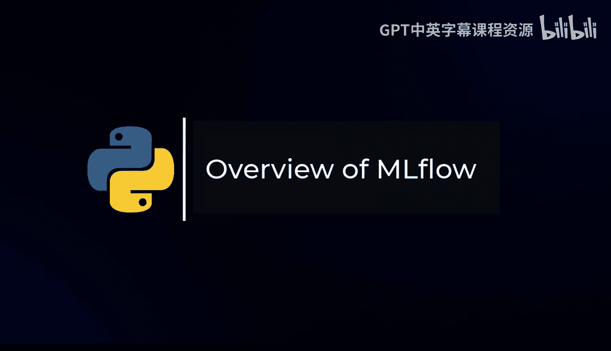
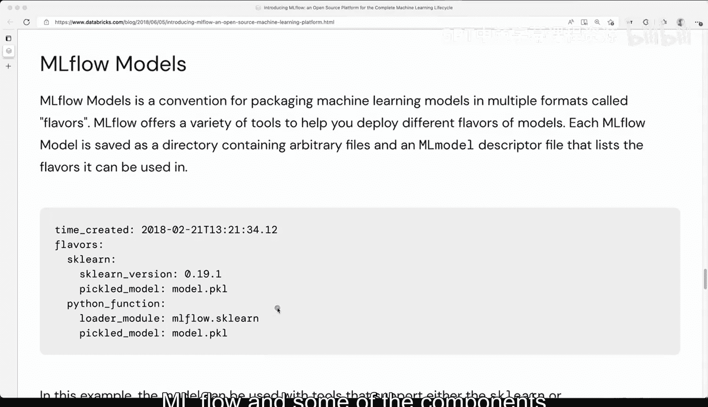

# 杜克大学｜机器学习运维｜DevOps⧸DataOps、Azure、MLFlow和抱脸｜MLOps ｜ Machine Learning Operations p143 02_01_02_MLflow概述.zh_en -BV1yE421c7uA_p143-

嗯。Tracking is one of those components that MLflow is able to do。

 So here we have a little bit of like a quick overview of what that tracking looks like so you have abilities to do perform certain things that are actually prefix with log and we'll see those in detail later but you can log parameters you can see here that parameters are basically key value pairs and those key value pairs can be anything so you can see here regularization in 0。

1 you can be anything and if you are keeping some sort of consistency in your product when your trained machine learning models or doing any kind of changes you can keep track of those while the。

The run is actually moving around and making progress。

 So aside from parameters which are key value pairs to log absolutely anything。

 you can log metrics metrics can also be anything as well and here you can see accuracy0。

1 So you're actually capturing certain things that are making sense for what you're trying to train So the difference between metrics and parameters is that parameters can be our key value pairs but you can see those as when you're going to be training and you're going to be passing some values around and you want to capture those And finally you're going to be logging artifacts。

 Now logging artifacts means basically not that you know initially can you can think about this as like oh it's going to report something as a log but no it's actually going to capture so say for example model PkL which is stands for pickle and it's going to push。

that binary to a remote server next I want to show you well this is kind of like the UI which will see like a newer version of the UI later on on this course but I want to scroll here to show you the projects so a little bit of the high overview of the projects again these are three components we just saw tracking now we're going to look at projects and finally we'll take a look at models so projects is a way of normalizing with configuration plain text configuration like this one that allows you to keep track of everything that you're doing while you're going to perform some actions in your machine learning project so you can name is one of the most basic things that you can do here these files using a Conda environment and pointing to a Conda Yamala file again we'll see in detail what that means and what are some of the options that you can do there but。

what this means is that it configuration in a textbased file or textbased framework rather that you can keep track when you're doing your machinery operations and you can put them in version control That means that if I come in tomorrow and change this Python valid apply to do something different to use some other file and I make a mistake well I can always come back and make sure that this doesn't have a typo so those are kind of like the things that version control will give you the ability of doing So I'm going scroll all the way down to models now so that now you can actually see what that means essentially you're tracking a variety of different ways of creating a model of producing a model and here you will see that what Python functions So you're instructing and willll flow how it should load this model how it should be。

With what versions of the machine learning libraries are going to be using so in this case。

 psychic Learn is going to be version 190。19。1 and its going to produce this model PKL so that's it that's a very high overview of MLOflow and some of the components that we'll see in detail later。

