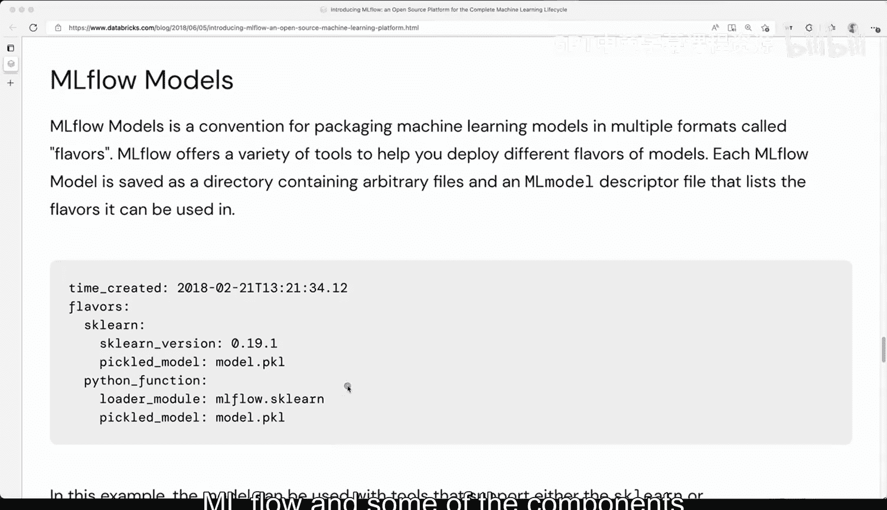

# 机器学习运维：02：MLflow概述

在本节课中，我们将要学习MLflow的核心概念与主要组件。MLflow是一个用于管理机器学习生命周期的开源平台，它能帮助数据科学家和工程师追踪实验、打包代码以及部署模型。我们将逐一了解其三大核心组件：追踪（Tracking）、项目（Projects）和模型（Models）。

## 追踪（Tracking）组件

追踪是MLflow的核心功能之一。它允许你在机器学习实验过程中，系统地记录各种信息，以便后续比较、复现和分析。

以下是追踪功能可以记录的主要数据类型：

*   **参数（Parameters）**：参数是**键值对（key-value pairs）**，用于记录实验的配置信息。例如，你可以记录正则化强度 `regularization: 0.1`。这些值可以是任何内容，关键在于在项目开发中保持一致性，以便追踪模型训练或代码变更。
*   **指标（Metrics）**：指标用于记录模型在训练或评估过程中的表现数值，例如 `accuracy: 0.1`。与参数类似，指标也可以是任何对你训练任务有意义的数值。两者的主要区别在于，参数通常是输入配置，而指标是输出结果。
*   **制品（Artifacts）**：记录制品并非生成日志文本，而是捕获并上传重要的文件。例如，你可以将训练好的模型文件（如 `model.pkl`，代表pickle格式的序列化对象）推送到远程服务器进行存储和版本管理。

## 项目（Projects）组件

上一节我们介绍了如何追踪实验细节，本节中我们来看看如何规范化和重现整个机器学习项目。MLflow的项目组件提供了一种基于**纯文本配置文件**的标准化方法。

通过一个类似下图的配置文件，你可以定义项目的运行环境、入口点以及依赖关系。这意味着你可以将整个机器学习操作流程以文本形式记录下来，并放入**版本控制系统（如Git）** 中管理。

例如，配置文件可以指定使用Conda环境、依赖的YAML文件以及执行的Python脚本。这样做的好处是，如果未来对他人的代码或自己的旧代码进行修改时出错，你可以轻松地回退到之前能正常工作的配置版本，确保实验的可复现性。

## 模型（Models）组件

最后，我们来了解如何打包和部署训练好的模型。MLflow的模型组件提供了一种标准格式来封装机器学习模型，使其易于被不同的下游工具使用，例如通过REST API进行实时服务或进行批量推理。

它允许你以多种方式（如Python函数）定义模型，并指示MLflow如何加载该模型、需要使用哪些特定版本的机器学习库。例如，你可以指定模型依赖于 `scikit-learn==0.19.1`，并最终生成 `model.pkl` 文件。这种封装确保了模型运行环境的一致性，简化了部署流程。

本节课中我们一起学习了MLflow的三大核心组件：**追踪（Tracking）** 用于记录实验参数、指标和制品；**项目（Projects）** 通过配置文件标准化和重现整个机器学习项目；**模型（Models）** 则提供了一种标准格式来打包和部署模型。理解这些组件是构建高效、可复现的机器学习工作流的基础。在后续课程中，我们将对每个组件进行更深入详细的探讨。