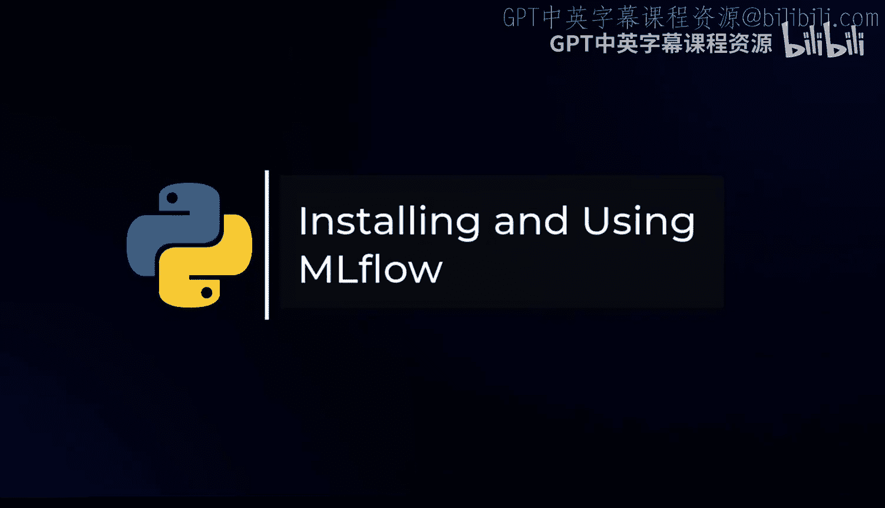
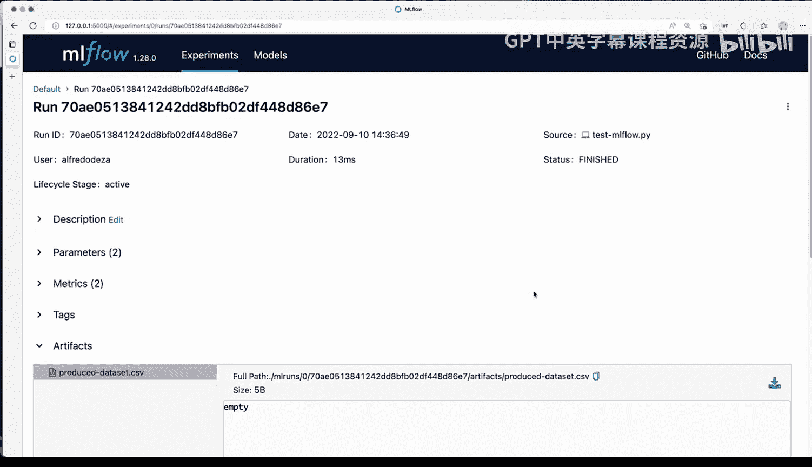

# 杜克大学｜机器学习运维｜DevOps⧸DataOps、Azure、MLFlow和抱脸｜MLOps ｜ Machine Learning Operations p144 03_01_03_安装和使用MLflow.zh_en -BV1yE421c7uA_p144-

Installing MLlflow is very straightforward if you have a Python environment。

 I have something that I've already activated here。

 it doesn't matter if it's a virtual environment or a condoda environment or something else in this case it just happens to be a Conda environment but'm going to go ahead and install MLflow so I'm going say PP install MLflow and that should work pretty straightforward it should take a couple of seconds and then complete that is effectively how you install MLflow just using PP if you have some other ways of installing well primarily Pip would be the one thing that you w to be using so once MLflow completes installing there's a few things that you can actually do before I show you kind of how to install with MLflow directly I want to show you what MLflow Ui will look like so I'm going to say MLlflow space UI and return。

And that will run a server。 Now， DC UI is running locally。

 So you can see here it's running aboard of 50。 And I'm going to click here。

And'm it's opening up on our window， which I'm going to pull into the view here。

 So you can see that it has a some minimal interface with a few things that look interesting。

 however。There's nothing here that you could say， well， you know。

 I can't see anything that would be related to models， except for I have like a chart here。

 But the thing is that this is empty。 So not entirely super useful。

 but you will see once we start when we once we start putting putting things in there。

 then things will start looking much， much interesting。 So let's switch the view back to VS code。

 and we're gonna create here a new file， and we're gonna call it。This is going to be testing。

Destine ML flow， so it's a very simple script。 it's just a Python script。

 I'm going to leave the terminal there running because it's our UI。

 so we're going to say say for example， from M flow。

Import log metric and log parameter and log artifact。

 This is something that we'll see later into more detail。

 but basically we'll do the infamous if underscore name。

Is main that basically tells Python A run this or straight away。

 like if I run it on the on the terminal executes as a script。

 so we can start logging some parameters。 So， for example， we can say， you know。

 let's say threshold here。 and we can say something like three。

 So that's a parameter or we could say verboity。Can type verossity verossity。

 we can say say for example， debug， you know， you're logging parameters。

 you're logging things that you you are requiring for your training to effectively work and then be trained and it could be anything that you want similarly we can log some metrics so if you're capturing。

 say for example， timet。You know， we could say， you know， this would be。You know。

 any arbitrary number， and we could say you know dime。

Time to complete let's call a T TC for abbreviation purposes。 and let's say this took 33 seconds。

 So you start seeing that you can you can start logging all kinds of things。

 And finally we can actually log an artifact which can be an actual file so we can say this file could exist already but we can say。

Say for example， well， we can we don't need to write it with Python。

 we can go here and say a new file and we can say this is our。Produced data set that CSB。

 so that's that you know， we can say this is， this is empty and doesn't have anything there。

 but I'm going to save it。 I'm going to close it out。 And then when we want to log an artifact。

 we are going to say log artifact。And then we're going to say that the artifact is going to be test well。

 produced。Produced the data set that CSsB。 Alright。

 so I'm going save these and then I'm going run a new terminal。And I am going to say。Pyhen。

 test and I' flow and see what happens。Alright， so that completed。

 and I'm going to go back to the web UI and see what happened。 So I'm going to refresh。

And we should start seeing that nine seconds ago I was able to run some things。

 so this is a little bit big， so let me try to make it slightly more readable there is going to be a little bit smaller but you can see here that is capturing things so metrics we talked about time to complete now I called the TTC and you could see that that capture here and timestamp so you have metrics separated there and we have parameters we said threshold was going to be3 and verboity was going to be debug so you start seeing those things there and then the source is right there let's click here and see what happens how about the artifacts well this is the nice thing is that we can click here and you it tells me lots of metadata about the parameter so that's a very quick very very quick overview on how to install and flow。

And how to start using it with the tracking UI。