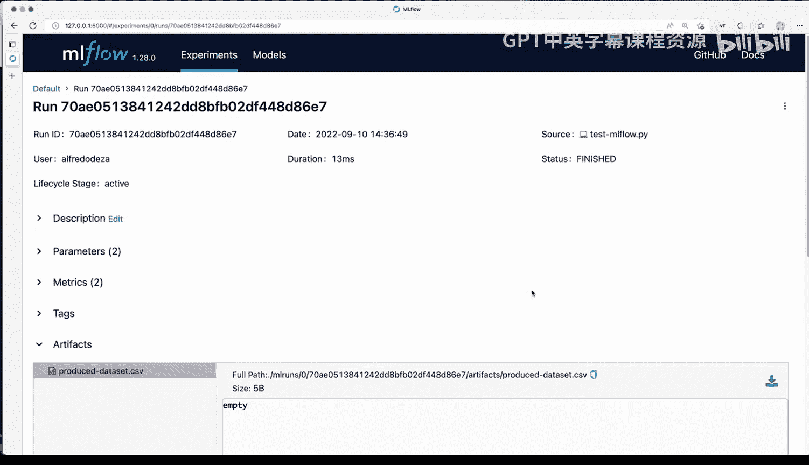

# 机器学习运维：03_01_03：安装和使用MLflow 🚀


在本节课中，我们将学习如何安装MLflow，并创建一个简单的Python脚本来体验其核心的跟踪功能。我们将看到如何记录参数、指标和文件，并通过MLflow的Web界面查看这些信息。

## 概述

MLflow是一个用于管理机器学习生命周期的开源平台。本节将指导你完成MLflow的安装过程，并演示其基础的跟踪功能。我们将通过一个简单的脚本，学习如何记录实验数据。

## 安装MLflow

安装MLflow的过程非常直接，前提是你已经有一个Python环境。这个环境可以是虚拟环境、Conda环境或其他任何环境。

以下是安装步骤：

1.  激活你的Python环境。
2.  使用pip包管理器进行安装。

在终端中执行以下命令：
```bash
pip install mlflow
```
安装过程通常只需几秒钟即可完成。安装成功后，你就可以使用MLflow了。

## 启动MLflow UI界面

在深入使用MLflow记录实验之前，我们先启动其用户界面（UI），以便后续查看结果。

在终端中输入以下命令：
```bash
mlflow ui
```
这个命令会在本地启动一个服务器。默认情况下，UI会在 `http://localhost:5000` 地址运行。打开浏览器访问这个地址，你将看到一个初始界面。目前，由于还没有记录任何实验，界面是空的，只显示一些基本的图表区域。当我们开始记录数据后，这里就会变得内容丰富。

## 创建并运行MLflow跟踪脚本

现在，让我们切换回代码编辑器，创建一个Python脚本来体验MLflow的核心跟踪功能。

我们将创建一个名为 `test_mlflow.py` 的文件。这个脚本将演示如何记录**参数**、**指标**和**文件**。

以下是脚本的详细内容：

```python
# 从mlflow库中导入必要的跟踪函数
from mlflow import log_metric, log_param, log_artifact

# 标准的Python脚本入口点
if __name__ == "__main__":
    # 1. 记录参数 (Parameters)
    # 参数通常是模型训练所需的配置或超参数
    log_param("threshold", 3)
    log_param("verbosity", "debug")

    # 2. 记录指标 (Metrics)
    # 指标用于评估模型性能，例如准确率、损失或训练时间
    log_metric("time_to_complete", 33)

    # 3. 记录文件 (Artifacts)
    # 文件可以是任何输出文件，如模型文件、数据集或图表
    # 假设我们有一个名为 ‘produced_dataset.csv‘ 的文件
    log_artifact("produced_dataset.csv")
```

为了测试文件记录功能，你需要在同一目录下创建一个名为 `produced_dataset.csv` 的空文件（或包含任何内容的CSV文件）。

保存脚本后，在终端中运行它：
```bash
python test_mlflow.py
```
脚本执行成功后，数据就已经被记录到MLflow的后端存储（默认为本地 `./mlruns` 目录）中了。

## 在UI中查看跟踪结果

脚本运行完毕后，我们回到之前打开的MLflow UI界面（`http://localhost:5000`）。

刷新页面，你现在应该能看到刚刚运行的实验记录出现了。界面会显示类似“9秒前”的运行信息。

以下是界面中展示的内容：

*   **参数**：在“Parameters”部分，可以看到我们记录的两个参数：`threshold: 3` 和 `verbosity: debug`。
*   **指标**：在“Metrics”部分，可以看到记录的指标 `time_to_complete: 33`。
*   **文件**：点击实验运行记录，进入详情页。在“Artifacts”区域，可以看到我们记录的文件 `produced_dataset.csv`。点击它，MLflow会显示该文件的元数据，在真实场景中，你可以从这里查看或下载文件。

## 总结



本节课中，我们一起学习了MLflow的安装和基础使用。我们首先通过 `pip install mlflow` 命令完成了安装，然后使用 `mlflow ui` 启动了Web界面。接着，我们编写了一个Python脚本，使用 `log_param`、`log_metric` 和 `log_artifact` 函数分别记录了实验的参数、指标和输出文件。最后，我们在MLflow UI中刷新并查看了这些被成功跟踪的实验数据。这为后续进行更复杂的机器学习实验管理和跟踪打下了基础。