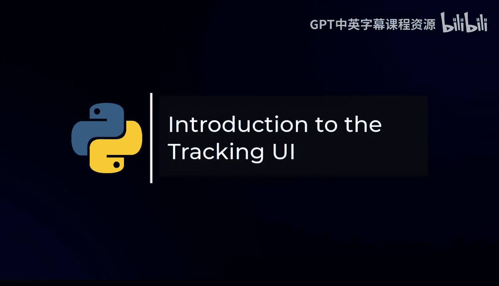
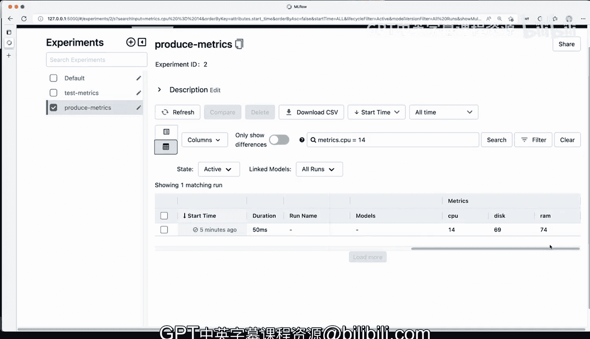

# 杜克大学｜机器学习运维｜DevOps⧸DataOps、Azure、MLFlow和抱脸｜MLOps ｜ Machine Learning Operations p145 04_01_04_跟踪UI介绍.zh_en -BV1yE421c7uA_p145-

。Let's do a little bit of more digging into the tracking server and the UI So one of the things that we're doing here is that we're going to log some metrics specifically we're going to be producing the metrics I'm not going to run actually but I'm going to simulate having certain metric names like CPU Ram and disk and I'm going to at random capture one of those and I'm going to select any percentage from0 to 100 So for 40 iterations I'm going to log a metric either CPU RamM or disk and for any number between 0 and 100 and'm going to run that I'm going to let that MLlflow capture that in the UI in the tracking server capturing metrics but let's go back to how that tracking server or tracking UI looks like so I'm going to go here this is running from the terminal if you remember。

I was running that with MLflow space UI and we run this before。

 so I have a little bit of parameters already captured that you saw the threshold and debug and metrics。

But now I want to create a new experiment， so before I run the metrics I want to capture those metrics in a new experiment。

 so how how do you go ahead and do that well you need to run a new you can either let let MLflow create a new ID for you or you go ahead and create one so let's go ahead and create one。

To create when， I'm going to go back to my aer andm going to open up a new terminal。

 and I'm going to。Run Ml flow。 And I'm going to run a specific command。

 So I'm going to say Ml flow experiments。And I'm going to say create and。

Create with a dash dash experiment dash name。 and that name is going to be produce metrics。

 So I'm gonna create that。 and I'm gonna to get an I。 So now with that I。

 you can actually instruct theml flow anything really that run MLl flow that that it should track this new experiment。

 So you can always also check back the Ui。 So if I go here and I hit refresh。

 you can see that produce metrics is right here。 there's nothing there。

 nothing has been run and I need to go ahead and start telling theml flow to capture stuff in there。

 So I'm gonna go back to the terminal and now the way I can do this。

 well outside of running the script or outside of running the process I can actually export a an environment variable。

 I'm going to call it MLl flow。Well， I'm not going to call it， but it's what it accepts。

 which is experiment。It's going to be underscore Id。 I'm going to say this is2。

 I'm going to run Python， produce metrics the pi。 So that's going to produce a lot of metrics。

 and I'm going to go back to the Ui。And I'm going to refresh。And you can see that a few seconds ago。

 I was able to produce that and it capture some metrics， CPU disk and Ram。 So again。

 these numbers use percentages are made up out of random choice。

 but the important thing is that it will allow you to drill down and do some operations here that I want to show you。

 So I'm I'm going click I'm going to click here on the star you can see that the metrics that were captured are3 Now why they were three。

 well because those were the only three options even though that I was able to log them for about 3030 times each。

 So let's take a look at CPU。 I'm going to click CPU and you can see that for every single one time that I created that you could see that I was able to log 52 here。

 then 78， then 45。What else， 10，62 so that's kind of like trying to to capture well not trying but effectively capture in every single iteration of every single metric that I'm pushing forward to and I'm here I'm simulating from0 to 100 and you can see here that nothing went beyond 80。

Let's go back and take a look at some of the other metrics。 so we had disk。

 so let's take a look at this。 here we capture a little bit more。 So we had 69，92。

44 sos that's pretty good so it could give you like a very good operation here where you can you can query you can query these you can even change the smoothness how you want this to be and all kinds of different things that you can have in the UI Now I'm running all of these locally but you could try to set this to a remote remote server I can actually show you that if I go back to the terminal and do less you can see that there's an ML runs and if I do three ML runs there are lots of different experiments running so you can see that the ID1 has some metrics。

 the parameterss the tags ID2 which is kind of like well we just run right now。

Has several artifacts and metrics and parameterss， so it gives you structure and that's really good。

 Now I want to go ahead and try to look at produce metrics here and then I'm going to instead of doing for I range 40 I'm going to make this more thorough。

 I'm going to make it 400 times and instead of CPU Ram and disk， I'm just going to change these to。

I'm going to change it to just CPU and see， well， effectively。

 that means that the lock metric is always going to be CPU。

So I want to show you these and how that looks and that that works。 And I'm going to。

For 400 times 400 durations I'm gonna select the number from 0 to 100 and see how that works。

 Alright， so that means that I'm going to run these python produce metrics for the same memoflow experiment。

 So I I'm gonna run that。 It's going run for 400 times and I'm going go back to the Ui。

 So here I'm going go I'm gonna go back go back again。

 produce metrics now there's a new run that came in and the CPU was about 60。

 So let's take a look that open up metrics open up the CPU graph and now look at that a more realistic graph right because we have 400 points。

 So you might be running a loop over your experiment training or machine learning model training and you want to capture all of these metrics you're gonna get something that looks kind of like this that looks really really nice and gives you a really good overview。

 So those are some of the features and lastly one of the things I wanted to show。

You was if you come back to produce metrics， you can query the the metrics and not only the metrics。

 but in this case， we could say metrics， say CPU more than say 88。 and well， there's nothing。

 we can say， let's say， for example， more than。5th or 14 and run and only only the one that I run just a minute ago was able to produce CPU more than 14。

 the previous one didn't。 So if I want to say， you know I'm basically querying almost like a SQL query。

 there's nothing there。You can see that I can do all kinds of different queries。

 so imagine having several hundreds experiments for produce metrics or whatever you want to call this experiment name and then query that it is a very powerful way and you can also filter with all runs or select it runs。

 you can say with versions and without versions again very。

 very useful and this is not only I only show metrics here but you could do the same querying and the same type of filtering for parameters and artifacts as well。

