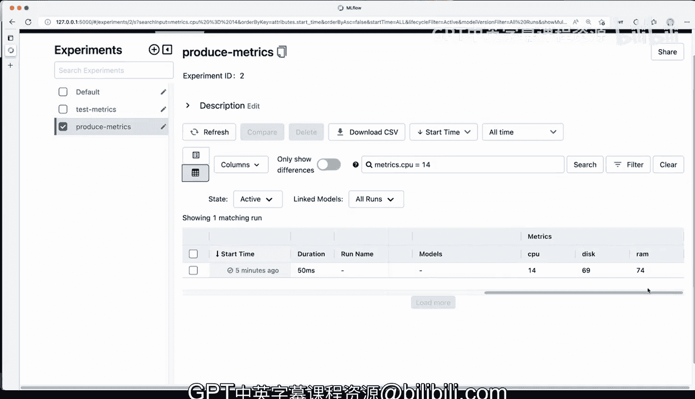

# MLOps 课程：04_01_04：跟踪服务器UI介绍


在本节课程中，我们将深入探索MLflow的跟踪服务器及其用户界面。我们将学习如何创建新实验、记录指标，并利用UI界面进行数据查询和可视化分析。

上一节我们介绍了MLflow的基本概念，本节中我们来看看如何通过其跟踪UI来管理和分析实验数据。

## 创建新实验

首先，我们需要创建一个新的实验来存放即将记录的指标数据。你可以让MLflow自动生成实验ID，也可以手动创建。

以下是创建新实验的步骤：

1.  打开终端。
2.  运行以下命令来创建一个名为“produce_metrics”的实验：
    ```bash
    mlflow experiments create --experiment-name produce_metrics
    ```
3.  命令执行后会返回一个实验ID（例如：`2`）。

创建完成后，你可以在跟踪UI中刷新页面，看到名为“produce_metrics”的新实验已经出现，但其中还没有任何运行记录。

## 记录实验指标

接下来，我们需要运行一个Python脚本来向这个新实验记录指标数据。我们将通过设置环境变量来指定实验ID。

以下是记录指标的步骤：

1.  在终端中，设置环境变量 `MLFLOW_EXPERIMENT_ID` 为你刚获得的实验ID（例如：`2`）。
    ```bash
    export MLFLOW_EXPERIMENT_ID=2
    ```
2.  运行你的Python脚本（例如：`produce_metrics.py`）来生成并记录指标。
    ```bash
    python produce_metrics.py
    ```

脚本会模拟记录CPU、内存（RAM）和磁盘（Disk）的使用率百分比，每个指标随机记录约30次，数值在0到100之间随机选择。

运行完成后，返回跟踪UI并刷新，你就能在“produce_metrics”实验下看到新的运行记录，以及被捕获的CPU、Disk和RAM这三个指标。

## 在UI中分析指标

现在，让我们利用跟踪UI的功能来深入分析这些记录的数据。

以下是UI提供的主要分析功能：

*   **查看指标详情**：点击任意一个指标名称（如CPU），你可以看到该指标在每次迭代中被记录的具体数值列表。
*   **可视化图表**：UI会为指标生成趋势图。你可以调整图表的平滑度等参数，以便更好地观察数据变化。
*   **数据查询**：UI提供了强大的查询功能，类似于SQL查询。例如，你可以在查询框中输入 `metrics.CPU > 88` 来筛选出CPU使用率超过88%的所有运行记录。
*   **多维度筛选**：你不仅可以按指标筛选，还可以对参数（Parameters）和制品（Artifacts）进行同样的查询和过滤操作。筛选条件可以针对所有运行，或选择特定版本。

为了演示更丰富的图表，我们可以修改脚本，让它仅记录CPU指标，并将迭代次数增加到400次。再次运行脚本后，回到UI查看CPU的图表，你会得到一个包含400个数据点的、更连续和真实的趋势图，这对于监控模型训练过程非常有用。

## 本地文件结构

所有实验的运行数据都存储在本地。你可以通过终端查看 `mlruns` 目录下的结构。每个实验ID对应一个文件夹，里面包含了该实验的所有运行记录、参数、指标和制品。这种结构化的存储方式便于管理和追溯。



本节课中我们一起学习了如何使用MLflow跟踪服务器UI。我们掌握了创建新实验、通过环境变量记录指标数据的方法，并重点探索了UI界面中查看指标详情、可视化图表以及进行高级数据查询和筛选的核心功能。这些工具能帮助你有效地管理和分析机器学习实验的整个过程。