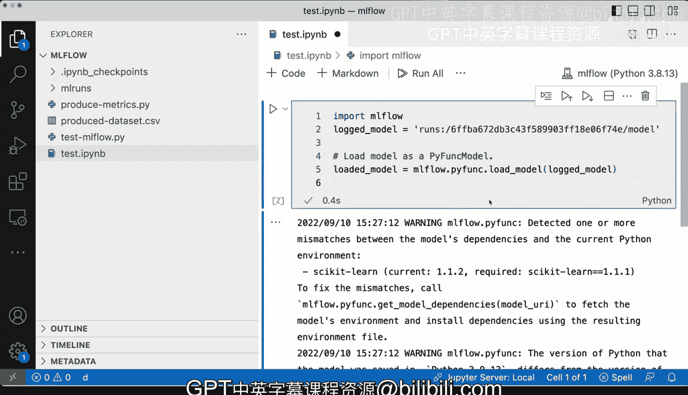

# 杜克大学｜机器学习运维｜DevOps⧸DataOps、Azure、MLFlow和抱脸｜MLOps ｜ Machine Learning Operations p146 05_01_05_参数、版本、工件与指标.zh_en -BV1yE421c7uA_p146-

Let's go deeper into parameters versus artifacts and metrics。

 So we've already seen how we can produce tons of metrics and log them to the UI and we' I'm going try to run these data breakricks slash MLflow example which happens to be in the documentation I'm going run this and then I'll show you kind of like what the files look like I'm going to execute these is going to fetch the project and its getting into an error All right so let's see what's going on here So one of the things that MLflow is kind of like strict about this that changing parameter values is not allowed So you can see here。

That the initial value was 5 and then kind of like tried to log it with a 5。0。 So not good。

 And it actually the exception message is pretty useful here because you can see that the parameters is being logged kind of like this is this is not okay because you're saying。

 hey， this is a parameter of depth3 and then parameter of the5。

 So why is not allowed I think is very helpful because what's happening here is your logging parameters on how you would run things say。

 for example， in the command line interface。 So if you're running a command and passing dash dash debug or log level rather equals warning you're not going to probably change that warning to say debug because you've already run that so it't doesn't make sense So amflow here will complain when that happens in this case you would。

You would be able to to kind of like overrite some some parameter if you actually absolutely 100% need to do that now don't do that。

 I don't think so like I think like the right way is to set your parameters right from the get go and then stick with those and then and then try to log them so so that's what happens so let's take a look at what that example looks like so I'm going to go to the MOflow example and I'm going to actually go here to because I've already forked the example and let's take a look at train up pi so train up pi we'll use the famous the famous wine quality CSB data and its going to try to train it that's fine and let's take a look at where this is logging so we we're passing or passing the。

That value of5， which is alpha right here。So you can see here that alpha is float C star RV1 if if it's more than one all otherwise。

 is' going to be 0。5。 So that is changing。Somehow， because right here， it is complaining about it。

But the， the thing is that we need to ensure that this is this is actually set correctly and not a problem。

 So line 44， it's right here。And so I've forged the example that apply to prevent this problem。

 I'm going to go back。And I am going to show you go back again。

 I'm going to show you kind of like the， the change that I did here to make this work。

 So I'm just forcing it to be an integer and not now worry about it。 Alright， so with that。

 let's go and。Back to the editor and run it again and see what happens。

 So back to Vishop Studio code。And instead of running。Running for， let me see。

Running for the Databricks example， we're going to run this one right here and let's say alphapha 5 and that's not this one。

So， let's say。So this one with alpha not alpha 4 but alpha 5。

 I'm going to run these and it's going to take a second。 All right。

 so that completed and you can see some some values are being set out。

 Now if you remember those values are being captured in the trained pie that we saw so we go back to the browser you can see。

Those values are right here and that's why those are getting printed。

 but you know printing stuff on the terminal is's only useful if you're running it directly。

 not if you're logging these metrics and Mflow is capturing all of that information for you。

 including including logging the actual model now in this case it's using log model so it's using a helper froms learn to say hey。

 I'm going to produce a model。For psyic learn and I'm going to capture is being captured here as all LR so that's basically right here on the elastic net is beam is producing that and calling to fit with the train underscore x and train underscore Y is producing that model and then we're kind of capturing there All right so so that's that's what's going on let's take a look at whether U Is so I'm going to refresh here and we have several runs now we have one that fail so let's take a look at that one that failed。

So。We can see that the command that ran was the one with databricks and that's good because that's the one that doesn't work because of the problem with logging。

And you can see here that alpha was pi and this is interesting because it's actually capturing other defaults that are being used with that ML flow run so that's interesting let's take a look at the parameters the parameters again was alpha was 5 so remember it was logged in as 5 and then it was kind of like wanted to change to 5。

0 which is a float and that's not okay。So the O1 ratio is 0。1 Let's find some metrics。

 there are no metrics。 let's see if there are tags， no tags and no artifacts。

 Why there aren't any artifacts because the run failed so you can see here status is failed so let's go back and let's take a look and the last one that we run which is this one so very nice we have a model right here。

 let's take a look a closer look So Al was5 already parameters was able to log them fine and then we see that there are three metrics now we have MA E R2 and RMSE So if we click those it's just a single value that never change。

 it was always 0。85 and if you remember and I go back to the text data here on visual Studio code that that is right right here on RMSE All right so but we run that with5 the alpha5 that's kind of like the。

F but we can do a few more runs， let's run it with three and we're changing values on the fly and then let's change it to 2。

5 or 2。4 rather they'll that actually create a problem because I'm changing a collision there but let's make an integer and not use a float that will work。

 so all right so we did a few runs and I'm taking advantage that this machine is able to to run this very fairly quickly I'm going to go back here and take a look at all of the runs。

 so now they're being captured and you can see here there are several variations。

 So why is this important Well we're seeing now that this is fairly populated。

 we're actually training with Ps learn and the parameters are changing a little bit you can see that 2。

4 failed that's why the metrics didn't were not captured but we're also have the ability to look at some of the models。

You can see here that cycle learningar is actually getting captured and I can look at that experiment and look at the artifact。

 so let's take a look at the artifact， look at everything that got capture so we have the ML model we have the condoda Yal we have the model PKL which is the pickle file and then we have all of these we can do the predictions I mean this is pretty remarkable because it's capturing absolutely everything that would be needed to run so say for example if you want to do that on the pandas data frame I mean that's that's tremendous so we can import MLflow load capture that log model from it tells you exactly where it's coming from and loaddown model as a pytheng model and and then do some predictions so let's try it out and see if that works so we're gonna go to our editor and we're gonna try to try to run try to create an ipyython notebook。

And let's say test， I python notebook， and'm going to paste。Bste that and run it。

And it's going to install some dependencies and to close these and it's going to run allright so this is running and you can see here that it took 3。

8 seconds and I got some warnings in the prediction with pandas but that's fine what I wanted to show you is that well data was not being defined that there's something else that I need to defined there。

 but it is a good start of like how you can very quickly get access to that loaded model so even if I don't have pandas here。

 could I could just run these and it would be able to fetch that log model and load that from from this MLlflow helper called load model from this Pyeng so very。

 very good or a way of interacting with the UI and the previous runs。

