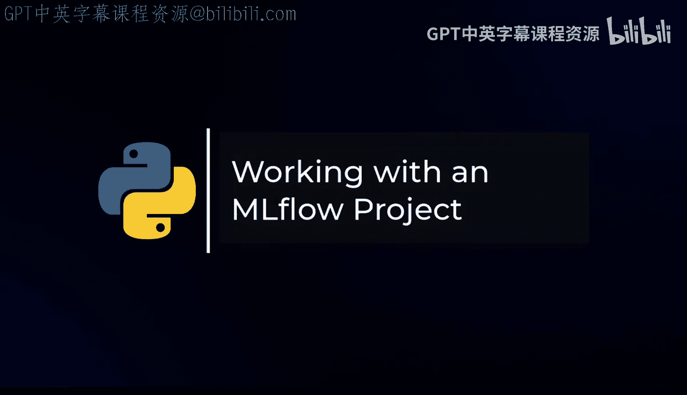
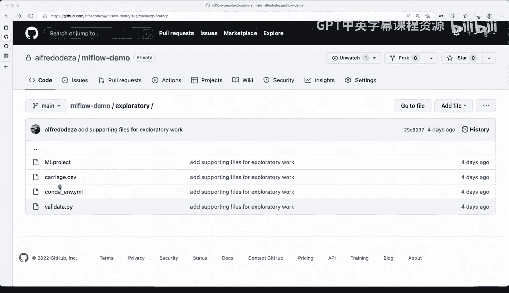
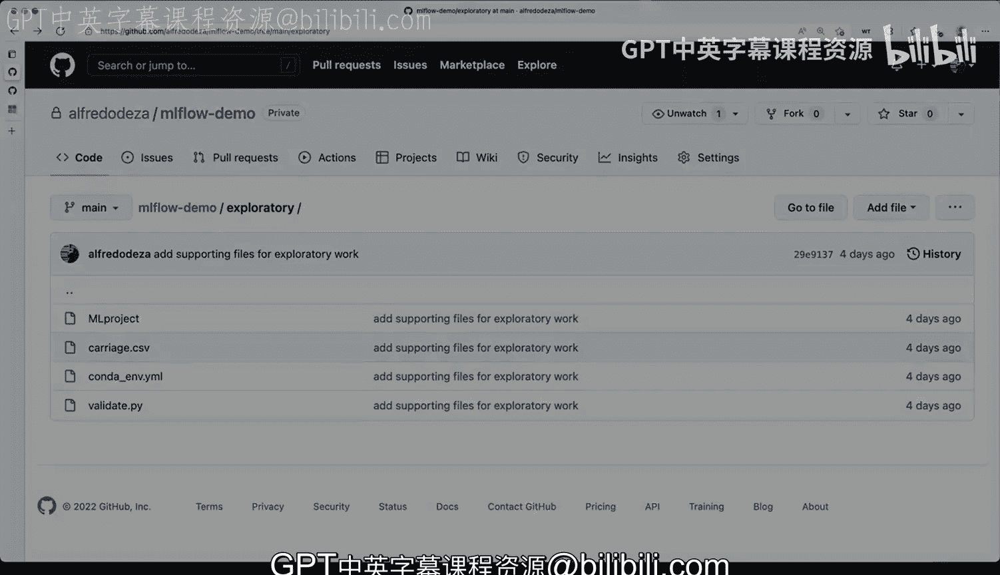

# 杜克大学｜机器学习运维｜DevOps⧸DataOps、Azure、MLFlow和抱脸｜MLOps ｜ Machine Learning Operations p147 06_01_02_使用MLflow项目.zh_en -BV1yE421c7uA_p147-

。Let's see some of the components for working with an MLflow project。

 so we're going to take a quick look here this is the Databricks documentation in Azure。

 but the reason I picked this it's not because it's actually the Azure part of the Azure documentation but it doesn't have anything to do with Azure but。

This is one of the。One of the benefits of using MLflow which is that you have this consistency。

 it doesn't matter where you're running， you can run locally， you can run on data breaks。

 you can run on data breaks on Azure as well， so the components are going to remain the same you're going to be using something else remotely but in yes in essence you're still going to need these things the project names the Conda environment specifying in a YaMO file。

And then a Python or a shell script， you can see here any Dpi or S。

 I recommend sticking with Python because that will give you the ability of using kind of like the same the same language as everything that is on Conda and all of the libraries already for data science。

 not necessarily like shell script unless you have a very good reason to do that next。

 I want to show you like the Yal file here for the Yal project one of the things that happens with and I'll show you these in a second is that because it doesn't have it doesn't have a dot an extension。

 a dotted extension it wont you won't get that Yal nice syntax highlighting so let's go through some of the things that you will see here first you start by declaring the name in this case they're using an example of my project you specify theda environment file will see this in a second what that means and then we'll have。

Entry points you can have as many entry points as you want。

 but you should have at least one this will allow you to basically use one of these to run a script with different types of parameters and even even path or something like more like a number in this case is a float and you can see the false20。

1 All right so that's kind of like a quick overview the documentation list code to the exploratory example that I have here in this example directory I have an ML project and this is what I was explaining that doesn't have Github can tell like what type of file is this because it doesn't have to dot extension it doesn't have at di yalt YMl that identifies this as a Yal file similar to what we saw in the documentation you have a name in this case is a name is a data say validation I'm going to have a con environment there and I'm going to have a single。

Main entry point with some parameters and a single command right here。

So I'm going go back and I'm going to show you what this Python script does。

 So the Python script is actually using click， but it doesn't matter click is a framework for producing Python command tools but it doesn't matter that is I'm using click you can use anything you like or nothing at all and use a plain python script with no frameworks at all So what this is doing it's actually reading a CSB file and log in some metrics you can see here if the logging metrics is bullolean it's true then things will happen over here otherwise it won't and it will check for unnamed columns and zero like if there's a account that doesn't have any items then that will be counted and reported there and I'm logging metrics and we'll see how those how those look All right and then finally I'm gonna to show you theconda environment So the environment is a special file for conda that is a。

what the dependencies are so in this case if you were to create a new kind environment。

 it will be named exploratory， it will be using the Con forge channels only or the actual the only one channel here's the Conda forge channel not channels and these are the list of dependencies so we're gonna take a look at in detail these later but just enough to know right now that this is a way to specify your dependencies and get repeatable environment going All right so these are the components that you will see normally in an ML project and kind of like in this case well have the CSB I didn't show you the CSB but we'll see as an example what that looks like it can be anything really and here you could train validate and do all kinds of other things in a repeatable manner。

