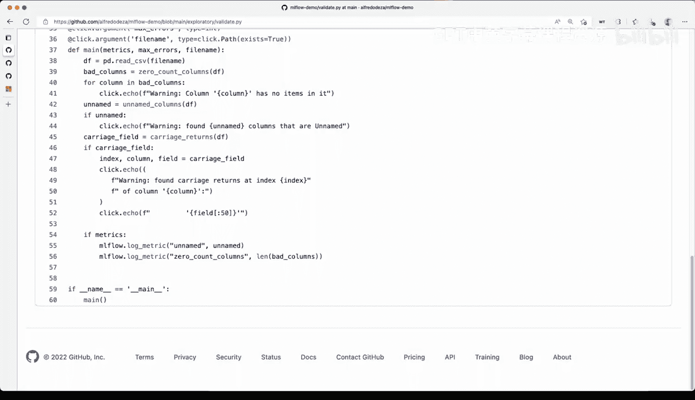
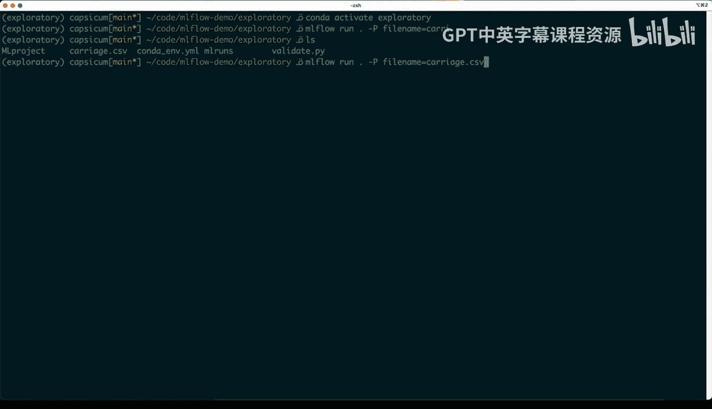
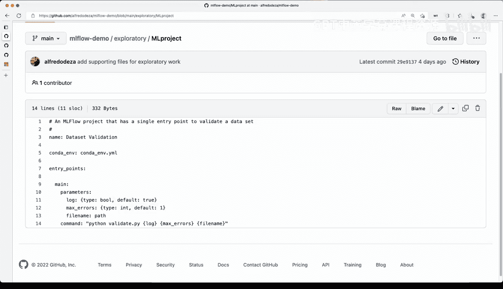
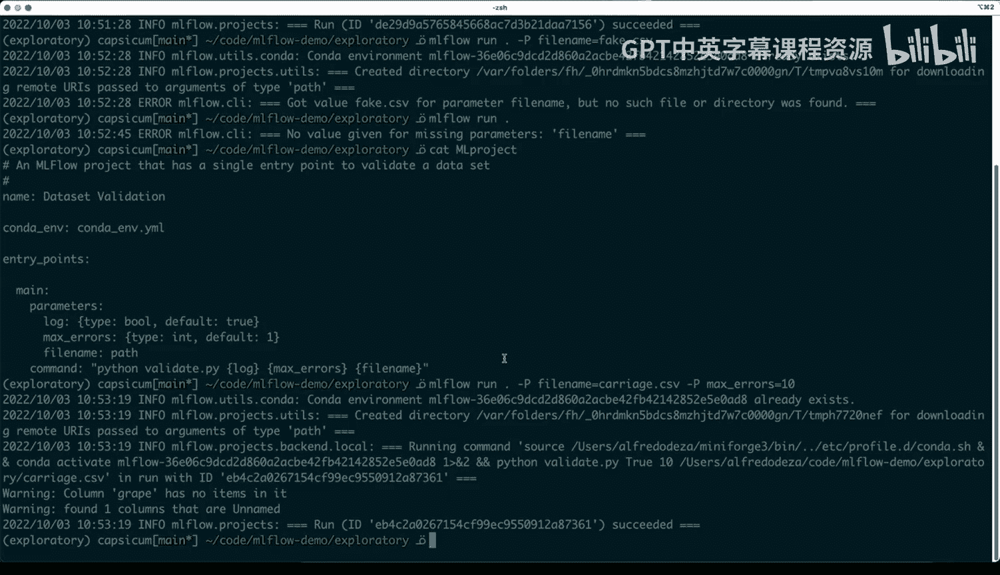

# 杜克大学｜机器学习运维｜DevOps⧸DataOps、Azure、MLFlow和抱脸｜MLOps ｜ Machine Learning Operations p148 07_01_03_创建MLflow项目.zh_en -BV1yE421c7uA_p148-

Now let's go and create an actual MO project so I've listed a couple of the steps that you will need。

 but let's start with the dependencies and for this project we'll be using an example project called wine ratings that CSB it's the data is just a single row。

 but it has many problems in it actually let's take a look at what CSB looks like and it is well actually not at this one this ones very large but what I want to show you is not that one but the one on exploratory and this carriage that CSB file it's only a single row and it doesn't have it has problems with some of the columns you can see here gray doesn't have any values and GitHub doesn't render that。

 but there's some carriage returns here on on this field right there on nodes so the problem with carriage returns is that might be problematic。

Some tools might not work with it， so we're going catch those。

 we're going report those and we're going to make MLflow work with that and run and install everything that we need to。

 So that's in the exploratory one and going back to the demo So if we go here on how to create a project。

 how to run it。 So I'm going to create an M4 project。

 we're gonna use the small CSB data file and then we're going to start with the dependencies。

 We're going create ada name Con environment name exploratory。

 I'm going use Python 3a because that's what I know that works with the tools that I want to use。

 then I'm going to activate that environment。 If you've never use Conda is essentially the same as're not the same but similar to a Python virtual environment you create one then you activate one and then everything that you install in that environment we'll go to an environment and not do your system or other types of environment。

 So there are contained contained dependencies in that same environment。

 it can be a little bit overwhelming。If you want to do anything very specific or different than these base examples I suggest you go through the documentation for Conda So now that we've created we've created the environment。

 we've activated the environment then the way you create that conda and that Yama file is by exporting it and once you export that you will end up with a file that is similar to this in this case I named it exploratory you can name anything you want and that name you can be anything you want really it's just a way of identifying what it is the channels I think by the fault you get a condoda for。

 but if you want something specific for example I know Pytorch once it's a specific channels and then enlist the dependencies so here we have some based dependencies and that's fine and then we are going to use PIip we can use PIip to actually go and install these extra dependencies at the very bottom right。

So not only we're declaring PP as a dependency， but we're actually then saying， hey， by the way。

 I want PIip to actually install pandas and ML flow and we have some specific versions there。

And then if you're installing or adding or removing things。

 it's always a good this is a good command remember you're going to you're gonna make the changes to the Conda and Yao and then update that and then use the dash prune means that anything that is no longer defined the Conda M is going to be removed So if you don't remove anything that's fine but if you do then it's going to stay on the same the same kind of like stay consistent route let's go and take a look at exploratory but before we do that we're going to see you know we already went through the M project。

 it is going to be run a single entry point is' going to be this python validate we already saw the validation it is this validate that p file here' to see here it is going to run a few commands going through the CSB and then report on it depending on what we're doing All right so now we're。

Go back to my terminal。 We're going to do Connda， activate。

Exploratory， which I just did， but you will see that it is showing up here。

 And then now I'm going to be running MLl flow。 So Ml flow run dot for signaling that this is the specific directory that I want。

 and I am going to say dash P file name equals。This is going to be。Carriage。

 I don't remember the name of the file。 So let's see carriage that CSP there we go。

 So Mflow run do dashP file name equals carriage that CSP。

 So lets let's talk a little bit about what's going on here。

 So M flow run is what we're going to use to run the project that means that this is the actual project。

 this is exploratories where this lifts dashP we're starting to passing parameters。

 So if you remember if I go back if I go back very quickly to here。

 not not to the not to the validate pi， but to the M project file。

 you will see here that the parameters listed here， have log max errors and file name。

 So file name is right there， max errors and log because log and max error have the faults you can see here that the fault is true and the fault is one。

 but file name does require parameter I need to specify those Allright。

So now that I know what I have to pass in file name carriage CSP and I'm gonna run this and see what happens。

 Allright so that ran very quickly， you can see there's a lot of output here but special attention to this one it knows that my python version is coming from a con environment it knows it found that there was an existing con environment。

 this one you reus it and didn't create one from scratch which is great and then you run Python ballot pi true because that does the default and then one because that also the other default and then you figure out a absolute path towards that carriage that CSB file in it this would guarantee that regardless of where you're running this it will still work so if you clone this repositor want to run these on your own the path will be slightly different but if you pass the same thing Mflow run doB file name carriage CSB sorry right there。

 it will work the same。All right， so it succeeded so what would happen if I do something that doesn't exist I say for example。

 a fake that CSB so what I would expect is an error and there you go error right right here is the error got value fake CSB for parameter foul name but no such file or directory was found and what would happen if I don't pass any parameters so if I do something like that。

Well， in this case， no value given for missing parameters found because remember found doesn't have anything the signals a default value。

 If you wanted to pass any of the other ones， you let take a look at the M project one。

 if we see a log in max error， so we want to pass。Ml flow run dashP file name， carriage， CSP。

 And then we say dashP max errors， we could say， you know，10， for example。

 and then we will run that and that would get captured again over here and it would it would be transparent。

 So you， you have the ability to pass extra parameters that are not captured into the defaults if you want to tweak around and play around with those。

 So that's it。 That's how you run an M flow project。

