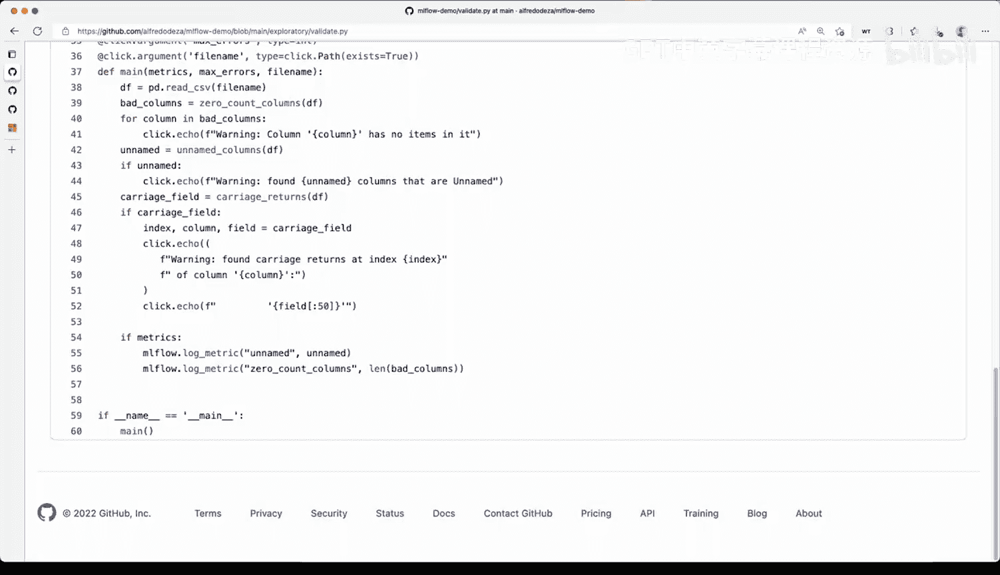
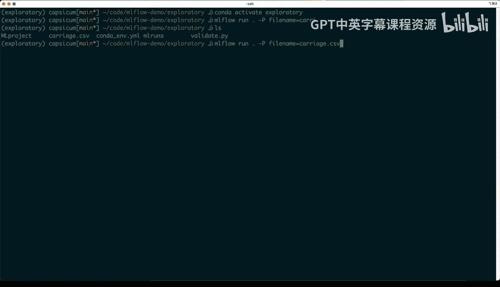
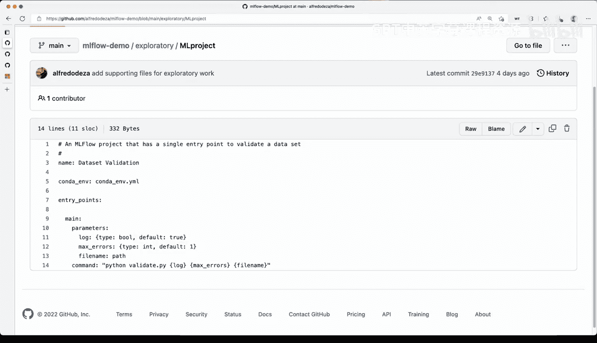
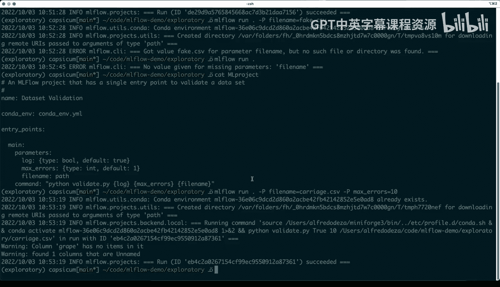

# 机器学习运维：07_01_03：创建MLflow项目 🚀


在本节课中，我们将学习如何创建一个实际的MLflow项目。我们将使用一个名为“wine ratings”的示例项目，并处理一个包含特殊字符（如回车符）的CSV数据文件。通过本教程，你将掌握创建项目、管理依赖、运行项目以及传递参数的核心步骤。

---

## 创建项目环境与依赖管理

上一节我们介绍了MLflow项目的基本概念，本节中我们来看看如何从零开始创建一个项目。首先，我们需要设置项目环境并管理其依赖。

创建一个MLflow项目的第一步是定义其运行环境。我们将使用Conda来创建一个隔离的环境，确保项目依赖不会影响系统或其他项目。

以下是创建和激活Conda环境的步骤：

1.  **创建环境**：使用命令 `conda create --name exploratory python=3.8` 创建一个名为“exploratory”的新环境，并指定Python版本为3.8。
2.  **激活环境**：使用命令 `conda activate exploratory` 来激活这个新创建的环境。激活后，所有后续的包安装都将仅限于此环境。

激活环境后，我们需要将环境的配置导出为一个YAML文件。这个文件定义了项目的所有依赖，可以被MLflow识别和复现。

使用命令 `conda env export > exploratory.yaml` 来导出当前环境的配置。生成的YAML文件内容结构如下：

```yaml
name: exploratory
channels:
  - defaults
dependencies:
  - python=3.8
  - pip
  - pip:
    - pandas==1.3.0
    - mlflow==1.20.2
```

在这个文件中：
*   `name` 字段标识了环境名称。
*   `channels` 字段指定了包来源（例如，PyTorch有特定的channel）。
*   `dependencies` 字段列出了核心的Conda包。
*   通过 `pip` 字段，我们可以指定需要由pip安装的额外Python包，例如 `pandas` 和 `mlflow`。

如果你后续需要更新依赖（例如添加或移除某个包），请修改 `exploratory.yaml` 文件，然后运行以下命令来更新环境并保持其整洁：

```bash
conda env update --file exploratory.yaml --prune
```

参数 `--prune` 会移除环境中已不再YAML文件中定义的包。

---

## 配置与运行MLflow项目

现在我们已经准备好了项目环境，接下来需要配置MLflow项目本身并运行它。

一个MLflow项目的核心是 `MLproject` 文件。它定义了项目的入口点、参数和运行环境。在我们的示例中，入口点是一个名为 `validate` 的Python脚本，它负责读取CSV文件并进行数据验证。

`MLproject` 文件内容示例如下：



```yaml
name: wine_ratings_project

conda_env: exploratory.yaml

entry_points:
  main:
    parameters:
      file_name: {type: string}
      log: {type: string, default: "true"}
      max_errors: {type: int, default: 1}
    command: "python validate.py {file_name} {log} {max_errors}"
```

在这个配置中：
*   `conda_env` 指向我们刚才创建的YAML文件。
*   `entry_points` 定义了如何运行项目。`main` 是默认入口点。
*   `parameters` 部分声明了运行脚本所需的参数。`file_name` 是必需参数，而 `log` 和 `max_errors` 有默认值。

项目将使用我们提供的 `carriage.csv` 文件。这个文件虽然只有一行数据，但其中包含回车符等可能造成处理问题的特殊字符。`validate.py` 脚本的任务就是检测并报告这些问题。

一切就绪后，我们可以在终端中运行该项目。首先确保你位于项目目录下，并且 `exploratory` 环境已激活。



使用 `mlflow run` 命令来执行项目，并通过 `-P` 参数传递必需的 `file_name` 参数：



```bash
mlflow run . -P file_name=carriage.csv
```

命令执行后，MLflow会：
1.  检测到并使用现有的 `exploratory` Conda环境。
2.  使用默认值 `true` 和 `1` 来填充 `log` 和 `max_errors` 参数。
3.  将 `file_name` 参数解析为文件的绝对路径，确保在不同机器上运行的一致性。
4.  执行 `python validate.py` 命令并传入所有参数。

如果运行成功，你将在终端看到相应的输出。如果传递了不存在的文件名（例如 `fake.csv`），MLflow会报错提示文件未找到。如果不传递必需的 `file_name` 参数，则会收到缺少参数的警告。

你还可以在运行时覆盖默认参数。例如，如果你想将最大错误数改为10，可以这样运行：

```bash
mlflow run . -P file_name=carriage.csv -P max_errors=10
```

这样，`max_errors` 参数的值就会被替换为10，并传递给验证脚本。

---

## 总结

本节课中我们一起学习了创建一个完整MLflow项目的流程。

我们首先使用Conda创建并管理了一个独立的Python环境，并通过YAML文件定义了项目依赖。接着，我们编写了 `MLproject` 文件来配置项目的入口点和运行参数。最后，我们使用 `mlflow run` 命令成功地执行了项目，并学习了如何传递以及覆盖运行参数。



通过这个简单的“数据验证”项目示例，你掌握了MLflow项目标准化、可复现运行的基础。这是构建更复杂机器学习工作流的第一步。