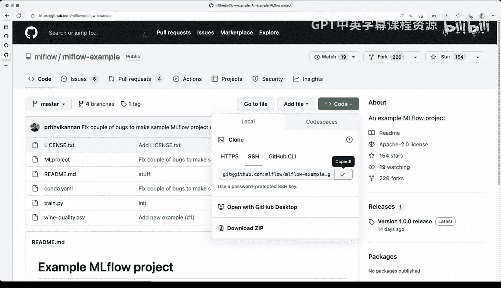
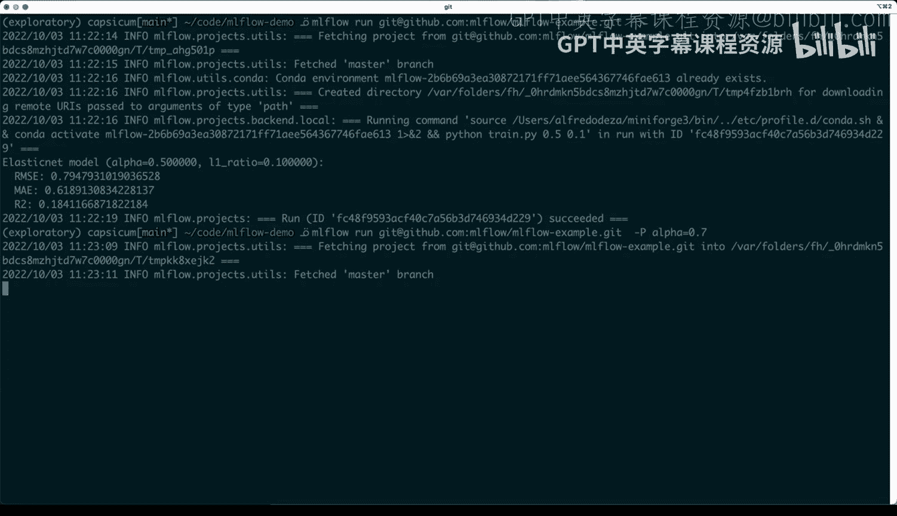
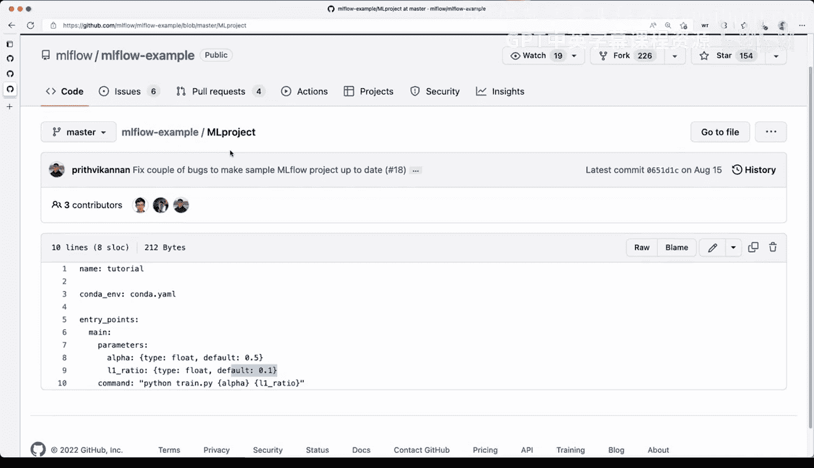

# 杜克大学｜机器学习运维｜DevOps⧸DataOps、Azure、MLFlow和抱脸｜MLOps ｜ Machine Learning Operations p149 08_01_04_从远程Git仓库运行项目.zh_en -BV1yE421c7uA_p149-

MLF has the ability of running remote projects if you pass in like GiHub URL。

 so one of the things that I want to show you is that how is that possible with an example repository that is actually pretty widely used on the MLflow documentation everywhere。

 this very short project similar to what we've seen already in the previous video so this is on the MLflow repository organization rather slash MLflow example that's the repository in a poly1。

 you see that it's fairly simple and it doesn't get updated too often。

 it has the same the same structure we've seen before we have an ML project file over here。

 very simple just 10 lines， it's a Python trained up pi then there's alpha which is value this value right there is a 05。

And then the L1 ratio defaults to0 to1 and then if we go and take a look at that train p file。

 it is actually also pretty straightforward it will do a couple of different things it will start run and we'll use that those values you can see right there L1 ratio and alpha right here So let's take a look and try to run this project so how exactly we're going run it we're going to go here。

And what we're going to do is I'm going to go to the terminal and go and run it。 But to run these。

 we will need to select one piece of information here， the the SSH。Based address。

 I'm going copy that。 and I'm going to use it to run it in the terminal。 So I'm going do this。

 I'm going to say M O flow run。 and then that address right there。 And I'm going to say。

嗯。I don't know if he's going to ask me to pass any parameters。

 let's just try it like that and see what happens。Alright so it fetches the project and then it starts running and then it succeeds so that's pretty straightforward。

 let's take a look at some of the things that happened fetches the project from GiHub so it goes right to the source right there to GiHub like that's the URL that I passed in and then it grabs the master branch。

And it looked at an ML flow environment that already exists Paren array ran these。

 so that's why this ML flow2 be 6 p69 a3 already existed so it just ran that again and it ran these elastic model and outputs a couple of values right there。

 so the documentation says that this also accepts。Alpha is 20。7 and see what happens。

 I think these tanks when when I pass something like that well it didn't it actually worked if we take a look at the M flow or the M project rather and you go here see the parameters Al the false 20 5 and L1 ratio the false 201 So there you go that's kind of like how you run how you run if you have a repository that is an M project and you run it remotely using the technique that I just show you you can you' are able to run that and fetch these automatically everything with M flow。

