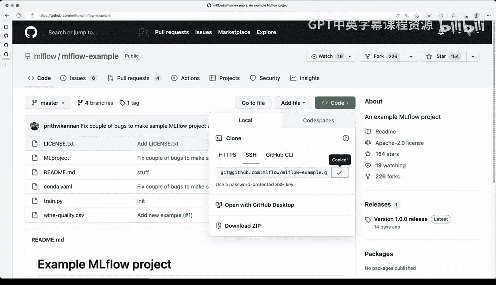
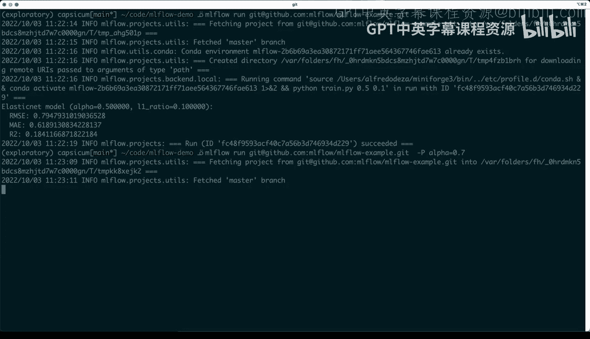
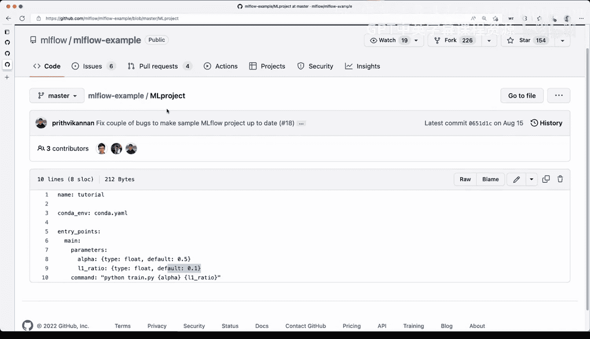

# 机器学习运维：08_01_04：从远程Git仓库运行项目 🚀


在本节课中，我们将要学习如何使用MLflow直接从远程Git仓库（如GitHub）运行机器学习项目。这是一种便捷的方式，可以让你无需在本地克隆代码库就能执行和复现项目。

## 概述

MLflow具备运行远程项目的能力，只需传入一个类似GitHub的URL即可。本节将通过一个在MLflow文档中广泛使用的示例仓库，来演示这一功能是如何实现的。

## 项目结构分析

上一节我们介绍了MLflow项目的基本概念，本节中我们来看看这个远程示例项目的具体结构。

这个项目非常简短，与我们之前视频中看到的类似。它位于MLflow官方组织的仓库中：`mlflow/mlflow-example`。这个仓库结构简单，更新频率不高。

以下是该项目的主要文件结构：

*   **MLproject文件**：这是一个非常简单的文件，只有大约10行代码。它定义了一个Python入口点 `train.py`，并包含两个参数：
    *   `alpha`：默认值为 `0.5`
    *   `L1_ratio`：默认值为 `0.1`
*   **train.py文件**：这个文件同样非常直接。它会启动一个MLflow运行，并使用上面定义的 `alpha` 和 `L1_ratio` 参数。

## 运行远程项目



了解了项目结构后，接下来我们看看如何实际运行它。

我们将通过终端，使用 `mlflow run` 命令来执行这个远程项目。为此，我们需要项目的SSH地址（或HTTPS地址）。

具体操作步骤如下：

1.  复制项目的Git仓库地址。
2.  在终端中执行命令 `mlflow run <仓库地址>`。

例如，命令可能如下所示：
```bash
mlflow run git@github.com:mlflow/mlflow-example.git
```
首次运行时，MLflow会自动从GitHub获取项目代码，检查或创建所需的Python环境（例如Conda环境），然后执行项目中定义的 `train.py` 脚本。

## 传递运行参数

默认情况下，项目会使用 `MLproject` 文件中定义的默认参数运行。但MLflow也允许我们在运行时覆盖这些参数。

根据文档，我们可以通过 `-P` 选项来传递参数。例如，如果我们想将 `alpha` 设置为 `0.7`，可以运行：
```bash
mlflow run git@github.com:mlflow/mlflow-example.git -P alpha=0.7
```
执行后，MLflow会使用我们指定的新参数值（`alpha=0.7`）来运行项目，而不是文件中的默认值（`alpha=0.5`）。这证明了我们能够成功地远程运行一个MLflow项目，并动态地控制其参数。

## 总结





本节课中我们一起学习了MLflow的核心功能之一：从远程Git仓库运行项目。我们首先分析了一个示例项目的结构，然后演示了如何使用 `mlflow run` 命令直接执行远程代码，最后还了解了如何在运行时覆盖项目的默认参数。这个过程完全是自动化的，MLflow会处理代码获取、环境管理和任务执行的所有细节，极大地简化了机器学习项目的共享与复现流程。