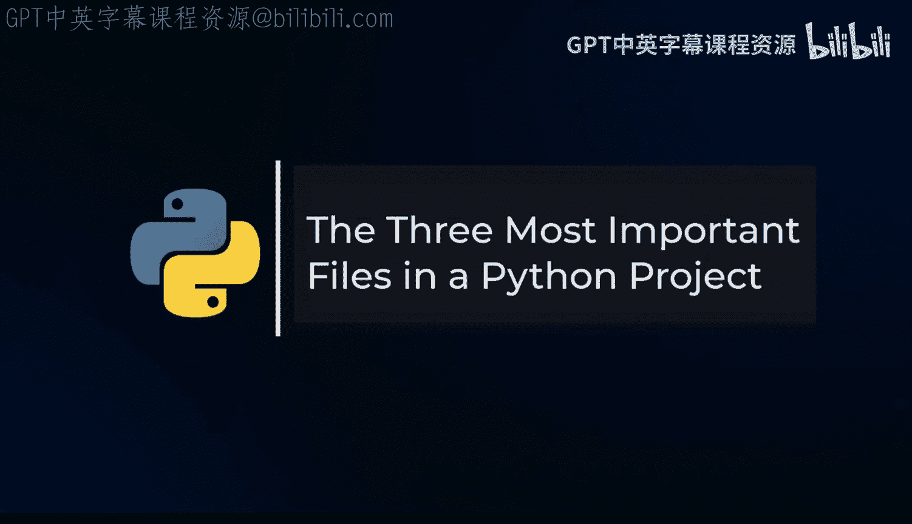
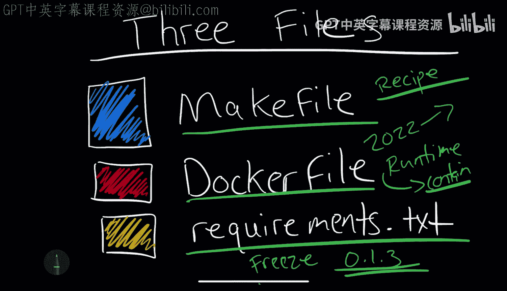
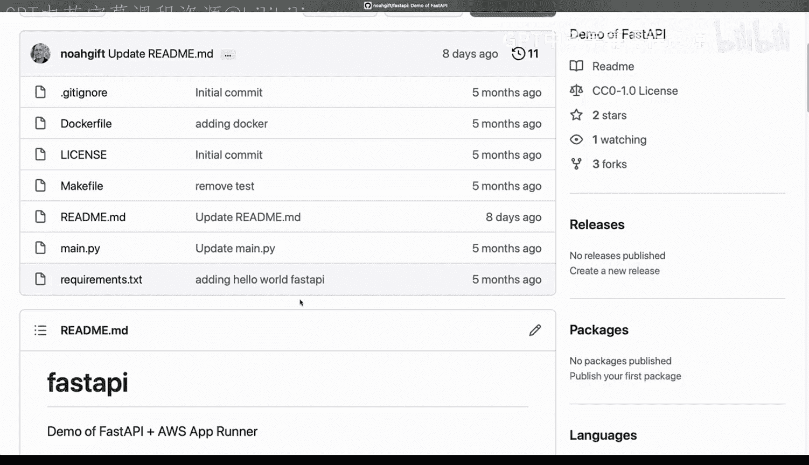

# 杜克大学｜机器学习运维｜DevOps⧸DataOps、Azure、MLFlow和抱脸｜MLOps ｜ Machine Learning Operations p15 22_01_09_Python项目中最重要的三个文件.zh_en -BV1yE421c7uA_p15-

Hi， my name is Noah gift， and I'm going to talk to you today about the three most important files in your Python project。

 These include a make file， a docker file and a requirements a Txt file。

 Let's go ahead and get started。 Let's take a look at the three files here that are important first step。

 We have a make file。 a make file is critical because it allows you to automate things like an installation step。

 aly step， a deployment step。 And really it's like a set of recipes。

 you don't want to have to go through and look at every single ingredient when you're cooking at home。

 Likewise， you want to use a make file。 so you don't have to look things up over and over again。

 So really it's a simplification process。 Next step， we got docker file。

 Docker files critical because it attaches the runtime。

 2022 and beyond there's no way projects are not going to use Docker files。

 It's really a must have this runtime packaging is critical。

 make sure you have it in your project so you can containerize and deploy。

tainersNext up we have requirements TXT file this is where you would hold the Python package requirements critical because it allows you to pin the version number。

 so this means that someone that checks out your project four years from now they're not going to go through and guess what version of a package you are thinking about and it really does automate things and you can use the freeze command for that。

Let's take a look at this project， NOAAgi fast API It's got those three components that I mentioned。

 the three most important files in your project it's got a make file we go here what does it do Well we have an installation step that's wrapped up makes it easy I just needed to do make install if I do a make test it test my code if I do a format make format it formatting for my code so really it automates all these really complex steps and I don't have to remember these next up if we go and we look at the most important other file is requirements file here notice here that I've got the packages and if I wanted to pin these when I'm in rapid development I wouldn't necessarily pin them but once I want to go and put these into production I would go through and I would pin these project files the other thing that I would do is look at this Docker file so you can see here that I deploy this to Amazon and what I did as I said from the public ecrR AWS Lada Python 38 Dockerbased image and this allows me to pull。

In just what I need in order to deploy it to that environment。

 I do a bunch of commands here to set up the runtime and then I've got this thing going and you can see from this picture that all I need to do is say Docker build space dot now I've got the thing running and I can say Docker run and you can push this into either a source code repository or a container repository in Amazon so really these are the three most important things Docker fileile make fileile and requirements file all Python projects can have it and further if I go and I want to set this up for continuous integration it's very trivial to do that。

