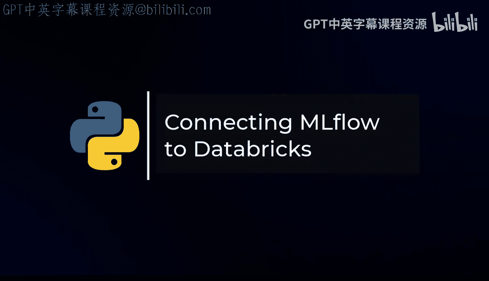
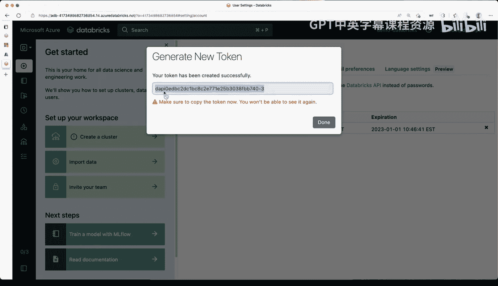
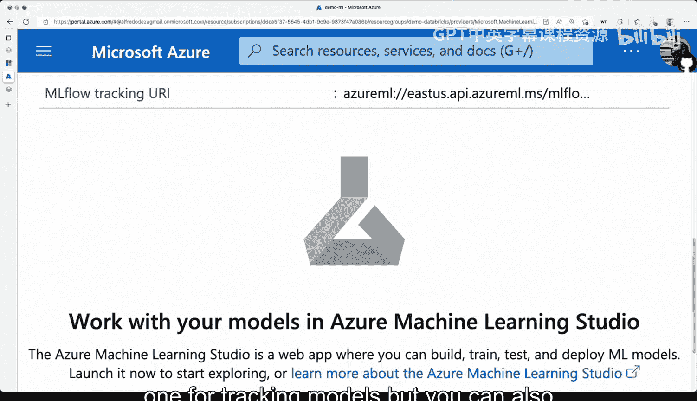
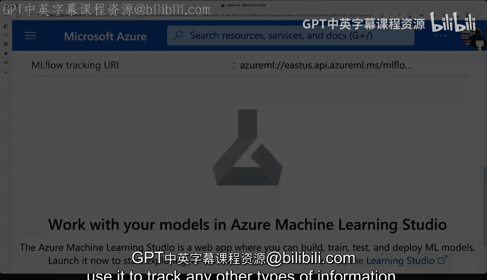

# 杜克大学｜机器学习运维｜DevOps⧸DataOps、Azure、MLFlow和抱脸｜MLOps ｜ Machine Learning Operations p150 09_01_05_将MLflow连接至Databricks.zh_en -BV1yE421c7uA_p150-

嗯。There are a couple of things I want to show you here on how to connect MLflow to databricks you have several options and MLflow is pretty flexible let's start here with the documentation from Databricks itself it doesn't matter here that it is referencing Amazon Web services because any of these will work as you know you can install MLflow locally and what you want is to make sure that everything is connected so here it goes about talking about the community edition。

 but don't worry about that it really doesn't matter what you need to whenever you're configuring MLflow to communicate with a databricks hosted tracking server is to ensure that you are exporting the MLF tracking UI and here this might not look correct might looks like it might look like this is an example but it isn't what it needs here it databricks。

And optionally， you can use data breaks， username and password if you want to authenticate straight away。

 or you can generate a rest API token when you generate a rest API token。

En createre your credions file， then you can you can do instead of a username and password。

 then you have the option to use the host and token instead of instead of doing doing this so there you have a couple of options that you can use to connect next it tells you to configure M applications but we're not going go through that but definitely you can well it tells you right here M tracking your eye data breaks and thenflow experiments create but in essence。

 what it means here is that if you set these variables correctly。

 then you should be good to go now sometimes generating a token might be tricky and I suggest going through the docs to generate a personal access token is pretty straightforward you would have to go to a host。

That version of Databricks which I'll show you in a second。

So this is my hosted data breaks that I have running here， and I believe if you come here。

Well actually let's go step by step with the Docs， it says click on the settings tab on lower left corner of your Datas workspace and then do user settings。

 so let's go to the user settings really quick I'm going to click here。

User settings and you can see here that I've already generated one but I can create generate a new token。

 so say for example， I'm going to say this is an example token and this is a good thing that it has like a lifetime in days at a false 90 So three months there and then it will go and expire and go away a good security practice。

 So you generate that and you get one time access to to this token and then you are done。

 I'm not gonna to use that right now， but it is how you would create that All right so next up。

 I want to show you how to do how to connect Mflow to Azure machine learning and you can you can use you can use the configuration there if you want to make MLflow work with Azure machine learning studio and Azure machine learning registry in this case now so because it's not the only thing you want you have many different options to connect MLflow to other remote。

Services in this case， I also want to show you how to do it with aure machine learning。

And a machinery registry。 So they talk here about an Ml flow U R I。

 So there's a couple of ways that you can get that you can either either build it manually。

 Let's see if they have the。The way on yeah， I don't think they explain here how to do that manually。

 but they they do have a way of setting that manually and the way you do that manually I'll show you with this notebook here you can see here that the Azure MLflow URLI uses these notation So Azure Ml colon you'll have to set up these variables the region your subscription ID your resource group and the workspace name So if you have that with Azure machine learning。

 you will be able to connect directly and and then that's it So no problem there by tracking but I want to show you another way that you can use to get that and it is coin to the portal and then the MLflow tracking URL I will show there and has these very convenient link here to copy that to the clipboard。

And then you can export it， so you there you go， there's like three different ways。

 two different services that you can connect MLflow to a remote tracking Sur1 for tracking models。

 but you can also use it to track any other types of information。

