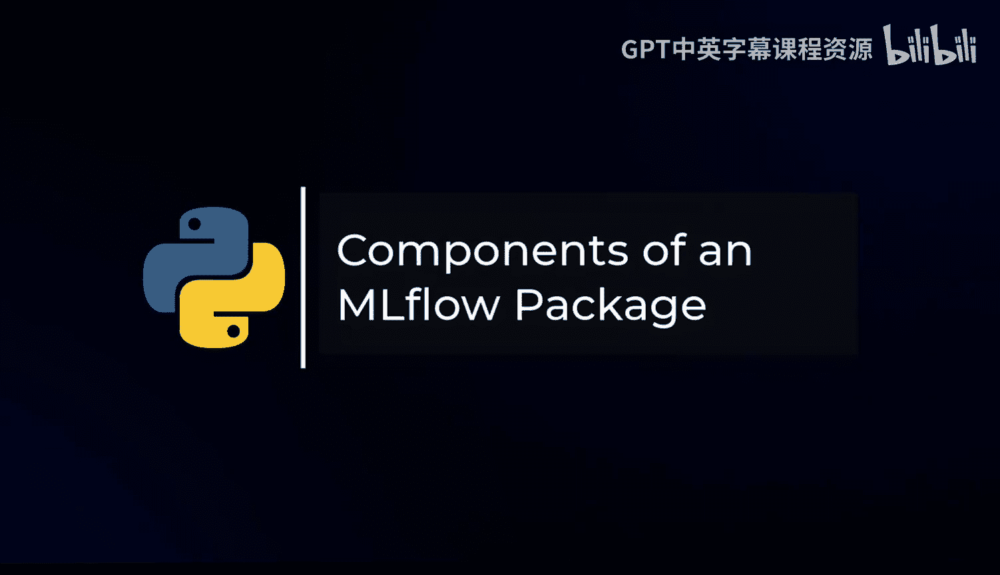
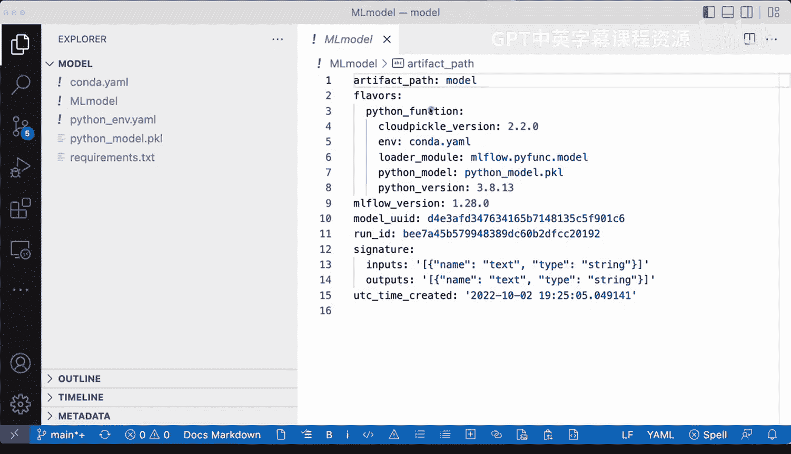
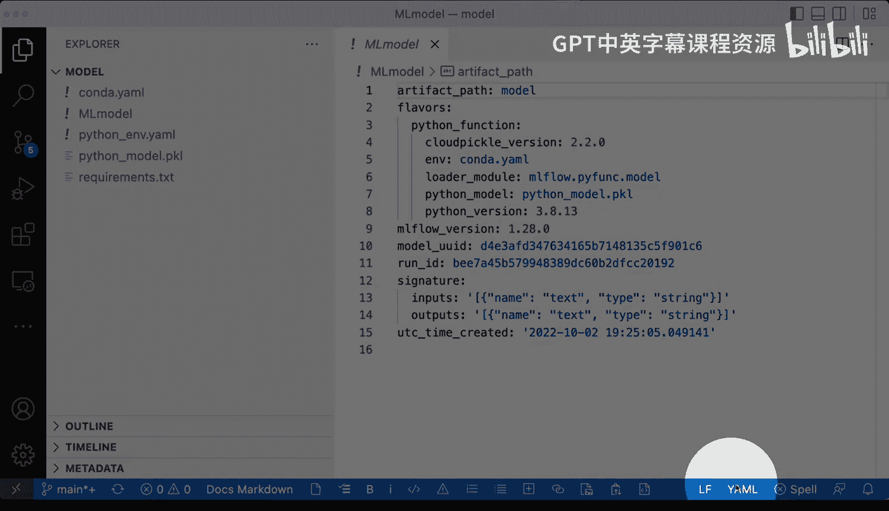
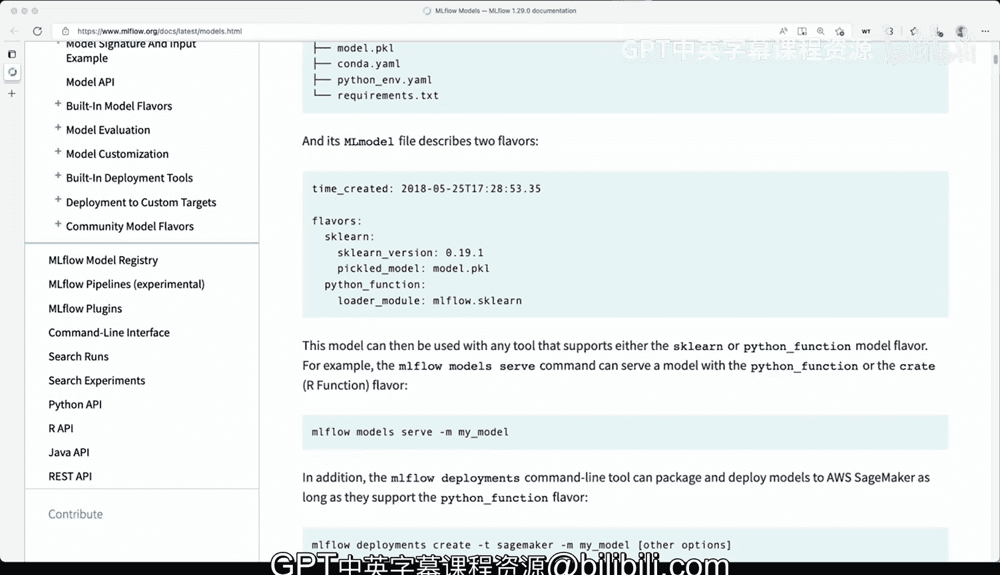

# 杜克大学｜机器学习运维｜DevOps⧸DataOps、Azure、MLFlow和抱脸｜MLOps ｜ Machine Learning Operations p151 10_01_02_MLflow包的组件.zh_en -BV1yE421c7uA_p151-

Let's go through some of the information required to understand what MLflow models are so MLflow models is just a way of formatting for for how a model a machine learning model should be interacted with where it came from what are the dependencies surrounding this model。

 how to interact with it how to run it， how to serve it and essentially hopefully how it was also built so I'm using the MLflow documentation here。

 but I'll show you a little bit of extra so that you have a good idea on how these looks but I want to go through a little bit of the storage format。

 so you'll have these files whenever you're dealing with a model particularly the ML model file which is again if you're following the convention that they're using for ML project it's a。

An Emma model it will be a YamL file as well， so just be mindful that when you open that it might not look quite good。

 especially in text editorators that don't recognize that as a YaMl file。

Then you'll have a couple of things you'll have the actual model in this case is a pickle file。

 a PkL that's a Python a Python based model there then you'll have your Conda Yamal which we've already seen how that looks like we'll have a Python environment that will also take a look and then perhaps even requirements that text for things that we install right there Al right so enough of the Mflow documentation。

 let's take a look about a thing that I actually build youve seen MLl model and I create this project and we'll take a look how to build it next but I want to show you how looks in Studio code So if I went through the actual run and you can see here we have these all of these files we have the requirements one we have the Python model PkL the Python environment MLl model and Conda Yaml will start by。

The MLl model interesting enough BS code did manage to find that this is Yal file。

 so the syntax high learning is working correctly there so that's great and let's take a look at some of the things that we're seeing here so this is a python function we have't covered what a python function is in the context of building machine learning models and Mlflow。

 but we'll take a look at that next but it is it indicates a flavor a flavor is just a way of telling MLl flow how it should work with this model so you have different flavors onx is a flavor psycho learning is and our flavor so you have different different ways of interacting different supported ways to deal deal with loading and interacting with the model All right so we have the artifact path in this case I went straight。

Into the path that it had that model。 so it does the artifact path cloud pickle version。

 So you start getting into some of the specifics behind that。 it was built using Python 38 13。

 This is important because if I was using Python， let's say something ridiculous like Python 31。

Then this wouldn't necessarily be compatible so this is already advertising something pretty crucial and important and this is important because before things like ML flow I definitely got into problems at some point trying to run automl models that came from a service and I didn't have the dependencies or Python versions and I had to find those find this by trial and error all right ML flow version perfect he was using 1。

28。Was the UI and run run ID。 so I did run these to create that and what the signature The signature is important because it tells us what the input and outputs expected are for interacting with this All right moving on let's take a look at the kind of Yamal Nothing really out of the ordinary we've already seen this file before we'll take a look at the Python M Yamo file and now this tells you a little bit more about all of the stuff regarding Python by what the Python version is what the build dependencies where and what are the extra requirements and these are here requirements that text So Mmoflow let's see Cloudpeco i Python transformers So this indicates that these might be coming from hugging face and we'll see how to get this going in a separate lesson but this is already important because it basically allows us to have lots of。

Information regarding how this model came to be and again it is just a normalized a normalized way that we can see about information specific to to to this model Python versions and where it came from and how to work and interact with it you can see here the Python function a load module is using M of flow that cycle learn so it's native support for cycle learn models and that's how this works right there and it tells you。

Specifically the flavor is cycle learned and it tells you how to how to do that。

 but this one has two flavors right Cy learn and Python function and the one that I show you in Vs code was using Python function。

 So there you go see we'll see next some of the other components of an MF flow package。

