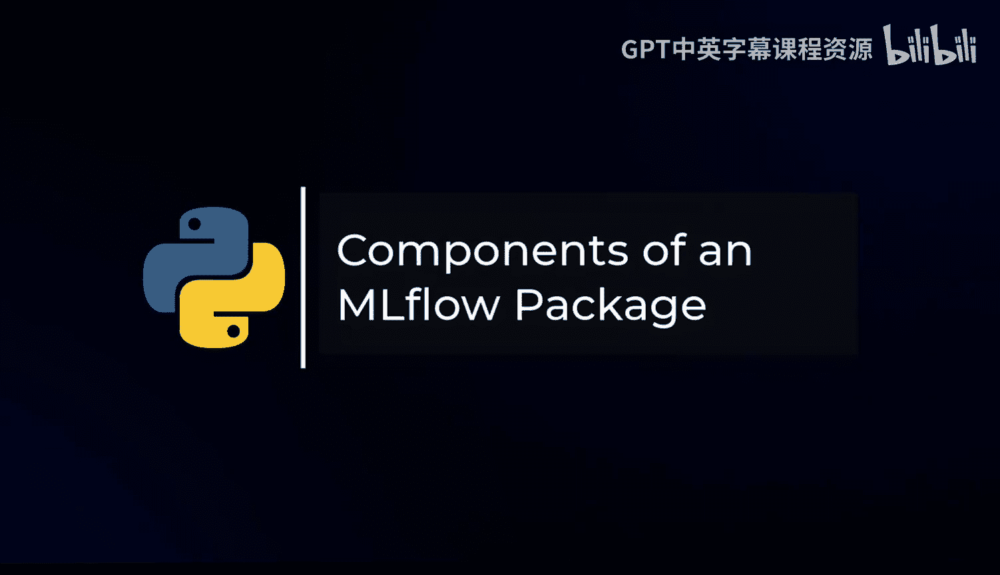
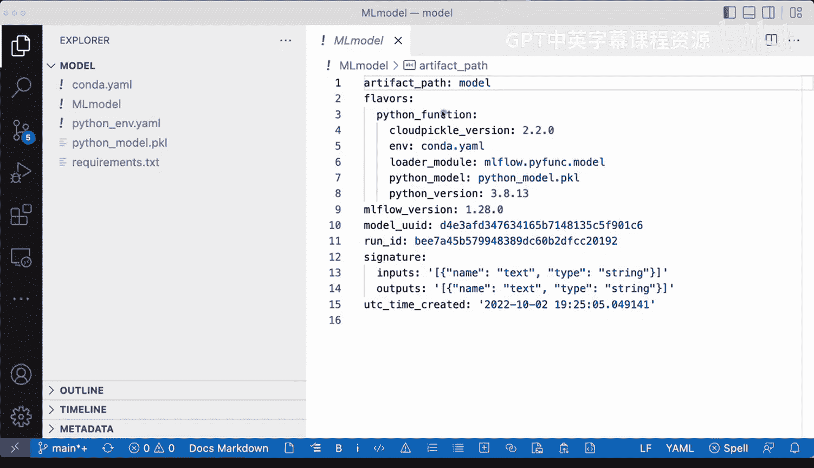
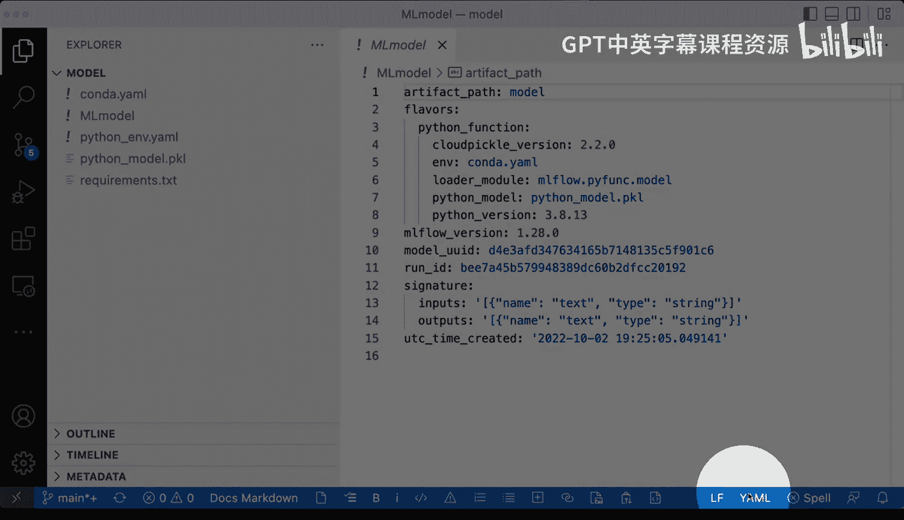
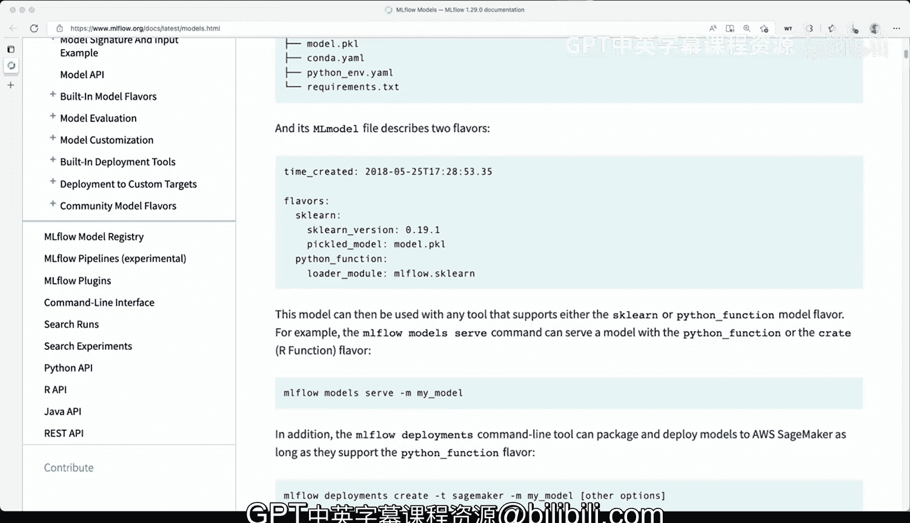

# 机器学习运维：10.01.02：MLflow包的组件 📦



在本节课中，我们将学习MLflow模型的核心概念及其组件。MLflow模型是一种标准化的格式，用于定义如何与机器学习模型交互、其来源、依赖关系以及如何运行和部署它。理解这些组件对于有效使用MLflow至关重要。

---

## MLflow模型概述

MLflow模型是一种规范化的格式，它定义了如何与机器学习模型交互。它包含了模型的来源、运行所需的依赖项、如何执行以及如何提供服务等信息。本质上，它旨在记录模型的构建和运行环境。

## MLflow模型的存储格式

上一节我们介绍了MLflow模型的概念，本节中我们来看看一个MLflow模型包具体包含哪些文件。当你保存一个MLflow模型时，它会生成一组标准化的文件。

以下是MLflow模型包中常见的文件：

*   **`MLmodel`**： 这是一个YAML格式的元数据文件。它定义了模型的基本信息，例如使用哪种“风味”来加载和运行模型。如果文本编辑器不支持YAML语法高亮，它可能看起来格式混乱。
*   **模型文件**： 例如一个Python的`pickle`文件（`.pkl`），其中包含了序列化的模型权重和参数。
*   **`conda.yaml`**： 这个文件定义了创建模型环境所需的Conda依赖项，我们之前已经见过它的样子。
*   **`python_env.yaml`** 或 **`requirements.txt`**： 这些文件指定了Python环境的具体细节或通过pip安装的包列表。

## 深入解析 `MLmodel` 文件





现在，让我们具体查看一个`MLmodel`文件的内容，以理解其提供的关键信息。在Visual Studio Code中打开该文件，可以看到其结构。

```yaml
flavors:
  python_function:
    loader_module: mlflow.sklearn
    python_version: "3.8.13"
    env: conda.yaml
artifacts:
  model: model.pkl
utc_time_created: '2023-10-27 10:30:00'
mlflow_version: 1.28.0
run_id: abc123def456
signature:
  inputs: '[{"name": "feature1", "type": "double"}]'
  outputs: '[{"name": "prediction", "type": "double"}]'
```

*   **风味**： `flavor`指明了MLflow应如何与该模型交互。例如，`python_function`是一种通用风味，而`sklearn`则专门用于Scikit-learn模型。一个模型可以支持多种风味。
*   **构件路径**： `artifacts`部分指明了模型主体文件（如`model.pkl`）的位置。
*   **Python版本**： 例如`"3.8.13"`。这是关键信息，确保了模型能在兼容的Python环境中运行。版本不匹配会导致运行失败。
*   **MLflow版本**： 记录了创建此模型时使用的MLflow库版本（例如`1.28.0`）。
*   **运行ID**： 关联到生成此模型的特定MLflow实验运行。
*   **签名**： `signature`定义了模型预期的输入和输出的数据结构，这对于正确调用模型至关重要。

## 环境依赖文件解析

接下来，我们看看定义运行环境的文件。`conda.yaml`和`python_env.yaml`文件提供了重现模型环境的完整蓝图。

`conda.yaml`文件内容示例如下：
```yaml
name: mlflow-env
channels:
  - defaults
  - conda-forge
dependencies:
  - python=3.8.13
  - pip
  - pip:
    - mlflow==1.28.0
    - scikit-learn==1.0.2
    - pandas==1.4.3
```

`requirements.txt`文件则可能列出额外的PyPI依赖包，例如：
```
transformers==4.25.1
torch==1.13.0
```

这些文件明确列出了所有依赖库及其版本（如`mlflow`、`scikit-learn`、`transformers`），这对于复现模型训练环境或在新机器上部署模型是必不可少的。它们解决了因依赖缺失或版本冲突导致的“在我机器上能运行”的问题。

---



本节课中我们一起学习了MLflow模型包的各个核心组件。我们了解到，一个MLflow模型不仅仅是一个模型文件，而是一个包含元数据（`MLmodel`）、序列化模型、完整环境定义（`conda.yaml`， `requirements.txt`）的标准化包。这种格式确保了机器学习模型的可追溯性、可复现性和可移植性，是MLOps实践中的重要一环。下一节，我们将学习如何使用MLflow来构建和保存这样的模型包。