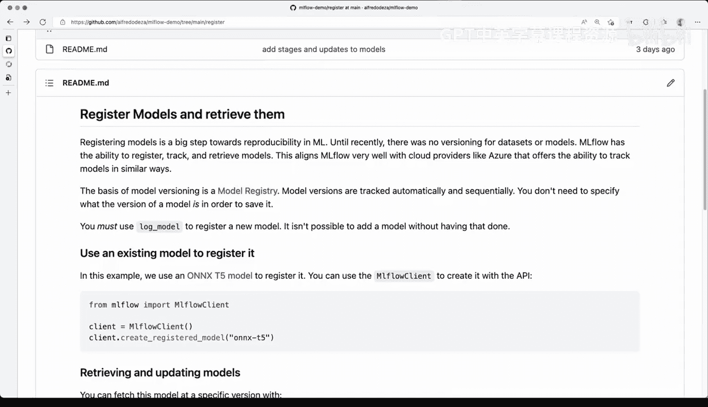
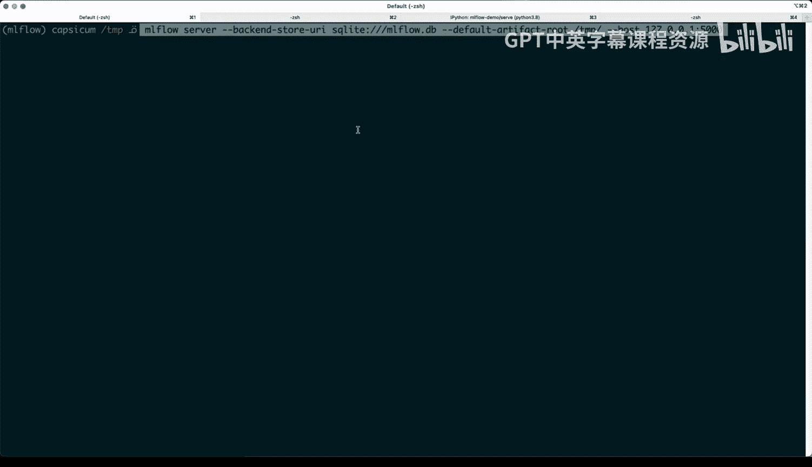
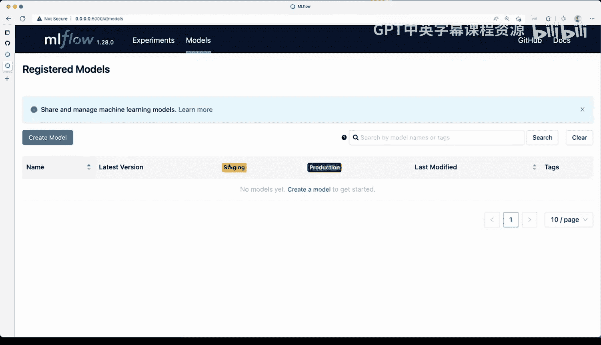
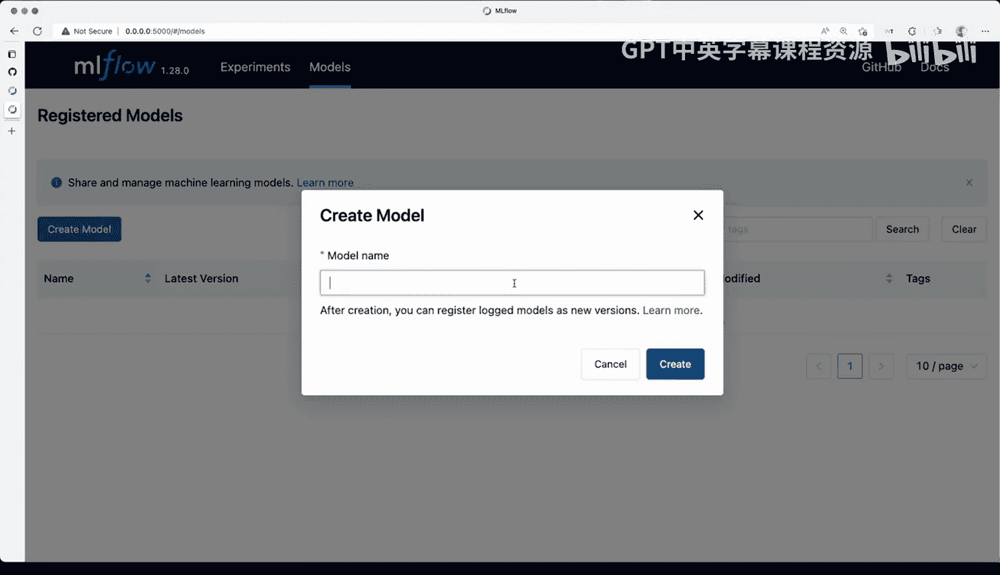
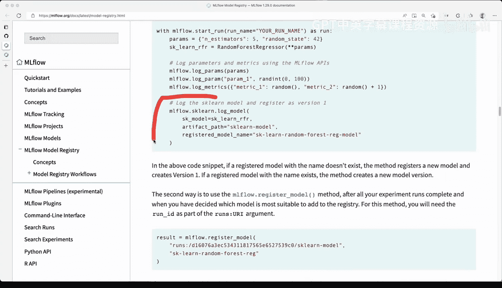

# 杜克大学｜机器学习运维｜DevOps⧸DataOps、Azure、MLFlow和抱脸｜MLOps ｜ Machine Learning Operations p152 11_01_03_在MLflow模型中使用注册表.zh_en -BV1yE421c7uA_p152-

Using a registry with an MLflow model is something that you should start getting used to is thisparic or this feature of MLflow is not unique to MLflow you can actually register models and I believe almost all cloud providers have like a solution for these where you can register those models and keep changing the versions that are associated with those models。

 especially when models keep changing which is a very useful feature All right so how do we do this exactly with MLflow I've documented a couple of the things that you can do here basically you have many different options on registering models and then retrieving them but essentially what it is is that you are training or producing models or creating new models or creating new environment for those models and and then you want to find some way to register them。

You can use an existing model and register it and start that way Now this doesn't give you much。

 it basically creates an empty placeholder with almost no information you can do this manually not manually but through the API or DS SDDK as you can see here but you can also use the user interface and I'll show you a little bit how that looks now I'm not going to show you how to retrieve or update models right now but definitely to create a new model youll have to create you have to produce an artifact and the way to produce an artifact is by using the log model when you're training it。

Allright， so we've seen a few of the ways that we can do that。

 but I haven't told you the whole story。 Now if you want to try these out locally。

 which I highly recommend you do， you will want to run a server and the way to do this is kind of tricky so you have to have a couple of things in order I'm going to paste the whole command here all right so the server started but like I said I want to I want to show you exactly what what's going on here so let's take a look MLflow server is the command and subcom that you want to use the backend store URLI I'm going to use an SQLite which is SQLite is an embedded database you should have that available on your system or once you will have to install SQLite3 and this is just pointing to a path on is the name of the file on the current path and then the default artifact root points to s temp which。

I'm just using as a temporary solution and then the host is 127 that0 that0 that1 and running on board 5000。

All right， so that is how it runs and you can see here that has put it。 and now if I go to the UI。

I go to my browser over here and I go here。😔，It will show that I have dis available so let's create a model to get started。

 you can use the UI， you can say， you know， say for example。

 D5 onyx and that will create an empty model so I'll give you the description tags and that way with these you can then interact with this because this is exactly the same using these API calls over here so that is how you start interacting interacting with with the different models and used the register but especially and I'm going show you here。

 there's a couple of other things that you may want to be doing once you've created these model you might want to you can see here that there's a couple of differences you can register a model you will use MLflow register model but。

Then you can use the register model to create a new register model and if the name exists it will fail because requires a unique name so make sure that you're mindful of the names that you have to use there and but then you can also do this manually I think this is very cumbersome if you want to try to do this manually so try to make sure that whenever you're doing this are like special locations in very few situations where you have to actually point to the run ID and where exactly that that lives so that's it that is how you interact that is how how you log how you log the model as you can see here and then interact with with。

With this server that allows you to store model information as we did before。

