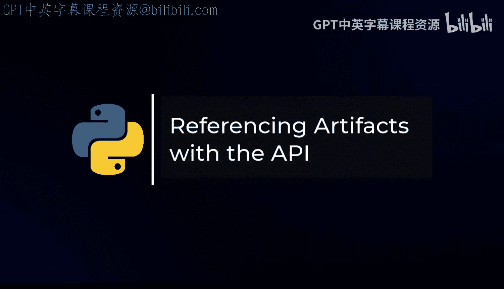
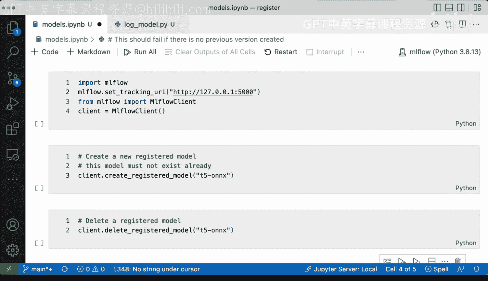
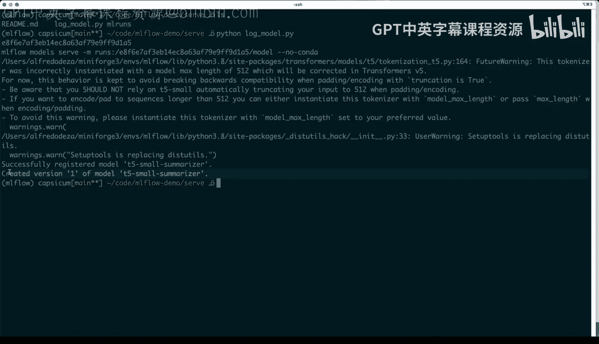
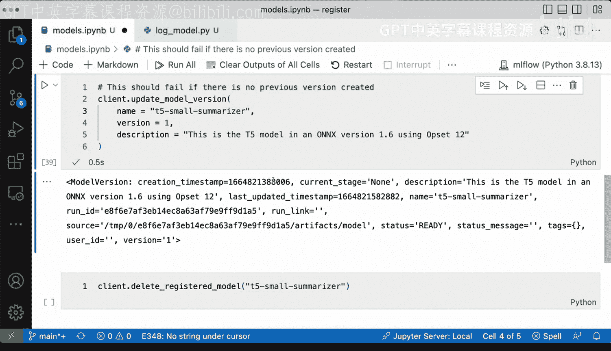

# 杜克大学｜机器学习运维｜DevOps⧸DataOps、Azure、MLFlow和抱脸｜MLOps ｜ Machine Learning Operations p153 12_01_04_通过API引用工件.zh_en -BV1yE421c7uA_p153-

Referencing and interacting with models that are living in a remote registry is a thing that is kind of like taking a step further when you're working with MLflow so we've already seen a little bit of the examples here of how you can register one but we haven't seen how to retrieve or update these models first let's take a look at what I have here。

 I've run a couple of experiments already， these experiments were run a few minutes ago and these experiments were able to log and log an actual model。

 but there's a couple of things that are not really straightforward and it might take a while it definitely took me a while to figure out and I want to show you so what I want to do is I want to open my visual studio code here and I have a couple of things here so I have this Jupyter。

nbook with some examples on how to register models and how to interact with the API dynamically but let's take a look first at how I log the model so I have this small script here and I really like hugging face I think it's tremendous and what this script is doing is actually using hugging phase so importing the pipeline from transformers and then it's creating these this python class that basically tells an'm willflow how exactly it needs to interact with this model so the way it interacts with the hugging phase model is it sets the tokenizer and model in the constructor and then it defines a single method that in this case is's translating English to German that's fine it constructs a model input and output and finally it goes and creates the tracking starts run and it logs the model there。

There's a couple of key items here first one is the log model you can see here that whenever you're logging a model you're producing an artifact。

 you're producing that model and here you're capturing all of the details in the beginning I didn't have a register model name so that cost that it wouldn't show up on the registry so in this case I decided to call this the T5 small sumr and a little bit of the details there about what the model is and it's not waiting for a registration and is using some of the parameters that I created。

key item here is the tracking Uri has to be set。 I wasn't setting the tracking Uri and that was causing the model not to be registered So if you're not setting the tracking Uri basically won't get registered and you you won't know because there's no output or message saying by the way there's no tracking Uri so make sure that the tracking Uri is always set to what you're expecting and then when you're interacting with it when you want to poke around with that model。

 then you have to make sure that in this case I'm doing that dynamically I'm running on4 5000 is's running locally and I'm setting that again I am not sure why does not default I believe that default is the file system and so there's that there's that disparity because you're expecting things to be running on the server。

they're not。 All right， so let's go and open up my terminal real quick and in my terminal。

 I'm going to run this log model and see what happens。

 I'm going to say Python log model this is just very straightforward very quick and it is running running that and successfully registered model T5 small summarizer and created version1。

 Al right， so let's go to my web browser and then if I refresh these。

 you'll see that there's now 16 seconds ago I run that and created a model that's fine。

 we have some versions that that's excellent。 So now what I want to go is go here two models and see what's going on there。

 So if I click on models you will see that now T5 small summarizer appears and that version1 is。

ThereIf I click here， there's a couple of things that are interesting if I click on version1 again and then I go and click on the source run several different things will come up these are very very interesting first you will have captured the ML model which we saw before the Python environment it allows you to have copy paste is essentially copy paste code that you can paste on a spark data frame so you can run these and interact with this which is really tremendous if you want to do this on the pandas data frame you absolutely can do that as well so a very powerful very complete solution there if you want to interact with all these models because they're capturing everything really like even the parameters well in this case I didn't use any parameters see the metrics。

 there's nothing there。Believe I use tags so there's no tags， but the artifacts。

 definitely they requirements， you can see transformers torch。

 there's all kinds of different things there。 All right。

 so that sets the T5 summarizemarr and now let's go back to the Vicious studio code and let's start interacting with this first we're gonna import em flow so the tracking Ui and create a client object that's perfect。

 now we're gonna register a model and let's see what happens。 this model must not exist。

 So we don't have a t5 onyx and this is just a name perfect。

 So so that register that and if we go back to to the Uri to the web service if I click models you can see that t5 onx is there there's no version though and the reason there's no version is because I just created with a name if I click here there's nothing going on nothing very useful let's go back and continue with executing ourselves we can definitely。

The lead register model as well if I click down the lead Reg model T5 onx you'll see that if I load these it's gone Now let's play a little bit with a T5 small sumr click on this and you can see there's no description the stage is none so lets let's make some changes there what we're going to do is going to update the description and I'm going to say this is the T5 model in an Nx version 1。

6 using Op 12 so if I run the cell and executes it completes the API。

Call and if I go here and automatically I didn't even have to reload and the description was updated perfectly for version 1。

 you can see here that the description says now that this is the D5 model in an onex version 1。

6 All right so that's a good overview how you can interact with these models when you're registering them in a tracking UI and a tracking server in a remote registry I'm using a local server here。

 but this would essentially feel the same regardless of what remote API you're using and it is we didn't cover absolutely everything that you can do of course。

 but this should allow you to get you started。

