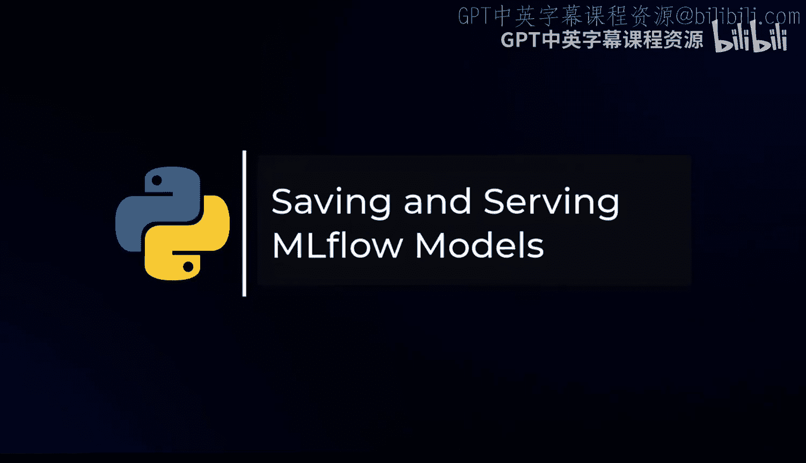
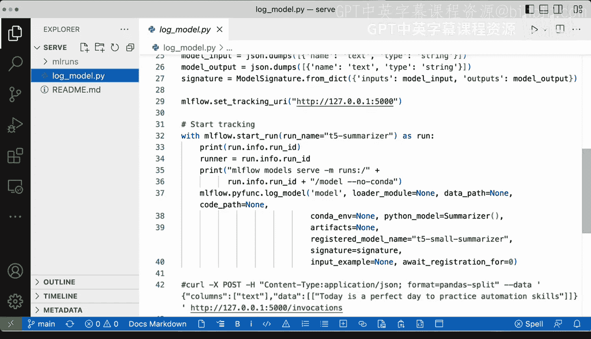
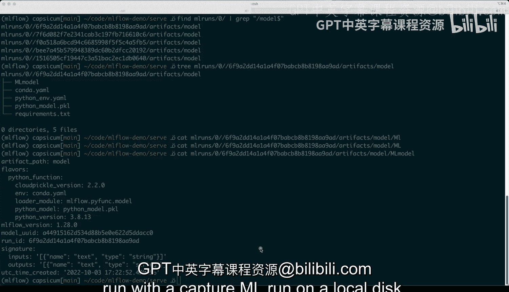

# 杜克大学｜机器学习运维｜DevOps⧸DataOps、Azure、MLFlow和抱脸｜MLOps ｜ Machine Learning Operations p154 13_01_05_保存与部署MLflow模型.zh_en -BV1yE421c7uA_p154-

Now that you know how to register some of the models that you will be working with。

 it's time to find about how to interact with them and one way that you can do that is by serving them we've already seen a little bit of these script that I created to log that model which has a couple of components。

 the first component is is this one where we have the summarizer class which inherits from this Python model class so as you know this is so that you can so the MLflow understands how to interact with that and in this case we've used a hugging phase API so that we can we can do some predictions in reality what we're doing is translate translate in English to German。

 as you can see here we're going to get the input and then we're going to use that input。

To the tokenizer。 And then the predict method is going to return the actual output。 Now we've also。

 and this is pretty important， especially when you're serving。

 we've also determined that we have the model input and model output right there and we are defining how to interact with this model。

 Now， when we run the the script， we were able to log that model run。

 you can see here that we we did log it and we used that registered model name， T5 small sumr。 Now。

 you can interact with this model from local runs。 And that is how we're going to do that。

 And the way and。Put this right here at the very bottom the curl command that you can use to make that happen。

 Allright， so I'm gonna to go to my terminal and see how we can make that work。 Okay。

 so I'm here in my terminal and I have MLlflow installed。

 I have a couple of Ml runs already you can see if I list the contents there。

 you'll see that there are several so let's go through some of the components you will need to know in order to run from a local run。

 So you can you can do Mlflow models serve and I'm going to pick these run id 151650。

 which is right right here right that one So that one is the one that we're going use and you can see has kind of like a path slash model and I'm going use port。

5001。And the reason is because if I don't use port 501 and let's try it out really quickly so that you can see kind of like what you will be getting into is an error condition you are getting this error condition because the port is already in use as you can see here connection in use port 5000 so that is because I have already a tracking server or tracking UI running already so I am going to use。

I'm going to use port，5001。So if I run these。You will see that it was able to boot up correctly and it is running already now good thing that I was able to save that curl command so that I can interact with it in the terminal so remember this is serving an API and one of the things that this will do is that like if I go to a browser and go to this address。

 nothing will happen， it only has one endpoint which is invocations and this is true for anything that you will serve with MLflow so here on this new tab I have the command paste it and the command is going to use that same URL or URL 127 that's0 that0 to1 on port 5001 and you can see that I am also using invocations this is critical because if you don't use that path it it will get you into trouble and remember those inputs。

And outputs， that is defined here。 you can see I'm using columns， text and the data。

 and this is kind of like a like a almost like a pandas and it is a pandas format。

 you can see here that the format is pandas split。Allright。

 so let's see what happens if I run these so I'm not summarizing by doing a translation to German and I wanted to translate today's a perfect day to practice automation skills we can we can of course do all kinds of different things here and we can we can see something something different say for example。

 curl can be difficult。To get right and we can run that and curl can well I can read German。

 but you get the gist of it。 So if we go back to the other tab on my terminal。

 youll see that the interaction， in fact， is happening correctly with a little bit of output you know there's some warnings about the max length。

 the tokenizer is not working quite correctly。Given the type of input， but that's fine。

 we are able to interact with it now one of the caveats here and we'll see these in all videos is that you are kind of like left in the dark as to how these will work so I'm going cancel the serving so that you can see a little bit of what is going on in these specific run right there so I'm going to have several runs and I'm going to say ML runs list the contents of the directory in zero and you can see there's plenty let's find let's find all of the runs that have models in it。

So actually， what I want to do is not I did the wrong grab here。

 so I'm trying to find anything that has a model and see if the contents are there。

 So there you go so you have a few just a few runs that we're actually able to produce one of those models。

 So if I go and grabs for example， the first one and I do tree so that we can see what the contents are you should already be familiar with these type of setup。

 this is the magic that allows MLflow to understand what is going on how to serve it。

 what are the requirements， where is the model what the Python environment looks like and Conda environment if if if anything that's that's kind of like what you need to do and the ML model explaining what it is and how how it works So in fact if we were able to look at that ML model file。

If we concatenate the contents of that run， you can see here that it has the actual signature and it has a timestamp and all kinds of different useful information that again we've already seen for ML flow。

 so that's super useful and that is those are the parameters。

 those are the things that metadata that allows MLF to serve a model， so there you go。

 that's how you serve a model that was previously run from an ML run with a capture ML run on a local disk。

