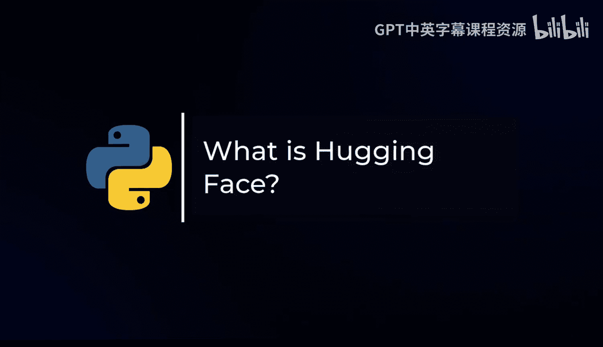
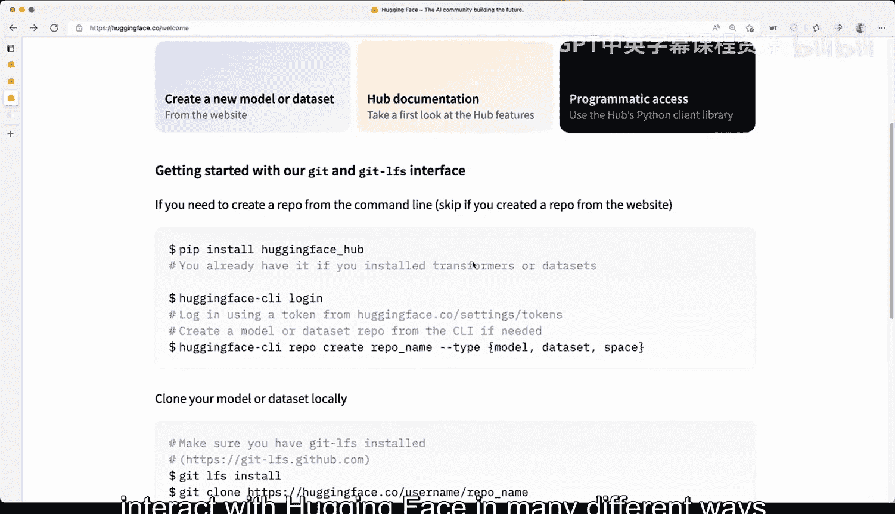
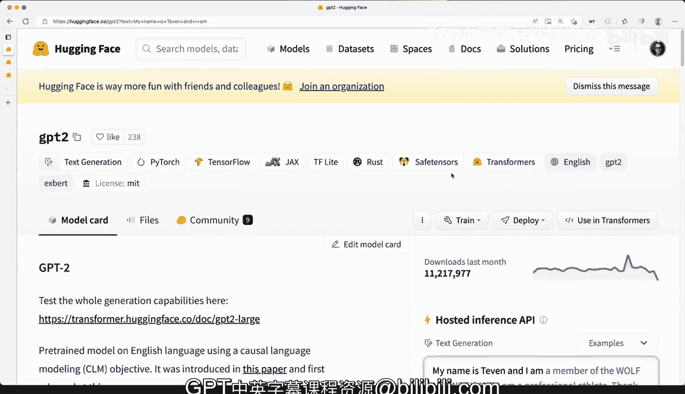

# 杜克大学｜机器学习运维｜DevOps⧸DataOps、Azure、MLFlow和抱脸｜MLOps ｜ Machine Learning Operations p155 14_02_02_什么是Hugging-Face.zh_en -BV1yE421c7uA_p155-

嗯。Let's dive in into a little bit of what hugging face is Now sometimes people don't see hugging face as a platform。

 but in fact it is you can see here that right off like the main website we see models。

 datas spaces and docs we'll cover a few of those in detail later but it is enough to say that we're going to be able to interact with and host models and create our own version of our models work with datas。

 existing ones and our own as well So this is the way I see it is that it's a platform a way where we can cross collaborate with everything machine learning Now I've gone ahead and create my own profile but an account and you can see here that there's models and datas I don't have anything yet I'll have to fix that pretty soon but this is the way again the way。

I see this kind of like GitHub， just like GitHub is for for software engineering。

 I see hugging face being the same thing， but for machine learning， collaboration and interaction。

The other thing I want to show you is once I created my account。

 I had this programmatic access using the hubbs Python Klein Library we'll get into a little bit more details as to what the hub is but you can start seeing here that sometimes it's not only the website。

 but you have libraries that you can use to create repositories with specific names and with specific purpose like say for example。

 a model or a data or even a space now spaces are its own special thing and we'll cover those later as well。

 but just wanted to show you that you you have the ability to do to interact with Hging face in many different ways and then the last thing I want to show you is that this is the Python package index。

 this is where PIip goes and。

Finds its packages， there are a couple of things I want to show you first is the first one is transformformers。

And if you search for transformers and you go to this one right here， version 4。

22 that2 in this case， you'll see that the familiar huggingface logo is right there and this is in fact coming from hugging face So this is hugging face itself providing open source tool in open libraries to interact with to interact with models and here Transformers is specifically for text vision and audio and it is definitely a joy to use and we'll see a couple of things that we can use and then you have all these kinds of demos available。

 Now the one thing I want to show you in relation to this I'm going to go back here So you see here T5 and G2 mentioned let's go back to the website to the main website over these the first one the first tab rather and I'm gonna search for。

GPT I'm going to say that I'm going to hit return。And then you'll have several different things。

 so this means that you has support for Pythtorch， Tensorflowlow， TFI。

 it uses several different things here and you have these model card the model card allows you to demo we'll explain what this is about and give you a little bit of information。

 you can look at this， you can deploy it Hifacease has its own way of deploying its models。

 you have like a hosted API where you can do live inference and you have like the endpoints and even sageMaker direct s sageMaker connection so that's pretty interesting and I'm going to scroll back here because I'm going to show you well here's the hosted inference API so let's try to compute that and see what happens and then we'll see these being being completed by the model so pretty good pretty useful and。

What I was telling you about before and I mentioned spaces a little bit was that you have the ability to use this G to model and do something else with it and repurpose it and fine tune it to your own needs and all of these are lots of different accounts that happen doing something with it Now here you have examples you have a little bit of documentation and then we saw transformers but you can see here pipeline and so transformers allows you to have an abstraction library with Python to do text generation in this case。

 this example is going to be using text generation you can see here and then it select GPT2 and again we'll see all of this in detail later but you get the output so essentially four lines of Python if you're counting the import statements and then you get something really powerful out so you get libraries hosting datas hosting models and interaction。

For from hugging face in a web UI that allows cross collaboration for anything machine learning。

