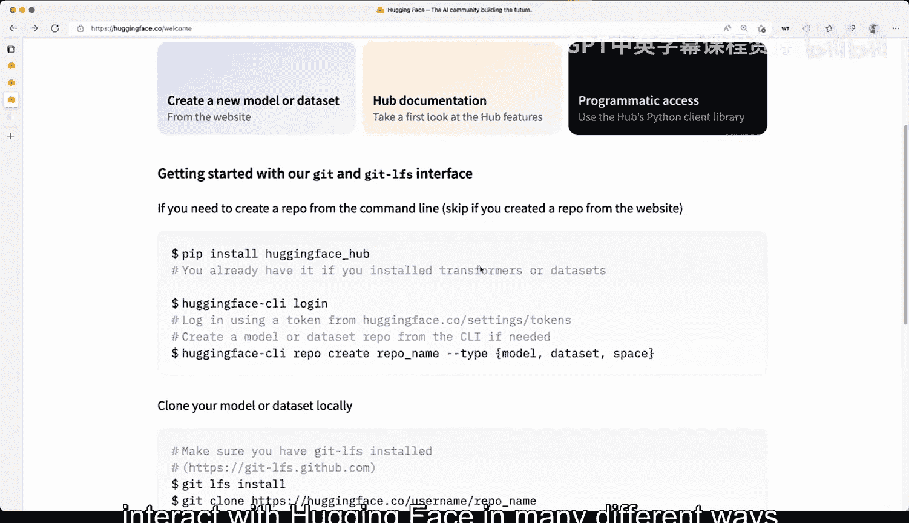
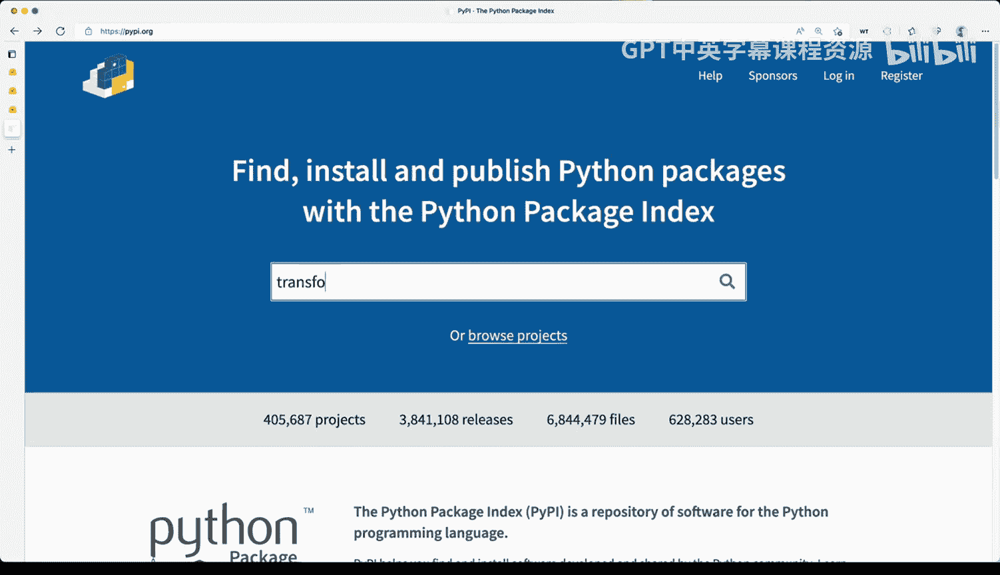
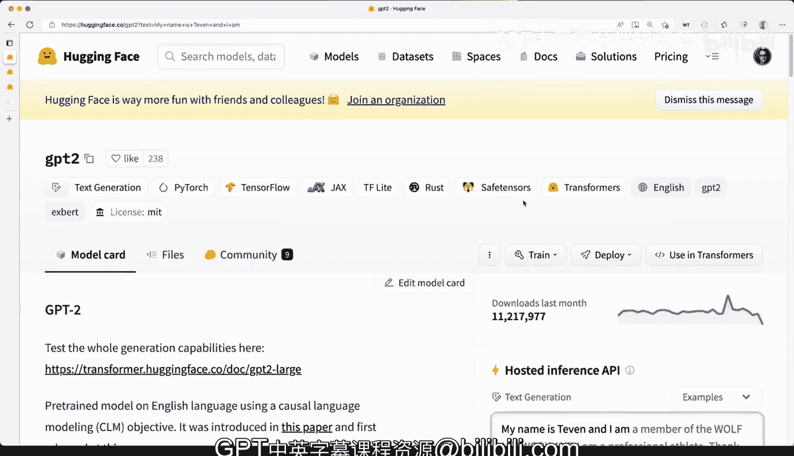

# 机器学习运维：14_02_02：什么是Hugging Face 🤗


在本节课中，我们将要学习Hugging Face平台。我们将了解它是什么、它提供哪些核心功能，以及它如何成为机器学习领域的协作中心。

---

## 概述

Hugging Face是一个为机器学习社区设计的综合性平台。它不仅仅是一个网站，更是一个集模型、数据集、代码和协作工具于一体的生态系统。你可以将其视为机器学习领域的“GitHub”，它极大地简化了模型的发现、共享、部署和协作过程。

## Hugging Face是一个平台

上一节我们介绍了Hugging Face的定位。本节中我们来看看它的核心组成部分。

访问Hugging Face的主页，你会看到几个主要标签：**Models**（模型）、**Datasets**（数据集）、**Spaces**（空间）和**Docs**（文档）。这清晰地表明它是一个功能丰富的平台。

以下是Hugging Face平台的核心组成部分：
*   **Models**：一个庞大的预训练模型库，涵盖自然语言处理、计算机视觉、音频等多个领域。
*   **Datasets**：用于训练和评估模型的各种公开数据集。
*   **Spaces**：一个可以托管和分享机器学习演示应用（如Gradio或Streamlit构建的应用）的地方。
*   **Docs**：全面的文档和教程，帮助用户使用平台的各种工具和库。

就像GitHub是软件工程师协作的中心一样，Hugging Face旨在成为机器学习从业者进行协作和互动的中心。

## 多种交互方式



上一节我们了解了平台的网页界面。本节中我们来看看如何通过编程方式与平台交互。



创建账户后，你不仅可以通过网站使用Hugging Face，还可以通过其提供的Python库进行程序化访问。例如，使用 `huggingface_hub` 库，你可以直接通过代码来管理模型、数据集或Spaces仓库。

```python
# 示例：使用 huggingface_hub 库创建一个模型仓库
from huggingface_hub import create_repo
create_repo(repo_id="your-username/my-awesome-model", repo_type="model")
```

这为用户提供了极大的灵活性，允许他们将Hugging Face的功能集成到自己的自动化工作流和工具链中。

## 强大的开源库：Transformers

平台本身提供了丰富的资源，而为了更高效地使用这些资源，Hugging Face开发了强大的开源工具库。

其中最著名的就是 **Transformers** 库。你可以在Python包索引（PyPI）上找到它。这个库为处理文本、图像和音频任务提供了统一的、高级的API抽象。

以下是Transformers库的一个核心概念——**Pipeline**（管道），它让推理变得极其简单：
```python
from transformers import pipeline
# 创建一个文本生成管道，指定使用gpt2模型
generator = pipeline('text-generation', model='gpt2')
# 使用管道进行推理
result = generator("Hello, I'm a language model,", max_length=30)
print(result)
```
通过短短几行代码，你就可以利用强大的预训练模型（如GPT-2）完成复杂的任务。Transformers库支持PyTorch、TensorFlow和JAX等多个深度学习框架。

## 实践：探索与使用模型

了解了核心工具后，让我们回到网站，看看如何实际探索和使用一个模型。

在Models页面搜索“GPT”，你会看到许多相关模型。每个模型都有一个**Model Card**（模型卡片），其中包含模型描述、用途、训练信息，以及最重要的——一个**Hosted Inference API**（托管推理API）演示窗口。

例如，你可以直接在网页上的演示框里输入文本，模型会实时返回生成结果。这让你无需编写任何代码就能快速体验模型的能力。

此外，平台还提供了多种部署选项，包括：
*   **Hosted Inference API**：托管的API，用于快速测试和原型开发。
*   **Endpoints**：专为生产环境设计的可扩展API端点。
*   **SageMaker**：与AWS SageMaker的直接集成，便于大规模部署。

你还可以看到社区成员如何利用这些模型。许多人会创建自己的**Space**，展示他们微调（fine-tune）后的模型或构建的特定应用，这充分体现了平台的协作精神。

---

## 总结



本节课中我们一起学习了Hugging Face。我们了解到它是一个集**模型库**、**数据集**、**演示空间**和**开发工具**于一体的机器学习平台。通过其网站和像 **Transformers** 这样的开源库，它极大地降低了机器学习技术的使用门槛，并促进了全球开发者之间的协作。无论是寻找一个现成的模型进行推理，还是想分享自己训练的模型，Hugging Face都提供了完整的解决方案。