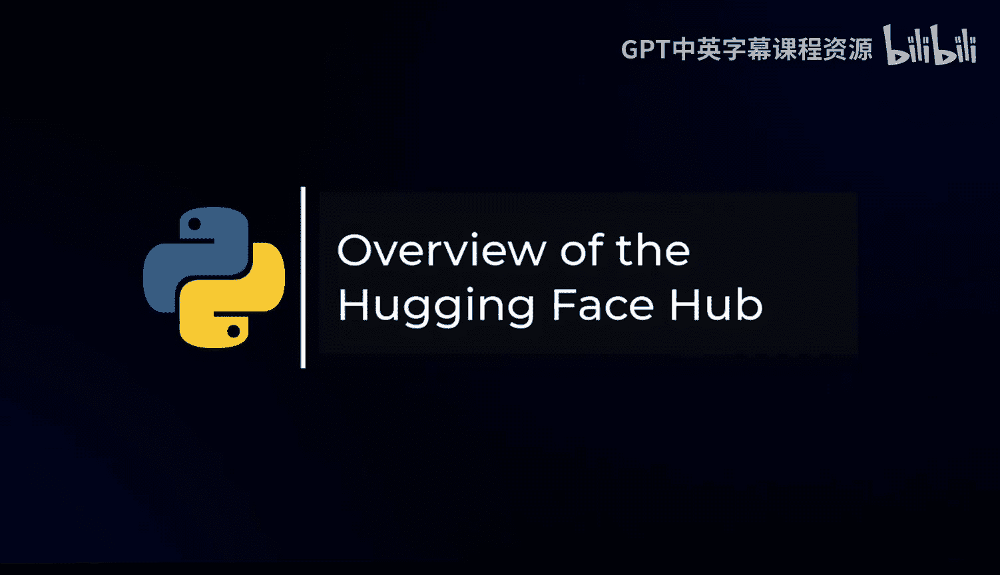
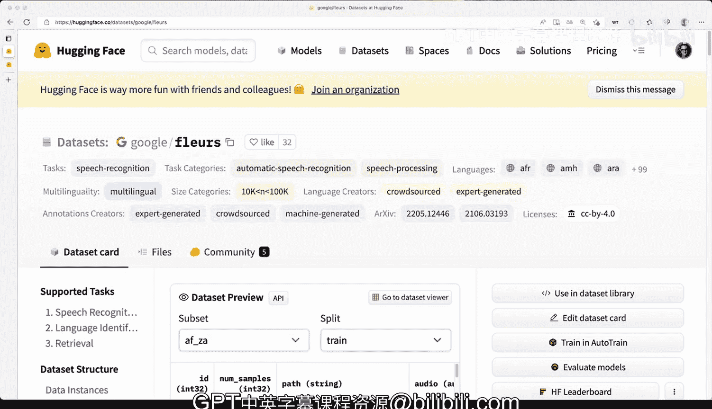

# 杜克大学｜机器学习运维｜DevOps⧸DataOps、Azure、MLFlow和抱脸｜MLOps ｜ Machine Learning Operations p156 15_02_03_Hugging-Face-Hub概述.zh_en -BV1yE421c7uA_p156-

Let's do a quick overview of the huggingpha hub Now the hugging phase hub means that you will be interacting with repositories models。

 datas spaces and even perhaps organizations and endpoints depending on what you're trying to do so I have the main for my account。

 the main hugging face space so if I go ahead and go towards the new button over here。

 you'll see that you have three main options if I go to model well that's effectively a repositories we're going to click here and you'll see that I get prompted to create a new model so in here you can actually fill out the names and have a couple options if you've worked before with GiHub this will feel very。

 very familiar it's similar similar interactions and you can do this。

Same thing here with the hugging face Ci so you'll have to specify who's the owner in this case I'm the only owner I'm not part of any organization and I'll put the model name for example example model name and then the license op pick probably like say something like MIT if it's supported。

 I think I scroll past by it， I can say MIT and if it's public or private so once that's available that is uploaded。

 I can consume these from anywhere either with the library is from hugging face or directly from this page but there's more to the Hub than these and I'll continue exploring some of the other things the data is it's the same same interface and again you can do this with the command line tool as well where you can put information here as to what the data is now datasets similarly will allow you to have those。

Hoed in and all of these by the way， are GiHub repositories。 So both the data， the model。

 they're all GiH GiHub GiHub Gi repositories where you can interact with and have pull request and changes and even clone the repositories locally so that you can have some interaction youll have to have Git LFs and actually this is covered in the documentation if I go back here you can see here that the clone your model or data locally it will require LFS so I think newer versions of Git the command line tool will come with LFS installed。

 but if it doesn't you can see here it's Gi L installed and then that's go to and then you can clone it pretty straightforward like like that and similarly going back to this this was with with a data if we go back and say a space。

The one that I wanted to show you is space allows you to have a hosted a hosted version of your own application using hugging face and in this case it has options of here it tells you streamle or radio but in fact you have you have these three options you can use streamlelate radio or static what does this mean like if you want to demonstrate what your hosted application can do and you want to do that interactively you can use any of these options to do just that so the space will allow you to have some of those running and and make it make it really really interactive so that's it that's kind of like a big highlevel overview。

 I didn't cover organizations but essentially that's if like if you're having like a group of people or your own company and you're working with all machine learning engineers and you want to create。

y own or new organization， then you will do that similar similar to what you would do with GiHub and an organization when you join a company say for example。

 let's see some of these ones right here well these ones are not organizations but you'll get Google is organizations or we let's take a look at that one and in this case Google is the organization and this is the project so if I was collaborating probably here Google will have to give me access to their own organization and help me contribute to this and I don't want to translate this right now and that's a quick overview of what the hub is essentially a few different components that we discuss we talked a little bit about data spaces organizations and models and repositories。

