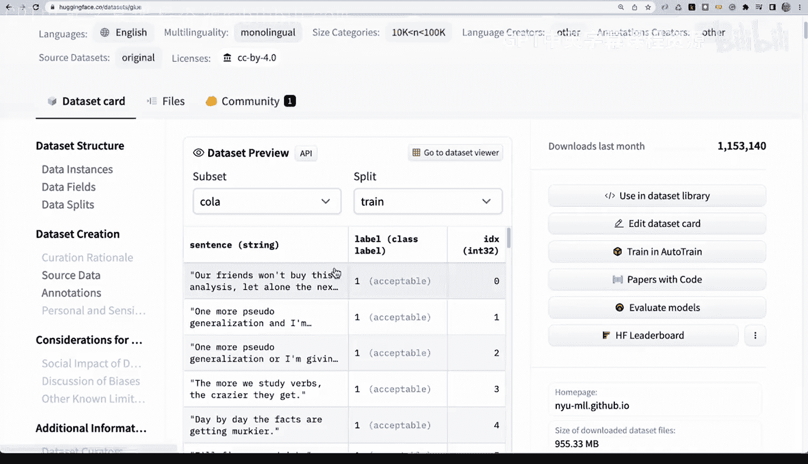
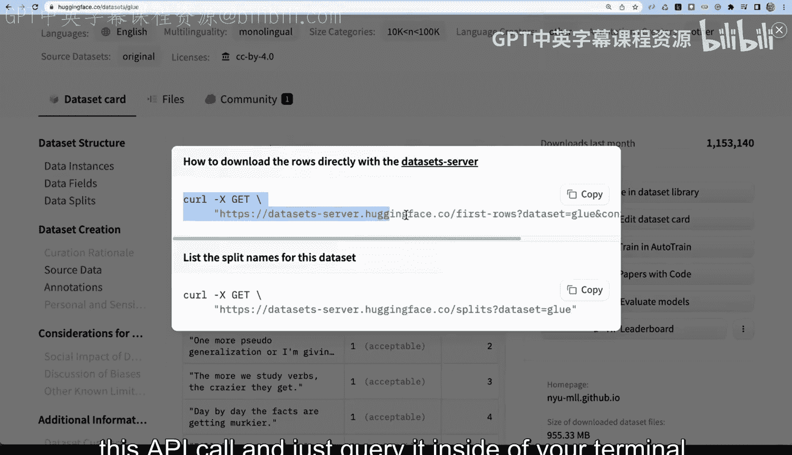
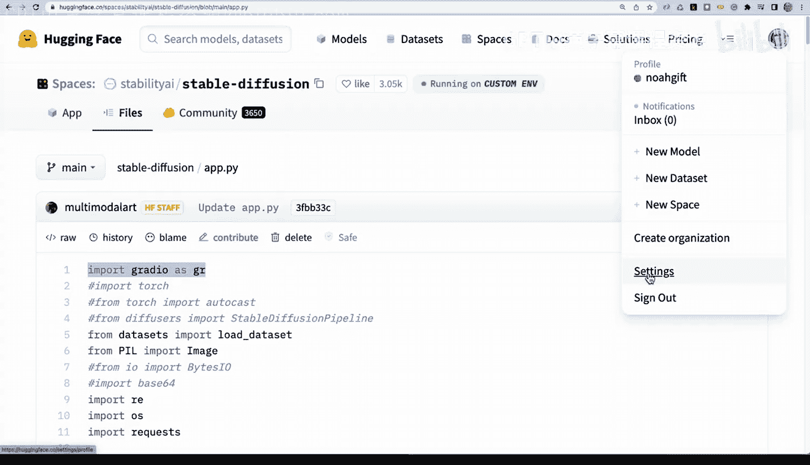

# 杜克大学｜机器学习运维｜DevOps⧸DataOps、Azure、MLFlow和抱脸｜MLOps ｜ Machine Learning Operations p157 16_02_04_Hugging-Face-Hub介绍.zh_en -BV1yE421c7uA_p157-

Huggging face hubub is really about just a few products。 First。

 you have the ability to log in and create an account。 and you can see here's my profile。

 and I have settings enabled as well。 And if we go to settings the most important aspect of your settings beyond putting your full name in homep page。

 etc cetera， is to actually create an access token。

 The access token allows you to programmatically interact with the Huging F hub。

 So what it means is that from Github actions you could push maybe artifacts into Huging face from a development environment you could go through and read and write data。

For example， a data or you could configure a spaces application as well。

 So I would say this is the first part of the Huging face hub is make sure youve got an account and you've created an access token and save that token somewhere secure。

 the next thing to be aware of is the models。 So if we go to models here。

This is really the heart and soul of a large component of hugging face at this time you can see there's 80。

000 models I'm sure this is growing by the month and it could be into the millions at some point and these models here are composed of multiple tasks and you can see the tasks we have image classification。

 translation etc ce and if we go through here you can even pull down even higher level categories like computer vision。

 these are all models that deal with computer vision natural language processing like translation or doing text generation We also have audio In this case you could see things like automatic speech recognition In fact if we select automatic speech recognition here。

 one of the things you'll notice here is that they have a sort by the most downloads you can see all the different downloads here for speech recognition and you could take a look at which。

icular model you may want to play around with when you're dealing with models。 So really the the。

 the ranking here。Are actually good ways to actually。

Figure out what it is you want to do when you're dealing with a particular category and in fact。

 one of the more popular recent additions is open AI Whi and notice that this open AI whisperhi large。

 you can actually use hugging face to actually include it and transcribe things inside of a project。

So that's models Now if we go to datas， the next thing to be aware of with datasets is that there are also a large amount of datas and the reason why these datas are interesting is that they can be used for fine tuning so this means that you can customize these pretraining models and make them even more accurate for particular problems you're solving so here we say fine grain tasks like language modeling。

 multiclass classification， etc， these are all useful places to to use these datas and what's also helpful is that if you go to the data you can see here that there are the structure。

 information about the data you can even preview it and you can even select right here this API call and just query it inside of your terminal and finally you can even go and train inside of your hugging face environment。

In general here， the data is one of the more useful aspects of the hugging face platform。

 And you can also upload data into the data。 The The last key component here is spaces。

And what's useful about spaces is the way to make machine learning applications and it's quite easy to actually create one if you just say create new space。

 it'll ask you for the name of the space and then what technology you want to use streamlit radio static and you can actually share this out with a particular license if you want。

 you can also go through and look at other models and this is actually a great way to get familiar with certain things if you want to take a look at some potential example of something you can go through here。

 and and figure out for example， the files themselves。

 you can actually read through and look at the particular files that were used for something here's another one stable diffusion demo。

We can see there's an application file right here and they're using radio for their spaces application。

 so really it' it's a place that collects models， data sets。

 spaces to use it programmatically you would go in and create a profile。

 create a settings section where you use an API key and we're going to get into this in a little bit。

