# 杜克大学｜机器学习运维｜DevOps⧸DataOps、Azure、MLFlow和抱脸｜MLOps ｜ Machine Learning Operations p158 17_02_05_使用Hugging-Face仓库.zh_en -BV1yE421c7uA_p158-

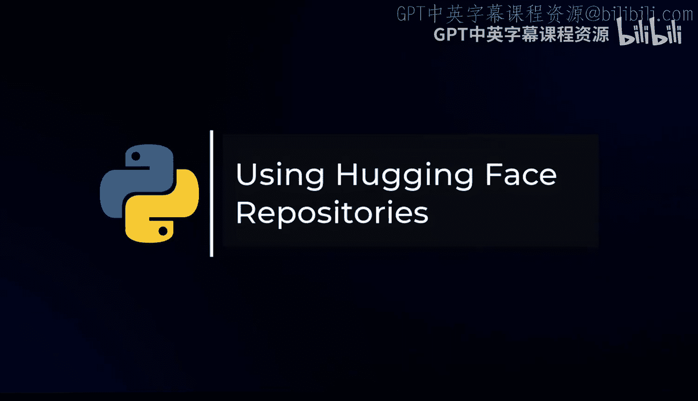

Let's get started with hugging face repositories So here what I have is the default page from Huging face I've logged in。

 I don't have any models or datas yet on my account let's take a look you can see here that I have the options to create one but I'm going to follow the documentation from hugging phase to be able to create a repository so I am going to go and use one of the libraries I'm going to open up my terminal over here I'm going create a new virtual environment and I'm going call it I'm going to call the VM module I'm just going to call it VM as well and then next I'm going to activate these as always and now that I'm activated I'm going to follow the instructions from hugging face which tell me to install these hugging phase underscore a hub which is where we're going to go through today and it's going to go。

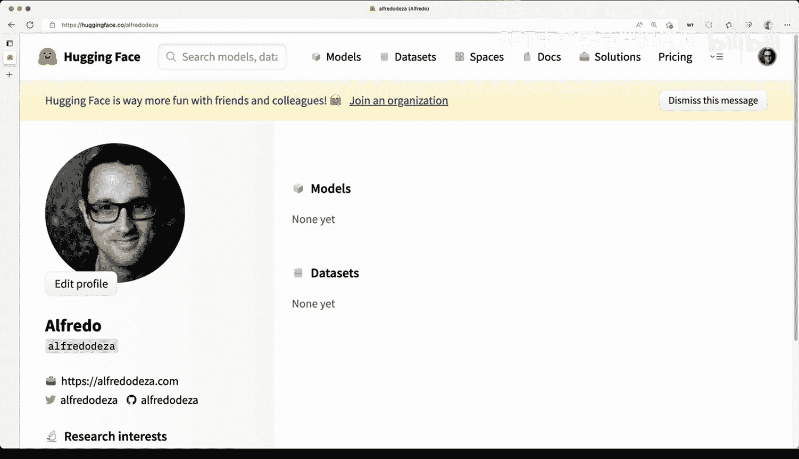

And install some of dependencies。 And next， I want to log in。

 So to log in is I'm going to go hugging face， dash， C I， and then logging。

And then that's going to tell me that I now need a token。

 so I have to go through a generate token from this URL over here and that's fine。

 I'm going to go back to here and I'm going to say。

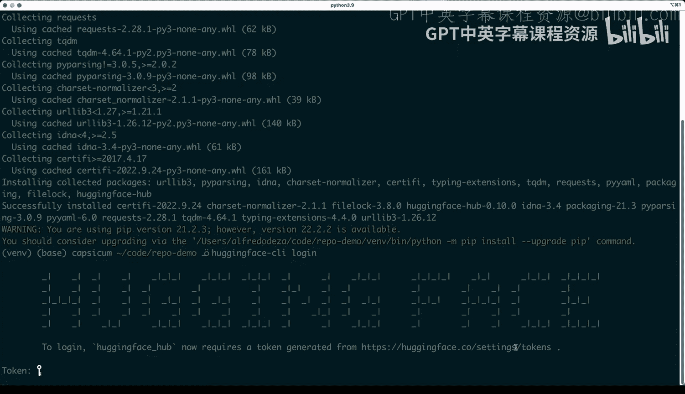

Well， let's actually go ahead and copy these。

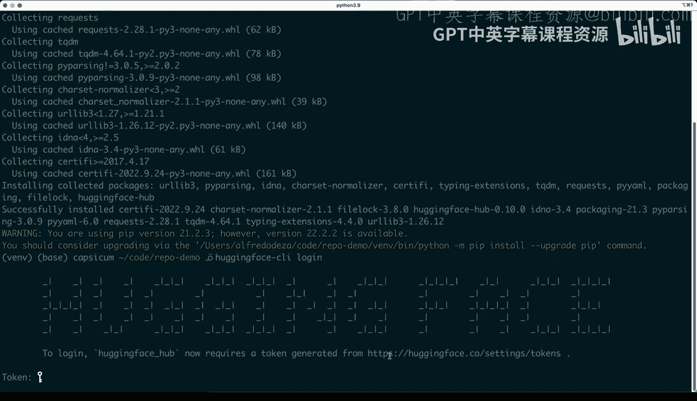

And open up that tab。 and I am going to go ahead and create a new token。

 So tokens are kind of like the ability of like have like temporary passwords for the same thing for authenticity to the same place。

 I'm gonna say this is for a demo and I want to not only read， but I I want to also write。

 So I'm gonna to generate the token and I'm gonna have this available now。

 I'm not gonna show it even though that is temporary， but I'm gonna copy。

 So I'm going to be using these little icon right there And later if I want to remove it。

 I can definitely go ahead and delete it and then that's fine。

 So I'm gonna go and copy that and then go back to the terminal over here。

 I'm going to have paste it over there and then hit return。

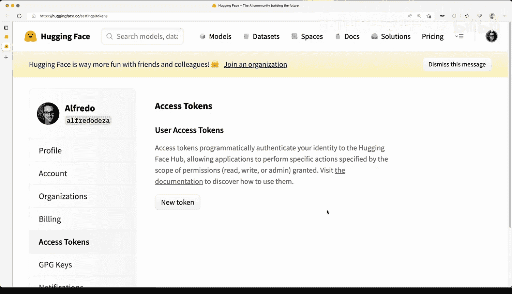

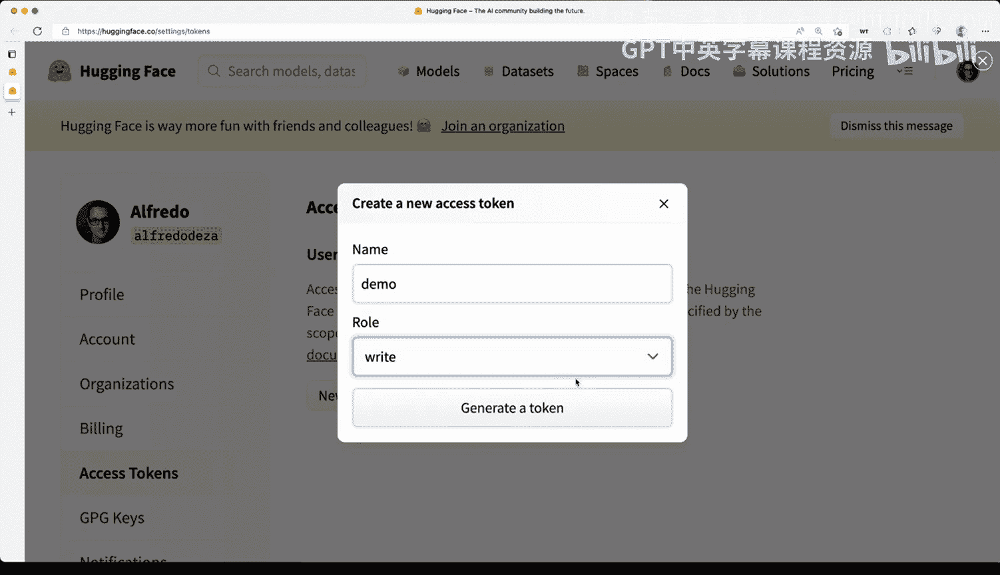

And then it says that the token has been saved to users hugging face token that's perfectly fine。

 authenticated through Git credential store， but this is in the helper defined on your machine。

 you might have to re-authentate when pushing to the hug face hub run the following command in your channel case you want to see this credential helper as a default。

To demonstrate what I want to do right now， I want to show you the website or the URL rather for the welcome the welcome site。

 So essentially what I want to do is right here。 we've already install hugging face hub now we've done the Ci login and now I want to create a repository。

 So I'm not going use the website interface So what we want here is huggingface Ci repo create and then we're gonna do we'll figure out the repo name in a second。

 and then what I want to do is upload a model。 I have a model already already a preexisting model。

 I'm going to do that。 I'm going to go back to the terminal where I've authenticated already。

 I'm going paste these this is not exactly correct。 So let's go ahead and change this。

 I'm going say demo onx is going to be the repository I'm going create and the type is model that's fine。

 I'm going hit return and see what happens。

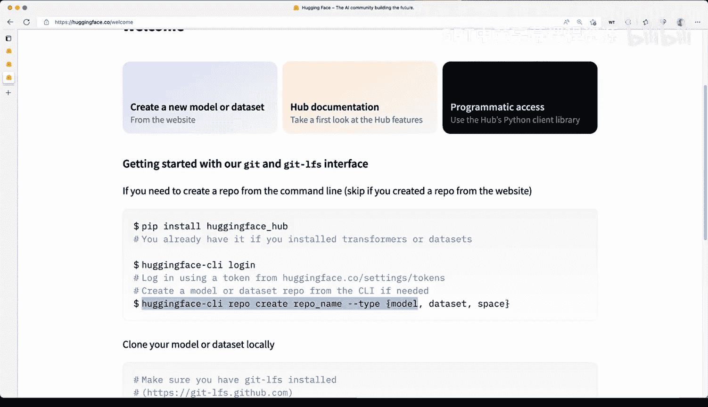

All right， you're about to create a fsa slash demo dash onex Pro。 Yes。

 I want to proceed that go ahead and perfect。 So that has been created now let's take a look and see what is what's going on here and I've opened and now there's no model card that's fine there are no files。

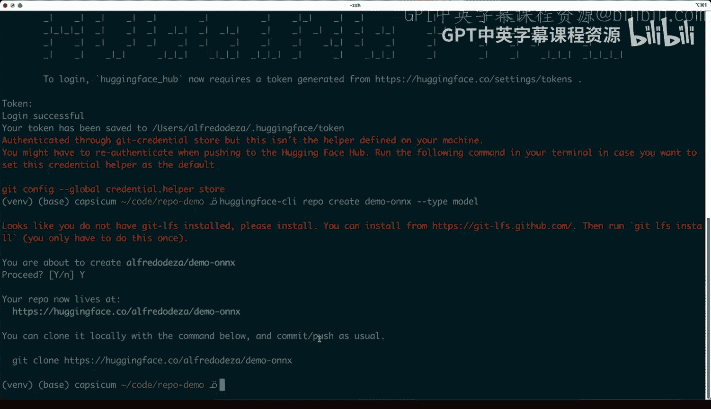

And but we could definitely upload some files so I can do that over here and you can see that I can definitely start pushing pushing some of the things that I want。

 So let's take a look at again here at the welcome page and see what else we can do So now let's try to add a model so I'm going to be able to upload a model and and then see how we can get that into repositorory。

 now that my repository has been created。 I'm going to clone it back again。

 So I'm going to create these repo inside of my repo demo and that's empty and I'm going I'm going to say I'm going clone these and now I will have I'll go to demo onx and now it's empty except a single file so I'm going to add I'm going to add these T5 very large model that I have here and I'm going to put it here and I'm going to add it。

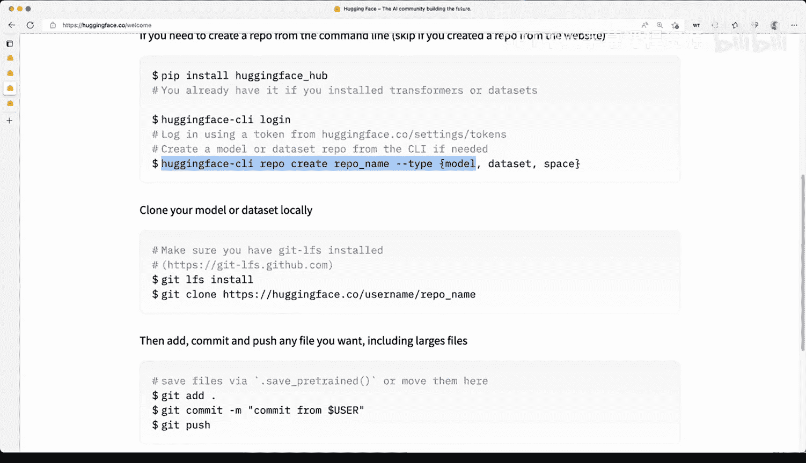

And then that's going to take quite a chunk of processing there。

 And I'm going to push it back to hugging face。 I'm going to say。Good get a push。

And then I'm going to have to authenticate again。 Now， that is that is fine。 I'm going to say。

That's my username。 and then my password is going to be the one that I used before。

 so that's one of the problems that you may have if you're trying to authenticate over over the command line too。

 but I'm going to go ahead and paste my token。

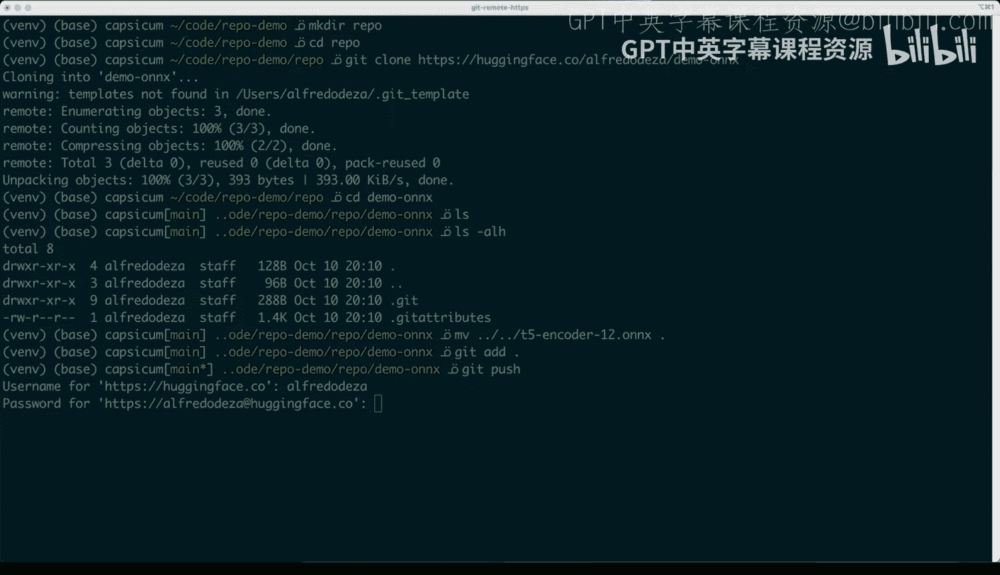

So now that I'm back on Huging face， I want to upload the model that I had before。

 so I'm going to click here and that file and upload new files if I wanted to create a new file I would have to go through the text file versions I mean you can see here that if I click there you'll slash then the name your file and then the contents and then I can commit but I don't want that I want to upload some files I'm going to click here and then Im going to drag them from my window from my operating system right here。

So I'm going to put this file over there its going to start uploading and I'm going I commit directly to the main branch and that's those changes are fine and I'm going to say commit changes so that's going to upload and this is going to take a second because this is a very very large model so I can see that my operating system is reporting that I'm uploading the very fairly fast rate I'm able to push almost 60 megabytes per second so this is going to take a second and you can see there that it was able to go through and push 439 megabytes of these T5 encoders so that's great。

 the files start with Git Lfa is to be to display of course because it's very large and now the next thing if I wanted to make this available to others and make it easier for us to consume I have to go to the model card over here and then start uploading details about how to use these。

As essentially read that MD arime Markdown father will allow me to display how these would work So if I go。

 say for example， to show you a different model， if I go here to models， let's say for example。

 this one stable deffficion。This right here is the model card。

 So you you see that it is just a maram file that you can add allow to put some documentation。

 some useful links。Essential this is the readme readme file。 So there you go。

 that is how you would go in and make some some updates create a repository and upload a model to this repository。

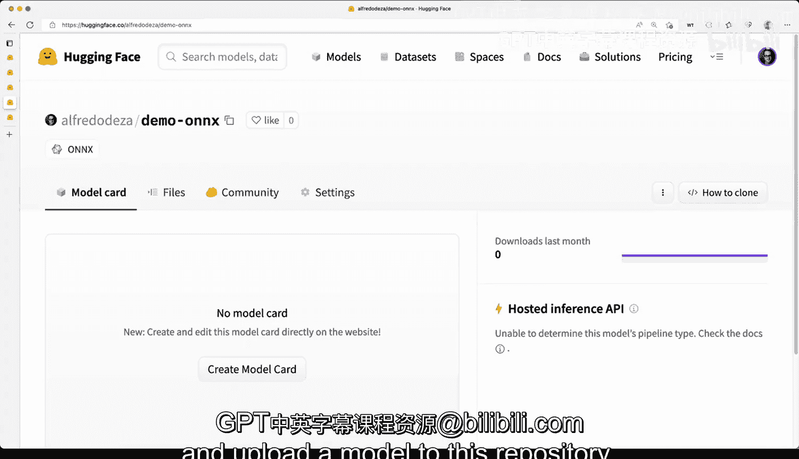