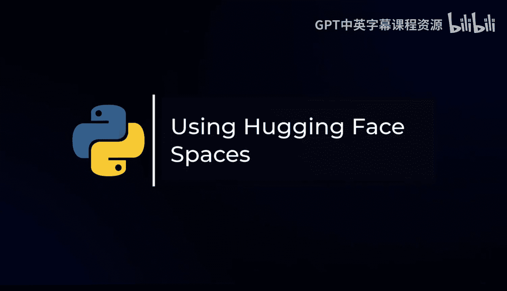
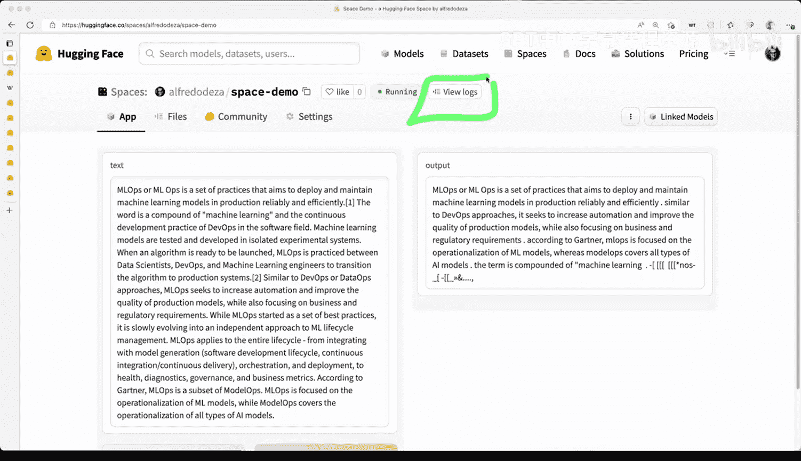

# 杜克大学｜机器学习运维｜DevOps⧸DataOps、Azure、MLFlow和抱脸｜MLOps ｜ Machine Learning Operations p159 18_02_06_使用Hugging-Face-Spaces.zh_en -BV1yE421c7uA_p159-

Let's see what hugging face spaces is all about。 We've already done a little bit of work with models and we've interacted with huggingface the platform itself a little bit already。

 but right now we're going to concentrate in creating a space。

 So to do that I am going to go ahead and create create a new space I'm going to click here on this button over here called New。

 And I'm going to say I'm going to create a new space， create an interactive machine learning demo。

 So what that is what a space is will allow us to get this machine learning demo going。

 So we'll see what are some of the options。 now you can also do this on the command tool but I' will concentrate using the web interface I have already my account over here and we'll create a new space name will'll set up a license and then I'll pick up radio you have three different options。

 You have stream lead you have the ability of。Using that I'm going to use radio like I said。

 but you can also do a static static application So this is the interactive portion of it and we'll see why that is important in a second。

 so for this one will say space demo and we'll be using a model and we'll see how that looks and for license MIT is fine for now you can actually pick any license that you may want like I said and we're gonna to make these use radio and we're going to leave it public you have the option to make it private and that's fine and so that that's essentially it like three different of four options。

 the name， the license， the space SDK， this case I'm going to use radio and then I'm going make it public Next I'm going to create create space this is going to take a quick second and you can see here that this is pretty much ready to go So let let's explore a couple of the things that are。

Needed here。 First， as always， this is a Github repository。 Next。

 you going to have to create an app that pie。 This is a requirement。

 it is kind of like the main entry point。 and we're gonna be using radio。

 So here you have this example that imports G as G and then it builds the interface and then it launches it。

 And once you're done， you can commit you changes and and push them to your application and then that's done。

 I think that for now we're going to oh and one last thing is that the requirements。

 if you have special requirements， you have to add them。

 So thats those will get automatically installed and it takes a few seconds。

 So let's instead of like going through the commandline tool and showing you all of that。

 I want to go ahead and I am going to I am going to。Creative files。

 I'm going to go to files over here。And I am going to create that app pie。

 So you can see already have a readme。And you can see that there's。

 there's a little bit of there's a little bit of stuff that was added automatically。

 So I'm going to add a file。And here I'm going to say create new file。

And I'm going to say add that by。And then I'm gonna to paste a premade ready to go appda that I already have and we'll go through it so I pasted that let's take a quick look at what are some of the things that I have paste it so first of all I am going to use transformers and I'm going to use from transformers I'm going to use specifically I'm going to use the pipeline and then I'm going to create a summarizer application now we haven't gone through some of the APIs needed for transformers for hugging face and how this all works but to demo the ability of interactive demo you have to deal a little bit with this and this is going to be enough you don't need to understand all of the inner workings on how all of these are set up but we'll cover those later but this is going to be very useful to understand the spaces and how the demo works right。

We have a single function called Trans and it's going to accept a single input called text We're going to make sure that we're not getting any any quotes or any or transformer we're transforming changing replacing quotes and transforming changing ampers that's fine this is optional I left it there because I think is a good idea then the result is this one line and when I say minimum length is 180 and then we're going to return these which is effectively the text next we're going to create the interface and the interface for radio is going to specify this single function you can see here that it the name of the function up here and then the inputs is going to be a text box what does this mean that when we create this is going to show us a text box for input and then when to say lines is 10 that's going to be kind of like the space that we're going to have available。

To input our text。 and then a placeholder， then we're gonna say， hey enter some text to summarize。

 you can put here whatever you want。 And then the outputs is going to be a text output。

 this is useful because there are are outputs。 there are， for example， image outputs。

 And then finally， this is going to launch that。 Allright， so I'm going commit that directly。

 And I'm going do that can press a button and then up here。

 you can see that there's this thing called the icon has changed to building。

 So let's take a quick look at I mean， I can click there。 It's just like an image。

 but I can click view logs。 I'm gonna click here and see what's going on。 Alright。

 so there's a lot of things here going on。 and you can see these mostly looks like。Like a docker。

 like a Docker log output。 And that's right。 This is Docker log output。

 And you can see here that is using Python 38 and it's copying requirements。

 that text and it' creating some some of the defaults that these application will need to run Now that's all good except we now are getting into trouble because requirements the text is a file that we do not have。

 So why is that important， Well， because if I go back to our app pie。 we're importing。

 we're using transformers， but we're not we're not importing it and we're using Tensorflow and we're not we're not installing it。

 sorry， like we we are importing it and we're not installing。

 So let's go ahead and create create another file。 Now you will see that here we're building up here。

 but because we don't have the requirements。The application will try to start behind the scenes and it will fail。

 so we'll probably if if I'm not fast enough， we'll see that this becomes an error。 Alright。

 so I'm going to go to files again。 I'm going to create a new file and I'm going to call these requirements text。

 I'm going to say requirements。Text， and then I'm going to put transformers。 and I'm going to use 4。

21。2 in Tensorflow 2。9。1。 Those are things that I know will work with this demo。

 and then I'll commit them directly to the main branch。 So I'm going say。Create requirements。

 text and then commit new file and then that's going to trigger the building again。

 So if I click logs again， you can see here what I was telling you before application startup is telling me the module not file module name transformer is not there so this is an error and it's something to to be aware when you can see here that we already got into trouble so this is runtime error and and that's fine so。

When you have a problem with the things that you're adding to the space。

 you will get into this runtime error and red button here if you're not taking a look so verifying once again the logs well it is no longer output in anything because right now it should be building it should be building again so let's wait a second and and wait until that that building works and it completes so that we can check this space running。

Al right， let's take a look at the logs here。 Several things have been going on and you can see here that the dynamic downloading of the models is happening and a lot of the things required for these to be to work effectively is going on behind the scenes I clicked on the logs and you can see that the logs are coming from the container there that might be kind of small to see but it says logs slash container andm I keep scrolling down here and you can see now that the application is starting to load so the important thing here is that all this is happening automatically I'm not doing anything except that in a new file and then at the very end you can see that the application is now running it has support port and that's perfect so I'm going go back to our application space demo and I'm going to click here and let's see what happens。

Alright so I've clicked there and there's a couple of different things that are happening here。

 First， I have the text box。 remember we added the enter text to summarize。 well that's here。

 that's the placeholder and then we have the output。 So because I want to lose summarization。

 I'm going paste a lot of texting here and and hopefully it will show up in the output and will interact with the model。

 So I have a page here called MLlops from like the definition from MLlops from Wikipedia I'm going to select all of that。

And when I copy， go back to our space demo， enter the text to summarize， paste that。

 and then I'm going to hit submit。Now， because there are different types of settings for the pricing models on the underlying compute that is processing all of this。

 this will take quite a long time。 actually， while this is going。

 I'll show you some of the settings here。 So I' when I click here。

 open up a new tab and you can see that I'm using the CPU basics。

 So two virtual CPUus and 16 gigs of Ram。 So this is not going to be。

A very fast option for what we're trying to do， which is interact with a T5 model and do summarization。

 So I would recommend that if you're going to do something like this。

 any any of these will work very， very well。 Well， actually even the T4 small sounds like like a good deal right there at almost half a dollar an hour。

 but if you want super fast， any of these will work。 now， if you're making a publictic， of course。

 you're gonna get hammer with these instances over there。 So let's take a look space demo。

 let's see still processing by my estimation， this will take around 90 seconds。

 So it took 70 or around 70 seconds， but I was close。 So there you go。

 that's a summarization and we did a couple of things to make this work。 we created a great OAP。

 we created the requirements that text， we install our dependencies。

The app radio app allow us to create this text input。 The buttons are already there。

 I didn't create any of the buttons and the nice CSs and a nice interactive you can see here I'm getting a little bit of garbage there。

 but that's fine。 I think this is a very solid summarization So this effectively allows you to create a nice interactive demo for any application that you may have。

 And you can see now that this is now running and you can also always access the logs。

 So there you go hopefully this is useful and you can start creating your demos。

