# 杜克大学｜机器学习运维｜DevOps⧸DataOps、Azure、MLFlow和抱脸｜MLOps ｜ Machine Learning Operations p16 23_02_02_数据科学实战-第一天.zh_en -BV1yE421c7uA_p16-

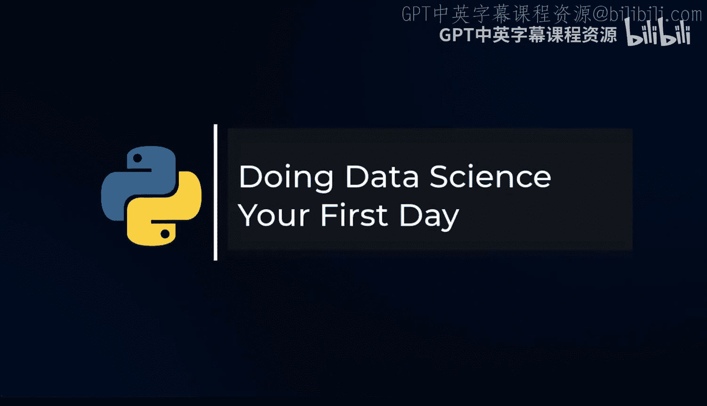

Hi， my name is Noah Gift and I'm going to cover how to be a data scientist on your first day at Work What do you do You're going to go in and create a notebook in coab create a structure ingest EDA modeling conclusion also check that into GiHub use Gitthub code spaces and also set up a continuous integration pipeline that uses NBV pluginin to test your notebook Okay let's go and get started。

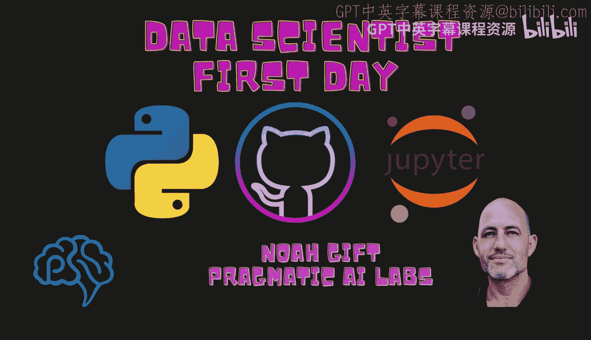

knowThis is day one here and the first thing that I typically see is in data sciences。

 the structure needs to be improved。And so what are the things that are important to do？

In terms of a structure。I think really you could divide it into four pieces。You could say ingest。

Expllororatory data analysis。Modeing。If necessary。And then conclusion。And in this style。

Is really helpful because if you think of things in this you sequence where this would be。

The first thing you do is you need to somehow get something。

 and then the next thing is to do exploratory data analysis。What do I know。

 what do I know about the data， can I do a scatter plot， are there anything that stands out。

 do I have enough data， do I need to go back and then once you have some idea。

Then we would I guess I could call this one， this would be two。

 and then this would be three is the modeling is come through and build out some kind of an idea of a prediction so。

Typically when you're modeling， you're thinking about your learning from the data and that's really what machine learning is is you're learning from the data and you're doing it maybe a prediction and you would predict。

Some numerical value or you predict a categorical value， once you've got that together。

 then you would go into step four and do a conclusion， as I mentioned before。

 what's really important about the conclusion is that you have a strong，Recommendation。Plus。

 you also have the data to back it up， right， so you can you can have a very strong。

Recommendation that but that is not necessarily good enough right a good example would be if you're a podcaster and you're not a doctor and you tell someone you you're healthy。

 don't get vaccines that's a very strong recommendation。

 but there's no data right there'll be a bad example， versus let's say an epidemiologist says。

Everybody should get vaccines because it limits your chance of serious health issues and by the way here's the actual data。

 we have the results right so you have to have both in order to be effective at doing data science。

So that's the structure。And so what I would recommend to start with is to think about doing this initially with a coab notebook if you have access to it or some kind of Jupyter notebook。

 and I'll start with just showing you like how to do that to start with。

 so if we go through here and we say new project， even if you haven't had a lot of experience with with a I'm sorry GitHub codespaces。

 it's pretty straightforward to get started， let's just pretend this is a data science project or just say data science demo and maybe put 2022。

 and then I would put in description， say this is my portfolio project or whatever it is you're building out。

And I would leave it public so that other people can see it。

And really the only thing that's important， most likely is the ReadMe file。

 it would be important to click。You might also want to do this。

 which is add a GettigOR file and the reason for using a GetigNR file is because sometimes the language itself that you use like C sharpp or Python or R or whatever may have artifacts that are really you don't want them in your project and so it helps get those out of your project and so。

Because most people that do data science are using Python。

 it wouldn't hurt to go through find Python and add it。

 right so just say add get ignorere and add read me。Let didn't create a repo。

A couple things I will point out to you about when you first start out is this is where I would probably recommend。

Putting your PDF or your your information is you don't even necessarily even need to put a PDF or a document if you want to just turn in。

A， you know， final report or your your presentation。

 I think this is probably more impactful because I'll show you why if you click on this。

 you could put in you know，Sections like， you know， background， you know。I。Looked at X， Y， Z。

 and then you could put in like。You know， interesting graph or whatever it is you want to put and it works very well to just build it out right here。

 put it into the into。Into this。 and then you have a really powerful readme file for your project。

 and I'll show you in addition how the notebooks hook in very nicely with this as well。

 So there's there's a couple different directions。 there's actually three different directions that I can think of off the top of my head。

That are equally interesting。The first one。That you may or may not be aware of。

 but many students that I teach at many universities are really interested in something called GitHub code spaces。

And what is neat about this is that。And in fact， it's saying I use it so much。 I have no more left。

 I'll just go through and delete one of these。Code spaces so I can show you how it works。

 Let's just delete this。There we go so the way GitHub codespaces works and why I think it's ideal for students。

Is that we'll just look pull this one up， data to science。Portfolio。Noop。😔，Go here。

And let's just find the last one I was working on， which I think was D， yeah， there you go。

 data science demo。And you just click on code and now most of the time when you work on a GitHub project。

 you would go like this and you could either download it。

 open it with Visual Studio but in the case of codespaces。

 this is a very new and emerging thing and in fact。

 universities if you ask your professor to use GitHub classrooms。

 they can give you access to this for free， so all the students I teach。

 I give them access to this for free。And if you click on this。

 what's nice about it is it'll set up a free machine for you。

 so a very powerful machine as well and also a full development environmentment。

So what's nice is that if you're running maybe windows you're running something where it it's complicated sometimes。

To to set up a development environment， you don't even have to worry about it。

 it's all set up for you， it's all automatic。

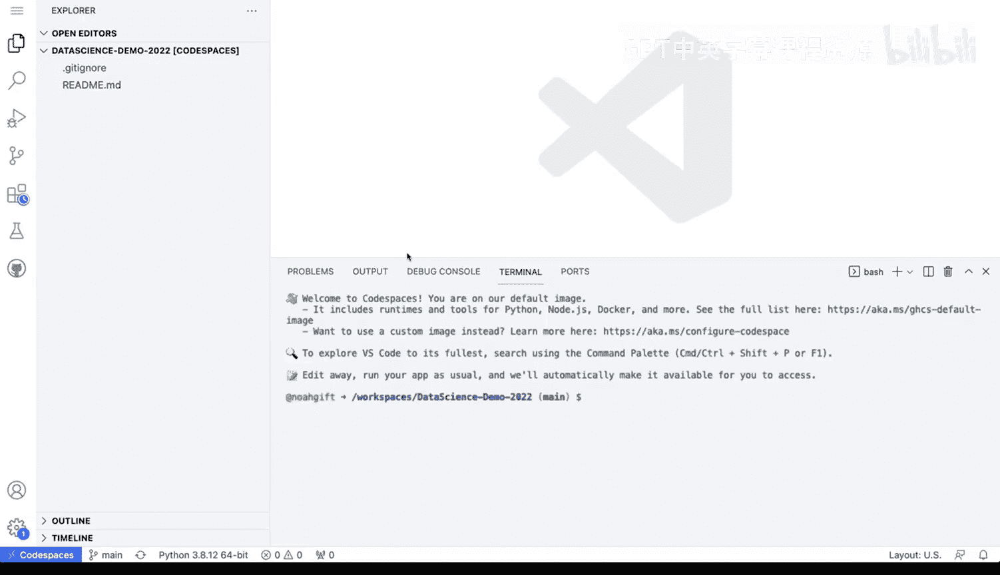

And it's got all the stuff hooked up inside， and in fact， you can even do if I remember correctly。

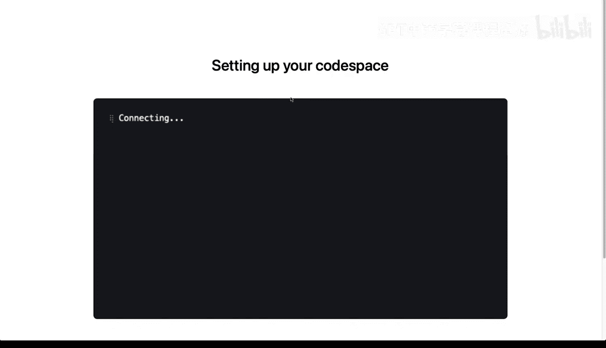

There is a way to。I don't remember off the top of my head， I can find it later。

 but in the marketplace you can actually also run Jupyter notebooks as well and you can connect to this in the background so basically there' there's a ton of it's a fullfledged development environment and I'll just show you like a hello world real quick just since we're here。

If you want to just go through and say you know touchuch hello dopyI， pretty straightforward。

 we can just say print hello right and if I go Python hello， there we go。

 we got it working and if I want to add it。I can just go here and I can do a commit。

 say adding file right so pretty straightforward process and again。

 if you want to test out different ideas， it's actually a very powerful machine。

And I can actually just go to here and go to go to my repository。And。I believe。

That if I go to code spaces now。Notice how it says it's a four corere machine。

 it's a pretty powerful machine， it's got eight gigs of Ram。

 I think I can change the machine type here。

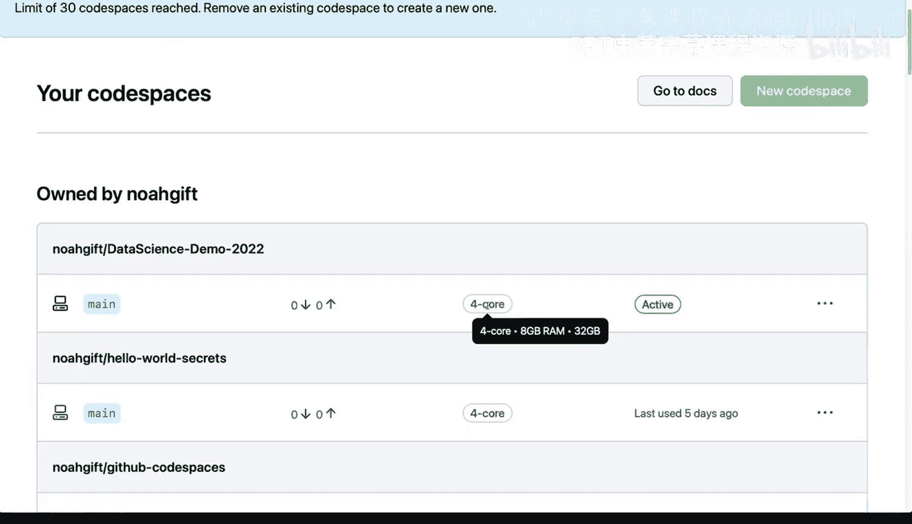

And if if you have the right environment， they even have 32 core machines。

 so if you're doing really heavyweight you know data science or whatever you could use it for that so that's definitely one thing that I've noticed a lot of students are gravitating towards so that might be one thing to take a look at now the second thing you can do。

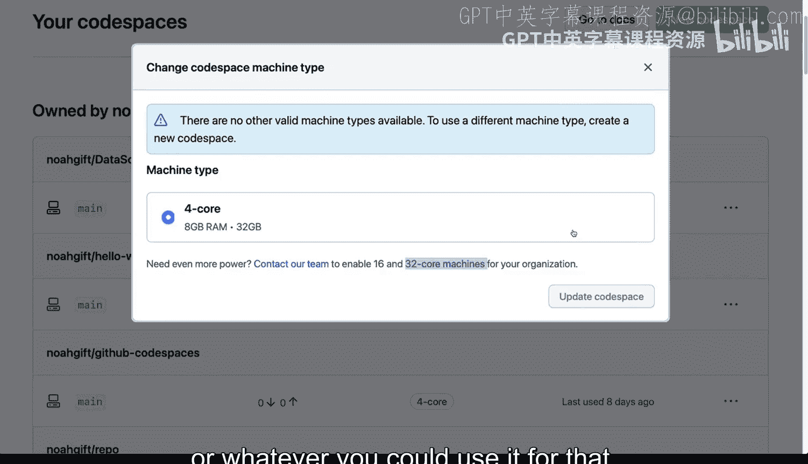

Is we can use coabab notebooks and in particular one of the things that's nice about coabab is there's actually。

 believe it or not three different versions of coab， there's the free version which is pretty nice。

 it has the access of a GPU if you go to the free version it can give you a GPU and you can do deep learning with it。

 but you could even。

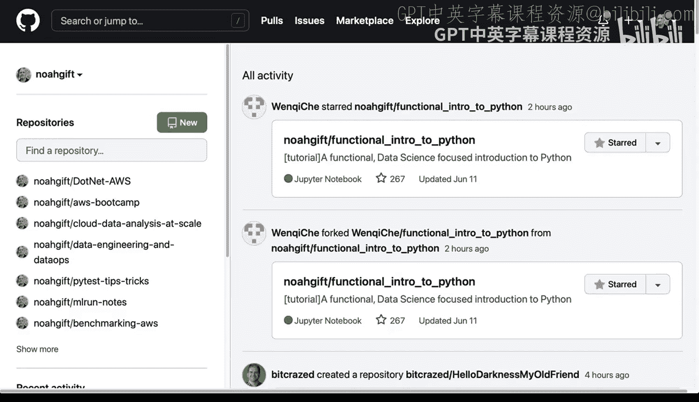

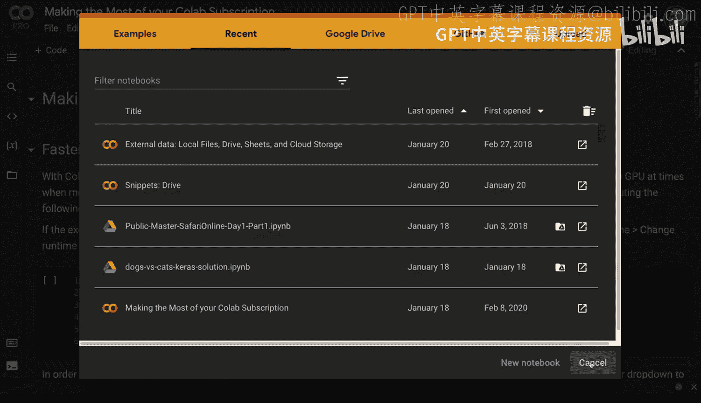

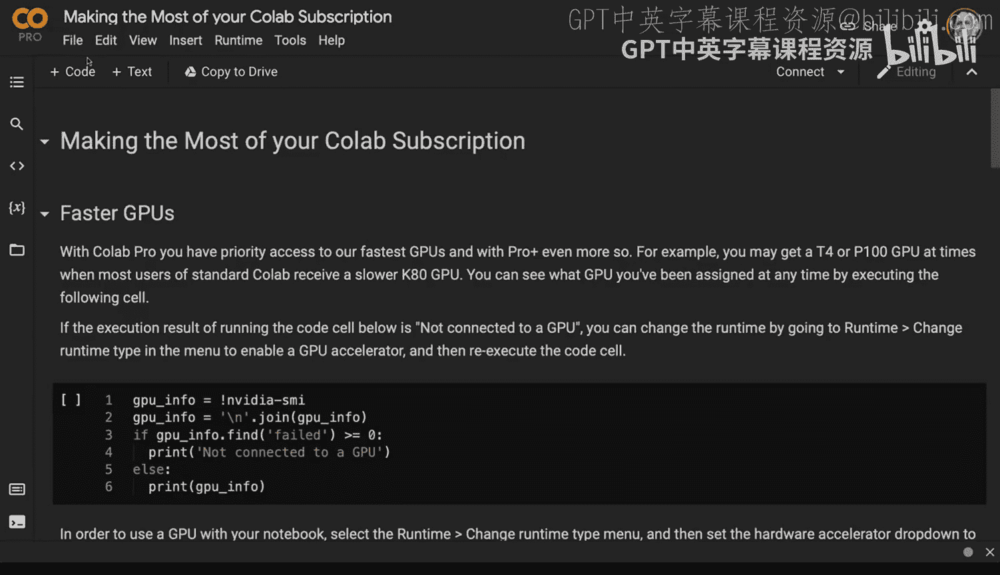

Do the pro version， which is the one I have where it has very high end GPUs that you can use。

 And then there's a third version they call it Pro plus， which is too expensive。

 I can't justify using it， but but basically。

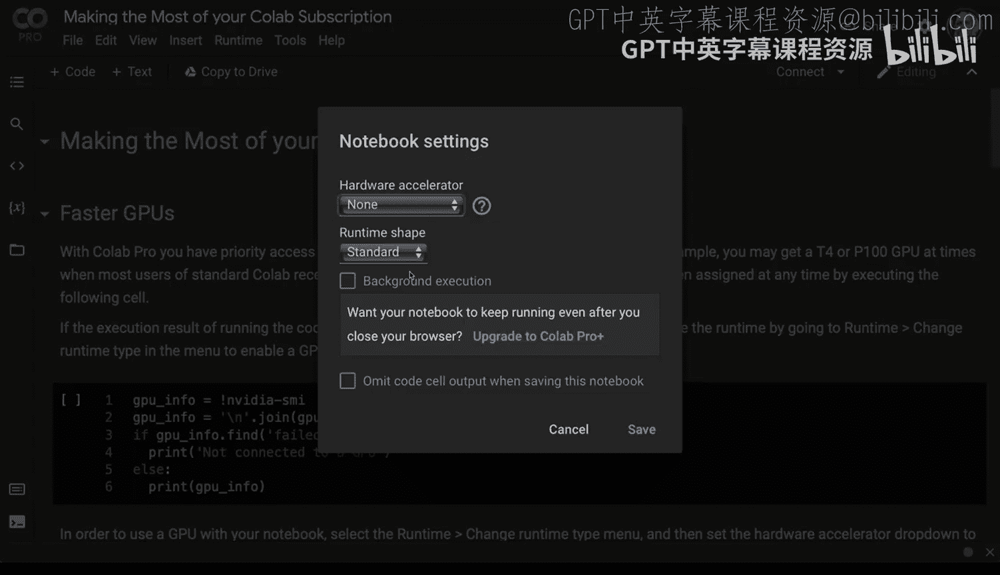

You can pay 50 bucks a month and you can actually just use it to do background deep learning so it could just sit there training jobs you know 247 and you could actually use it instead of you buying a GPU so this is also a very interesting product for students and for people that are doing deep learning and doing things with GPU that you may want to take a look at I think for students probably the free is good enough or the coab Pro they're both pretty good So for me 10 bucks a month it works pretty well So I'll show you what what I see a lot of people do that I think is a good idea is we go to file。

 go a new notebook we start with a brand new notebook。

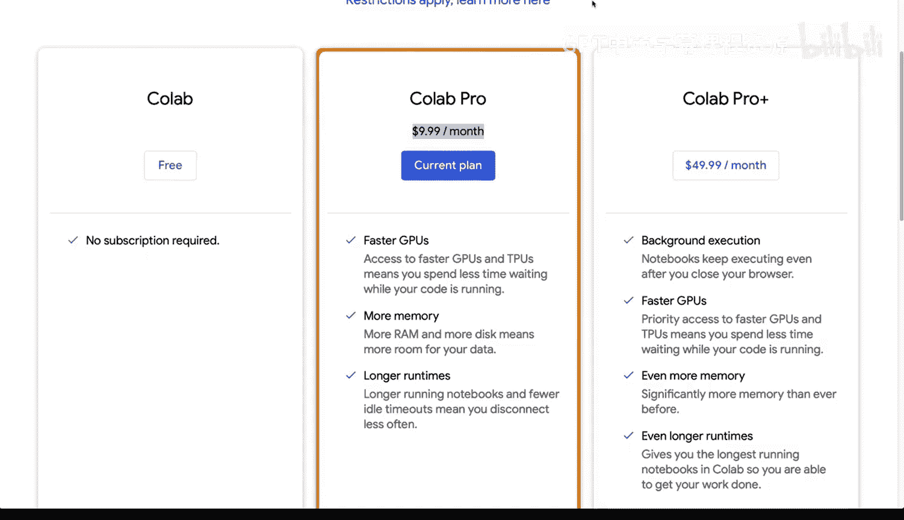

And then again， we can start with that structure that I mentioned before。

 remember there's ingestion exploratory data analysis。There's modeling and conclusion。

 the way I like to do this is first build out the name of the notebook and we can just call this you know data science。

Noebook。So we've got the name here and then I would build a new text cell and I would put it above。

 and then I create a hierarchy， so I create a structure inside this notebook。

 so I say first two hashtags and I say ingest。Like this and then notice that I can create multiple of these so then I can say EDA。

Like this， and then I can make another one and we can say modeling。

And what's really nice about this is again， it creates a hierarchy that I can use。

And then I can put my conclusion。And then if other people start to use this notebook and it becomes。

 I mean， many projects that I work with with people that are doing data science master's degrees。

Their notebook could be 1 thousand lines right it's almost too complex to look at unless you use something like this because then you just do this。

 you just say， yeah， let's not look at that， let's not look at that。

 let's only look at this section right and you collapse it and then if you click on the left here。

Notice now it has a table of contents so you can actually go through and you can just toggle through all of the different things。

 So this is very， I think。One of the most important ways to structure。

 you know a notebook and then when you get into modeling， for example。

 this happens a lot of times in a machine learning class I know many of you are interested in doing machine learning what you could do is you go through here and then do another subsection and then you just say。

 for example， you know classification。Algorithm1。Or A then and then have another one that's like。

 you know， empty one and then maybe you know。Classification。Algorithm。

B right and so then the idea here is again you can just you can tell people， hey， don't look at this。

 don't look at this， we're only going to focus on the modeling for the next half an hour and let's just go through the code together and we're going to look at this right so the hierarchy is really nice So once you've got that set up。

Then what I would do is I would go to file。And I would say save a copy in GitHub Now one other thing you can do that is really nice if you're working in a corporation or on a very long-term project is you can actually create multiple notebooks and put them into a drive which is actually really nice。

 but I think for portfolio projects and for student projects I would recommend something like this where you just say save a copy in GitHub and then what it'll do there's a hook right into the GitHub and notice this little checkbox says include a link to collaboratory。

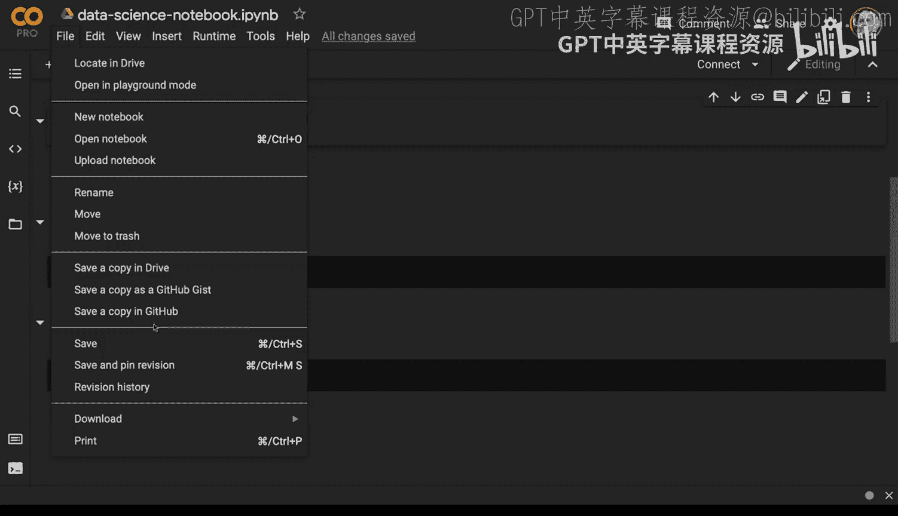

And what's nice about this is it'll open back up again and so if I go here。

And I scroll down to the data science demo right here。

 I can click on this and I could even do branches if I wanted to。

 but I'm going to say go ahead and say okay。

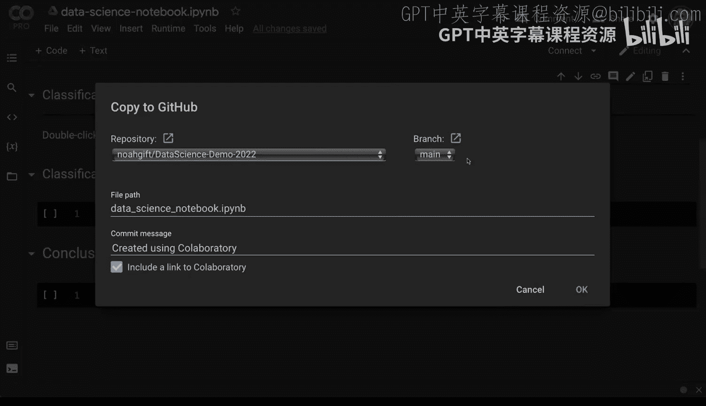

And then what's nice is that now it's checking into my project right and so someone could go through and run my code whenever they want and I could even put a link to this if I wanted to。

 I could go into my readme and just say here。

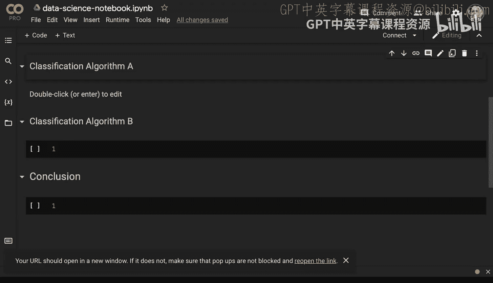

You know。O， you know， my notebooks or my notebook or whatever。My notebook can say here。

Run my collabab。Notebook， make a URL， put this in。And then if I save it out。Here。

 someone can click on this link right and they can click on it。 And then if they want to run it。

 they just open this。 They click this button， it opens up the code。 So when you're running real code。

 it's， it's very nice， right， so the idea here is it's got organization and it's 100% reproducible。

 So that's the structure that I would recommend for。

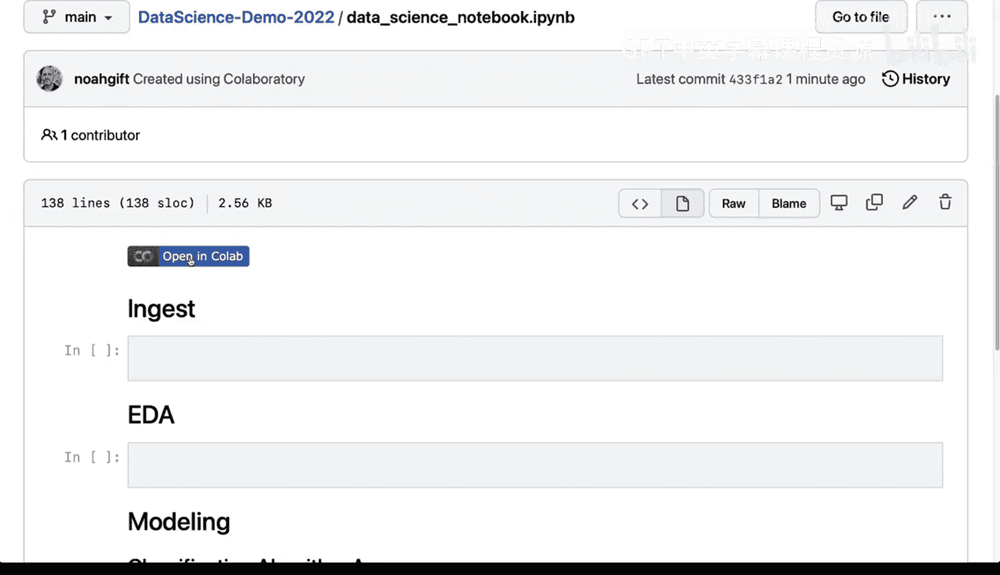

I've taught probably thousands of students now， this is what I tell them to do。

In terms of data science， I've taught thousands of students。

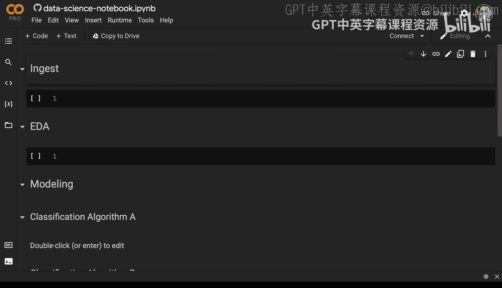

Now let's move on to the next section， which is let's now get into a little bit of code。

I have another notebook that's a data science notebook here。In minimal Python。And inside。

 and I'll put this link into the other repo in a second。 In fact。

 I guess I could just do that right now。 Let's just do that。 Let's put the link into。

Dta science demo， we'll just say。You know。A full data science notebook。Okay， there you go。

And in fact， that's not exactly the notebook I want。 I want this one。 Yeah， this one right here。

So we'll go back here。Andput this in。Okay， so when I go back to this notebook。

 this is a more realistic kind of real worldl data science notebook notice again I went through here and you can see there's a bunch of structure for this notebook。

 I can also click runtime and depending on what it is I want to do I can change it if you have the pro version。

 there's actually a high Ram so sometimes this is actually nice like if you're doing a huge data visualization。

 it actually can be nice to use more RA or again， if you're doing GPU。

 you could just pick GPU but for now I'm just gonna to do the regular runtime here so I'm going to connect to it。

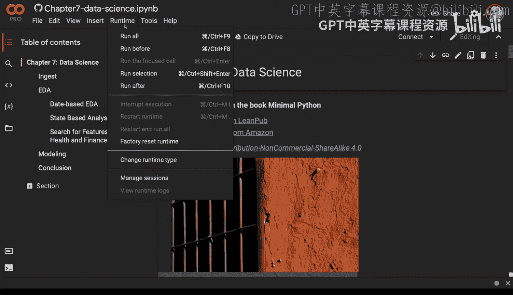

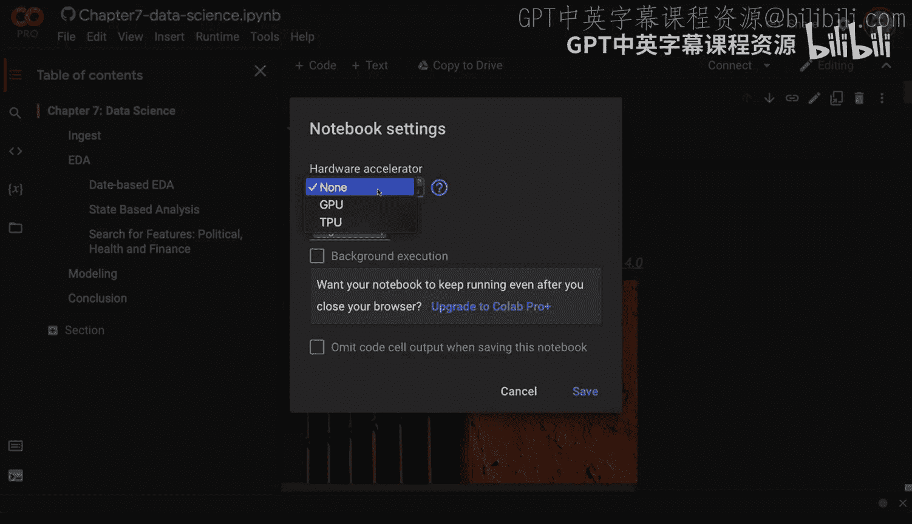

And let me just show you some of the things that I typically will do and a couple very subtle things here。

One of the things that you can do in a student project or a portfolio project is to make it so that。

You're not。Telling someone to pull in data that doesn't exist for them。

So I think this is a very subtle thing， but if it's a portfolio project。

 I would recommend you link directly to the data so that someone， look。

 you can run the same thing that I run， you can just click this button。There we go。

 and it just runs the code there's no like。You know。

 I have to call someone up on the phone and say hey， what happened， where did you get this data。

 I don't know what this is like you just click the button and run it One of the things that's nice about the pandas library。

Is that you can say PD。Dot read CSV， and it will read in a URL that has a CSV。

 So if you found one in this case， this was from。The New York Times， I forget when they did this。

 I think this might have been too。

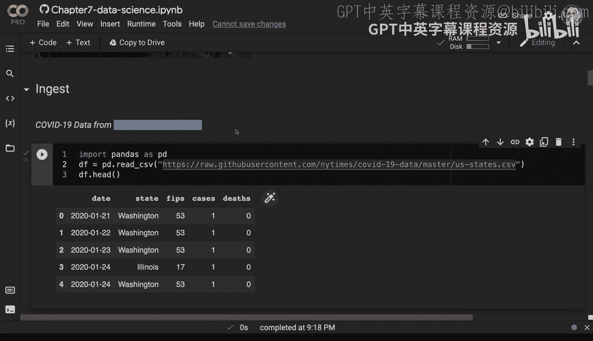

Two years ago， I think I started looking at this data。

And it's nice is you just you know they have different data science projects that they do and you just link to the data and you're good to go。

 So I think this is a really nice technique because then it's completely reproducible And then from here this is where I would go in and I would start to look at the data a little bit。

 So if you're not familiar with Python or pandas。

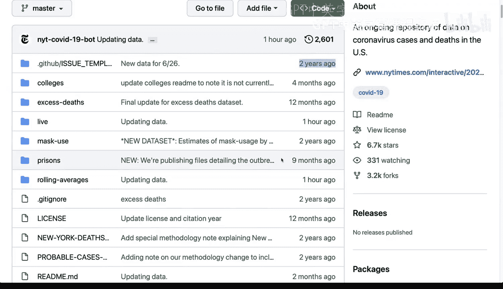

It's fairly intuitive， you can think of the Padas library。

As essentially doing what Excel or Google Sheets does is it looks at a bunch of columns and rows。

 that's it， that's really what it does and if you say DF。

 that's the convention a lot of people do is they assign a data frame to the letters DF。

You can then look at the bottom of the file right in this case。

 we can see that this is data from 2022 and West Virginia， and then I could also look at the columns。

 So I think this is always a good idea。 It's just take a look at the columns and with the pandas data frame。

 It has things attached to it。 So this is a neat little thing to know about in Python。If you go here。

And you do dot。It'll autocomple。 You can just wait， you can just wait to see what it does。

 and it'll show you everything that's possible inside of the notebook。 And so in this case。

 even I can partially complete。Right， and it'll still auto complete， autocomplete and then。

It's even better why type it right， just do tab， there we go。

 we go to tab and another little trick you can do is if you do shift question mark like that。

You can actually into a return， it'll pop up the help right， so it'll go through and it'll tell you。

You know， immutable ND array， implementing order， sliceable set， you know， et cetera， et cetera。

 like it tells you every possible thing you would want to know about that particular。You know。

 Python data type。And similarly we can also go through here and we can look at the shape right and so this is something I like to do a lot when I'm first looking at a data is I like to do DF shape。

 this might be maybe one of the most important things that you do because this tells you two of the most important parts of the dataset。

One， it tells you how many rows， so in this case there's 38，000 observations。

Which is quite a bit actually， right because this case data in the United States hass been out for a while。

And then we also have five columns here and then once I've got this。

 you know again I could play around with the data and move it around but I could just close it now right I could just say okay。

 I got it loaded， let's just hide it right let's just get rid of it and now I can just go into my exploratory data analysis and I like to think of exploratory data analysis as it's like plain when you're a kid you just go outside you play around。

 there's no rules just see what's happening in this case we say you know DF do describe。

And we can see that these are really the statistical descriptions， right， so the median here。

For the cases， the median， for the deaths， we can look at the max， so I think these are daily。

 if I remember correctly。I believe， these are daily observations。We can see， in fact。 I mean。

 just from this， we can see some very interesting data。 So we know that。

The most in the United States of a region， the amount of people that have died。

There were 70000 deaths at one point in one day， which is pretty， pretty substantial。 The median。

 though， on an average day in the United States over the last two years。

2600 people died per day of Covid。 So that's not a small amount。

 That's as definitely something that's very significant。 to be aware of。

 And then if we go through here， we look at cases and deaths in the US。

 here's what we get into things like seaborn and you know， map plot and all that。 But really。

 it's pretty intuitive to use these libraries because the way I use it， I just go to seaborn。

 and I'll just show you this real quick。

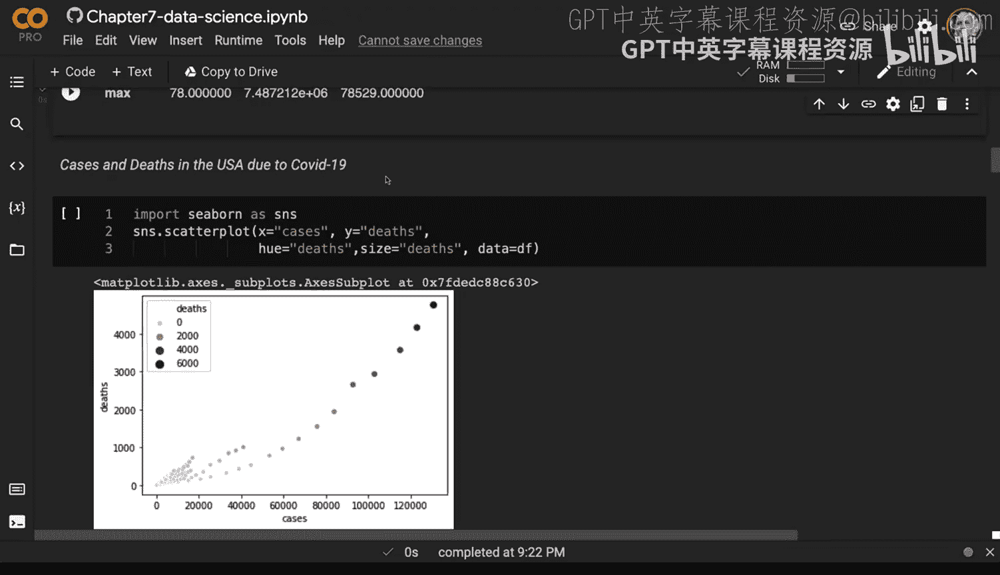

If I was going to use this library， I would just go to Sebornour。

And I would just literally copy an idea like you don't need to overthink it， just find some example。

 you know， categorical， okay， where's where's categorical swarm plot you just go through here and just find an example and just paste it in right just just go through and paste an example。

 So in this case， you know here we just say import seaborn as S and S。

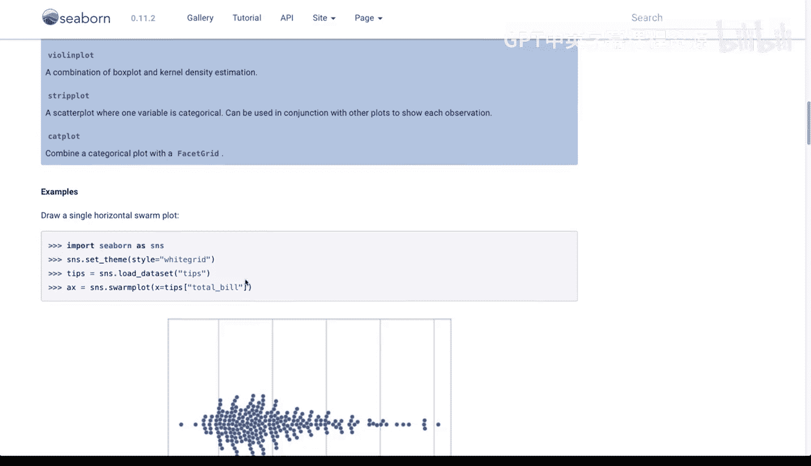

And we do a scatter plot， so the scatter plot is the column X， which is cases。

And then why we have deaths。 And then we could also do。

 you know a little bit of stuff and like make it， you know。

 bigger circles or make a different color or whatever。

 And then this is the part where we put the data inside right so this is a fairly sophisticated plot。

 but you know， it's only three lines of code。 So if I go through here and I run this。

 I think the last time I ran this was。Months and months ago。

 so this will look very different so if we run this。We can see that whoa， very different。

 a very different plot here。So we can see that， in fact。There's a lot of cases。Here。

 which is kind of interesting actually， but things look at the you can see， for example。

Whatever this was， this is pure exponential right， like pure exponential growth。

 but we all know what happens with exponential growth。

 eventually exponential growth turns logarithmic and so now we see that that's maybe a good sign。

 maybe a good sign here that potentially we see the deaths becoming logarithmic right I mean eventually。

You know if you infect everybody， eventually things will settle down and so now we can look at datebased examples as well and you know we could convert the data frame to set index here。

We can filter the data set， these are just different ideas， you know to trout out with the data set。

 you know， here's the day before yesterday and look at what's happening and so these are just again just ideas to play around with。

And then I could go through here now， I don't know why。That problem isn't working。

 sometimes older notebooks that happens。But basically。

 we are going to sort the data frame here and see what are the states with the highest deaths in cases and show the first 10。

And so we can see here that the in fact。It is actually pretty interesting because if we look at the max。

I guess you know， some of this is not reported in the news yet。

Because not everybody is looking at the data。Like we are， we're doing data science， but look at this。

 you can see that the California has had。On 120， they've had 78000 deaths in California。

 So that's that's very significant， right， because if if we look， if we go back to。This data here。

This looks like。Believe it or not， we've actually hit the max deaths ever。

This is the peak amount of people that have ever died in a day in the United States was yesterday。

So that's interesting right like that I haven't heard maybe that is in the news。

 but I didn't hear anybody say that， but that definitely would be an insight right that could be that could be significant right if we look at this data right and you can see Texas as well。

 right？That's almost matching， so we can see that basically Florida。

 Texas and California are at the peak deaths that have ever been recorded in the United States。

So definitely interesting。 and then if we go back to the max here again。And we look at the cases。

 well it's in scientific notation so it's kind of annoying I'd have to fix that but there definitely appears to be something unique happening in the last few days with COVID and then you could also go through and look at the shape of what we change and figure out the top 10 states and then you could you could basically make sure that we're only looking at you make a set so like only only pick the top 10 states and then you could build a slightly more complex plot so again the idea here isn't that there's a certain formula it's just you follow your own intuition and play around with different data and so in this particular example。

We can actually do something called an LM plot。And what this does is it's a 15 by5 plot and we can put to different height and we can put columns that are the states。

 and so we can basically look at all of the states and compare them against each other。

Which would be kind of an interesting one。

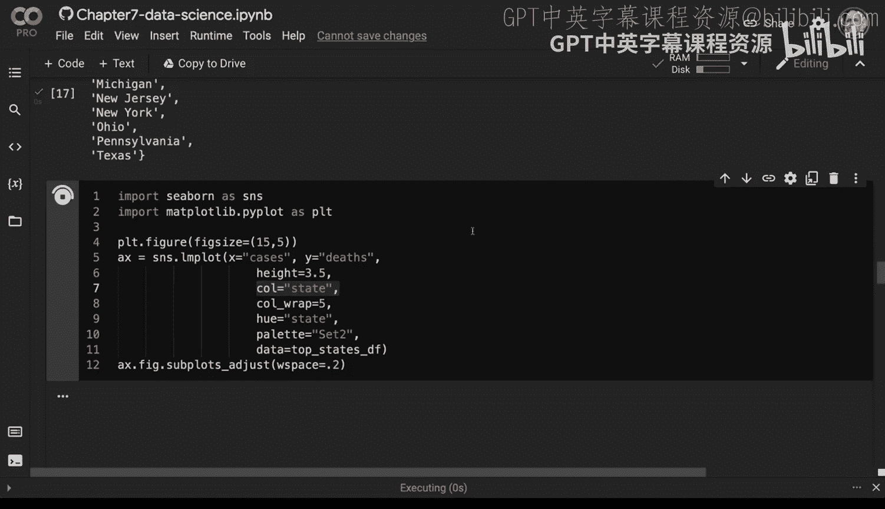

To look at。 and so if we look at this。Again， I think this is promising I mean it's actually kind of nice to look at the data yourself instead of reading the news because a lot of the news is so。

You know，Salized， but if you look at the data here。

It definitely looks like things have like they're logarithmic right。

 which seems like a good sign right if we have California。

 which is the biggest state in the United States population wise， you have Texas。

 which is I think it might be number two， Florida look。

 you see look it's plateaued right so it's basically it's not it can only go down right if it's plateaued here。

So that is potentially interesting。 you could see that maybe the natural。You know。

 phase of this could be that， and I'm just again brainstorming here。

 but that once the Omicron has mutated that potentially it affects a lot of people。

 but you know maybe things like start to level out in terms of the death rate and so you might be able to look at different states。

And see like how early they are right， like in this case， maybe Georgia you know。

 has started to hit the threshold， you know， Pennsylvania maybe it hasn't hit yet right like it's it's still early。

 but but states like California， Texas， Florida，Although New York doesn't look like it's potentially hit that plateau yet。

 once it reachs that logarithmic tabletop right there that maybe the worst is over right so again we're just brainstorming there's not necessarily a conclusion here。

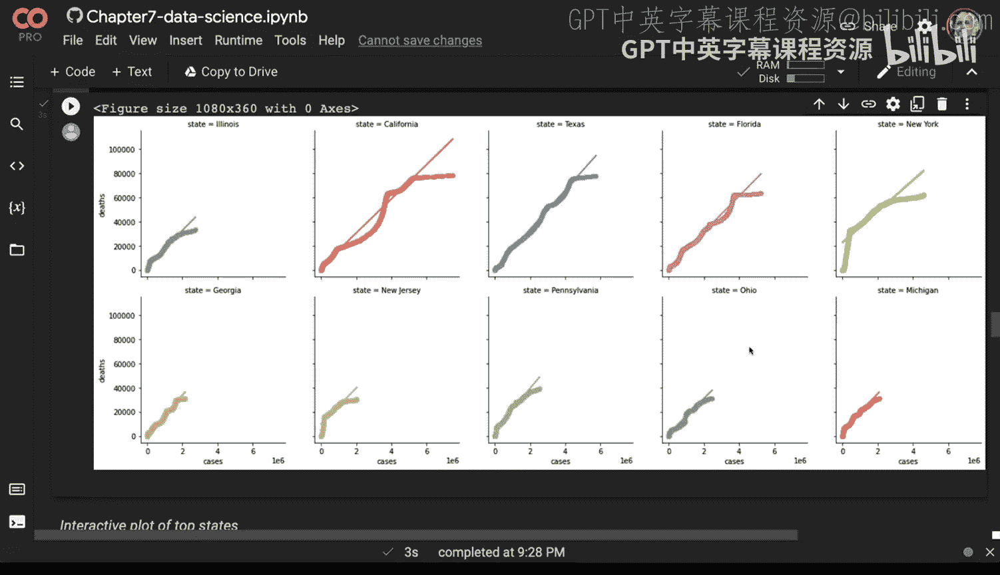

嗯。And you know， we could look at more data。 You could look at an interactive one as well using the plotly。

 this is a plotly dot I here。 And if we look at this data。We can do a scatter plot and look at。

 you know， again， kind of compare them This may not be that helpful。

 although I mean I guess is you can click it here， click on it here。

 but this visualizations a little bit messy， maybe doesn't help。

 but this is an exploration that I was trying to play around with a long time ago like two years ago。

 it might be more interesting now， which was I wanted to look at you know the essentially how much。

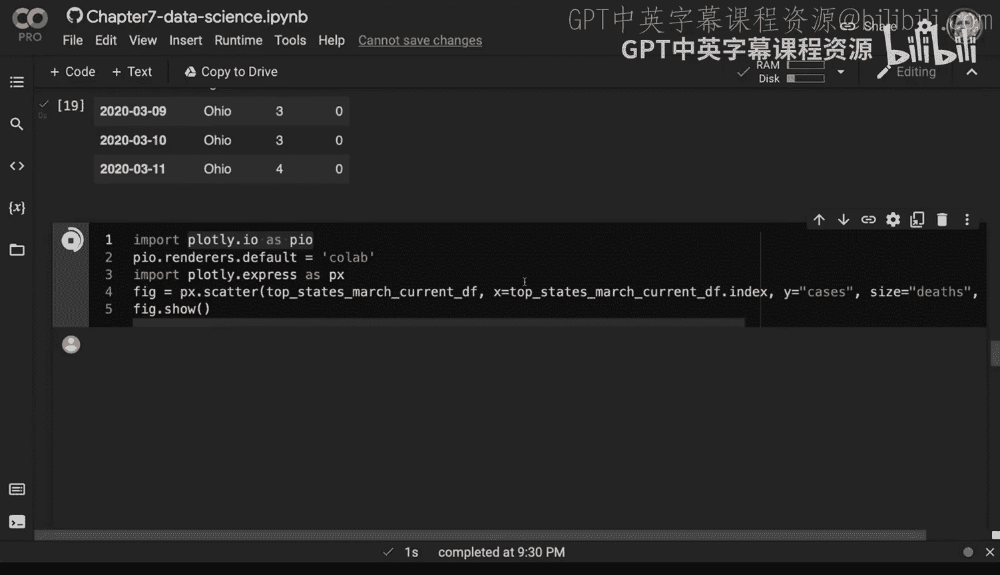

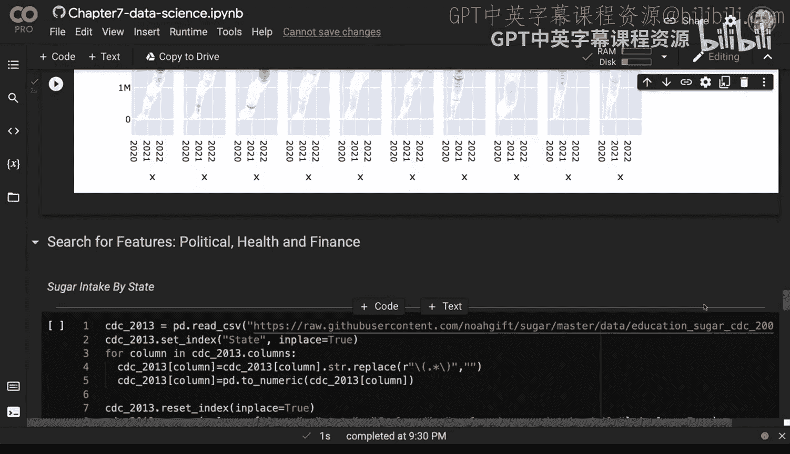

The people in the states would consume sugar， which we know is very related to diabetes and also low education。

And so typically that's actually in the south， the southeast of the United States。

 and then also who they voted for because we know that I believe it's there's a very high percentage of the Republican candidates or Republican people in the United States that don't are vaccine hesitant and so could that play a factor。

 like these are all different things that we could we could look at in terms of the features that we would want to look at so if I go through here。

What I did is I could pull in。The sugar intake by state。

 This was from the Center for Disease Control in 2013， so it may not be perfect。

 but it may give us a little bit of data about， you know what's happening。 Now。

 you can see here that if we look at some of these states that。

People that didn't graduate from high school have the highest sugar consumption rate right so we know that education level is highly correlated just visually I don't even have to do an analysis with your education level。

 the more educated you are right you have basically 25% of the sugar intake so I think most of us know that the sugar is actually poison the more sugar you have the quicker you die so people that are more educated know that they should avoid sugar so they don't get diabetes。

 obesity。And so then if we look at the sugar data， we could combine it with COVID 19。

And we could see like， you know， is there something going on and then we also could pull in the election data from 2016 now it would be again。

 I didn't have this data because the election didn't happen。

 but it might be interesting and this would be a good project for a student pull in the 2020 election data。

And find out which states went for which candidate and could we look at something that's happening like if you vote a Republican well we know many Republicans don't want a mask。

 they don't want a vaccine and they also are more prone to I believe spreading misinformation I think there's some research around that on social media so maybe there's something where we could look at that from a perspective and so what I did here was I did I added these together。

 I used the concatenate function in pandas to take two data frames and then I used PD tod get dummies all that does is it makes something a zero or one so that I can then do some data analysis on it。

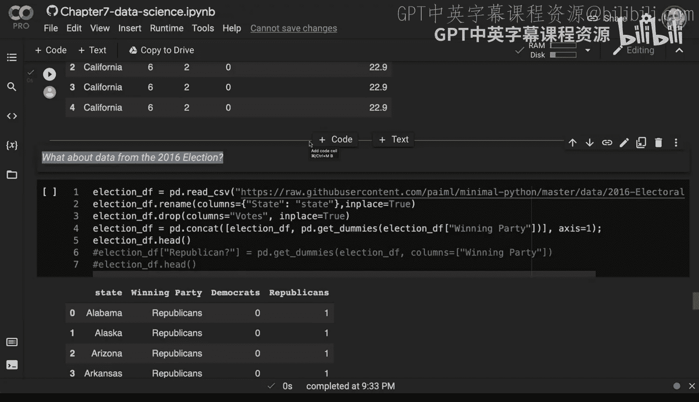

And then I can merge this in to all the data so finally。

Now we have something that's kind of interesting right， we have the deaths， the cases。

 the sugar intake and who you voted for right， so we have basically a rough indicator of whether you're obese。

 which I don't know if there's a better way to figure this out。

And whether you have poor health right because if you're high sugar intake。

 most likely you're unhealthy， also the we know what political affiliation and so does that give us anything。

 let's see what happens， where we could generate a correlation。

So the way you do this in data sciences。You do the correlation to see are there things that are correlated with each other。

 so what we can look at is， for example， Republicans still surprisingly or negatively correlated with deaths。

 at least in 2016 election， I don't know for 2020。 So thats to me。

 that's a little bit unintuitive so。Why is it that the states that weren Republican？

Maybe it's too high level， we need to go granular and look at it from a county level。

And then also the sugar intake right is not what I thought it would be negatively correlated。

 so there could be much more data that gra granular look at the data to really figure out what's going on what I thought was happening is not happening and so I need to look into the data more and visualize you what's happening and you can see kind of a scatter plot here。

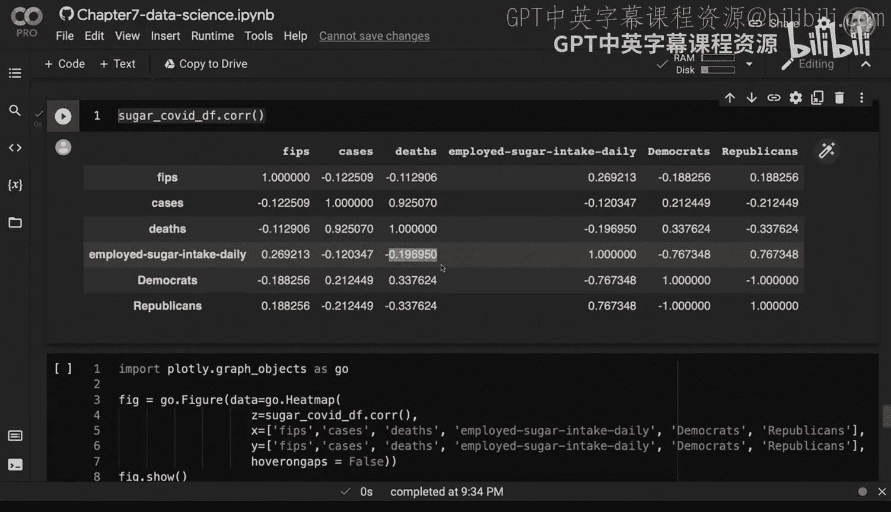

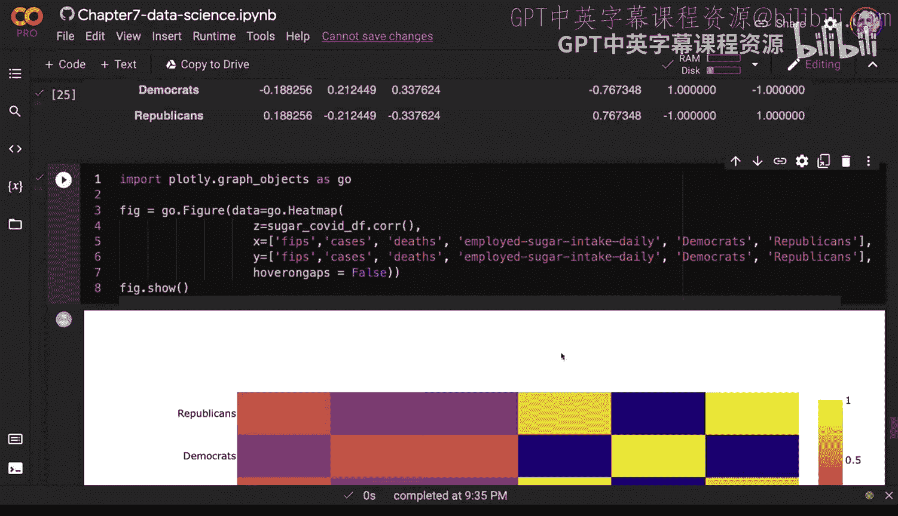

So and then this is one thing that I see many students struggle with when they're using collab。

Is that， okay， I did this Explor to analysis and then how do I get it out Well， fortunately。

 once you've done some kind of data frame。You can use this part right here。

 you can say sugar COVID data frame dot to underscore CV， and this will build out。A CSV file。

If I run this。Now the question is how do I get it out Well fortunately， pretty straightforward。

 if you go to the left and you go to this icon here and go to files。It'll appear inside of the list。

 All you have to do is go to this hamburger menu。I think that's what it's called and you click on download。

There you go and now you've got the data downloaded to your desktop right so very straightforward as well to pull it out if you want to。

 and then I guess you could even do this So if we go and we just say file，To save a copy in Github。

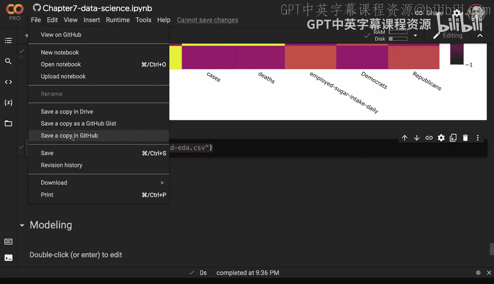

I could even， if I wanted to put a different message or whatever。

 but I'm just going to save this to the data science portfolio thing that I was creating， here we go。

 data science demo。

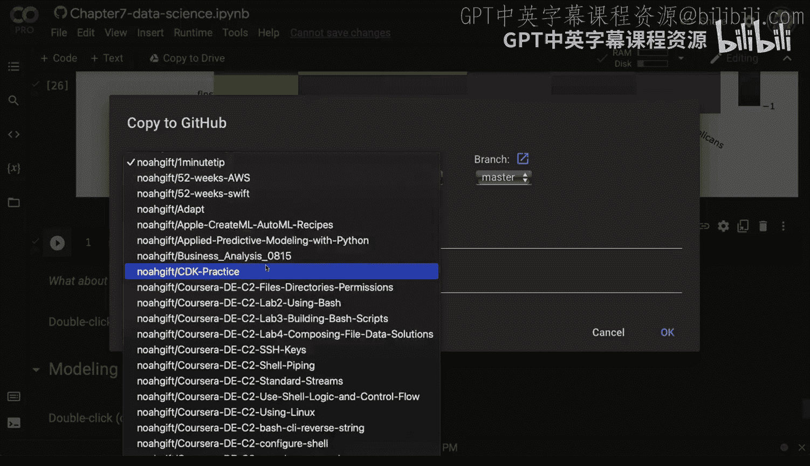

And do you okay？And then the other thing that I'm going to do。

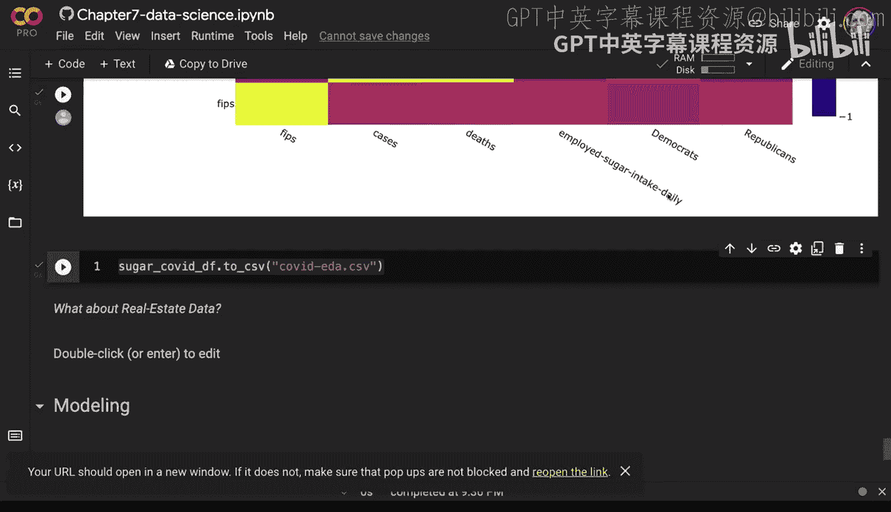

Is I'm going to go back to that that that section here。 double check that it exists。 there we go。

 right， So we see that this thing， this thing exists。 So I could put a， I could put a link here。

 I could change that other link and just say。

You know， a full data science notebook， let's change it to this。And you could even do this。

 you could say。You know， here is my raw。Data。And。What I could do。Is go to。Here。😔，Say add file。

 you don't even have to open up anything else， say upload file。

 and I could just go to that file that I downloaded earlier， which I believe is in downloads。

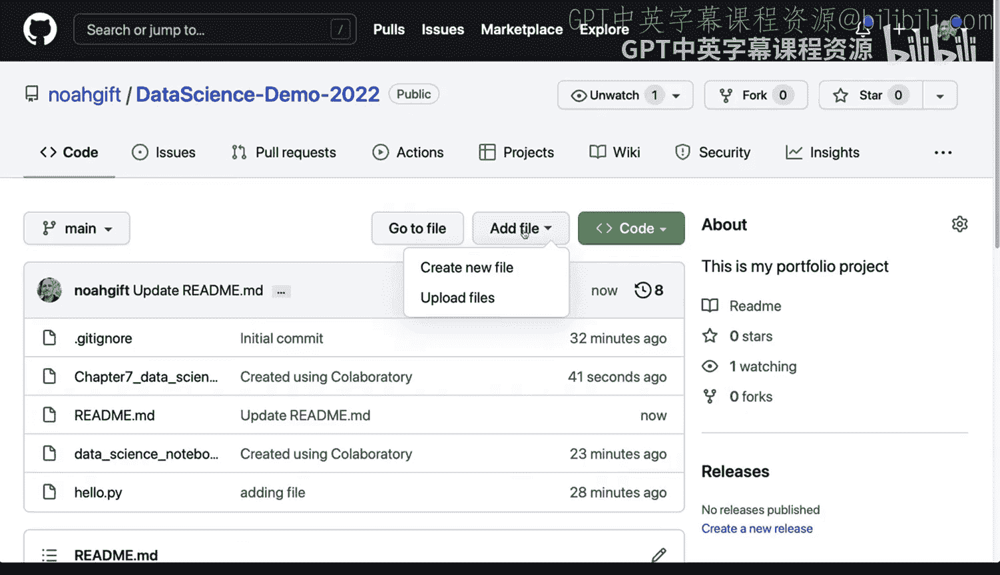

There we go。

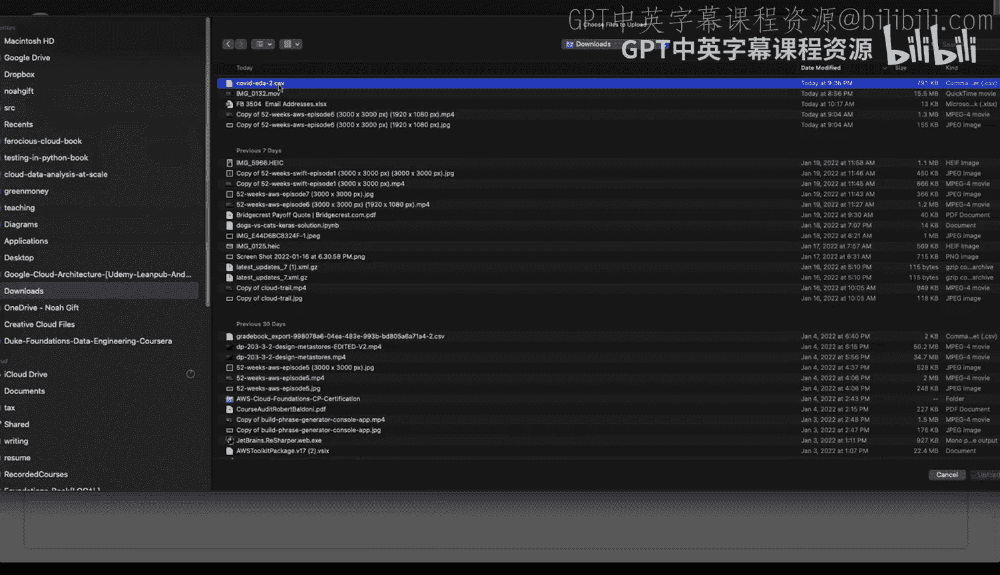

And put it right here。Committed and what's neat is that that this will actually visualize the data right inside so you can actually look at data。

Inside of here， and I believe it'll just open up some kind of visualization， oh， it's too big。

 this one is a little bit too big， but you can still look at it visually right like you could you could look at the data and if you click on raw。

You could give this URL to another person and they could do from， you know。

 pandas or import pandas a speedD， and they could just pull this in and do something with it。

 So really， this is， this is pretty nice because。We have a full round trip。

 the only other thing that we could do that would be a best practice would be。

 let's see if we can set up what I would call continuous integration where we test this automatically。

So the way that we could do this is I go back to codespaces。

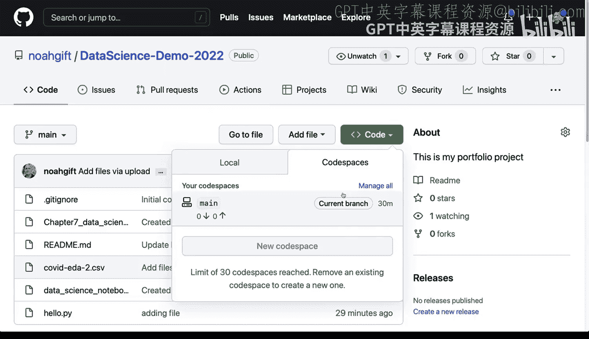

And I think we can hook this up real quick。

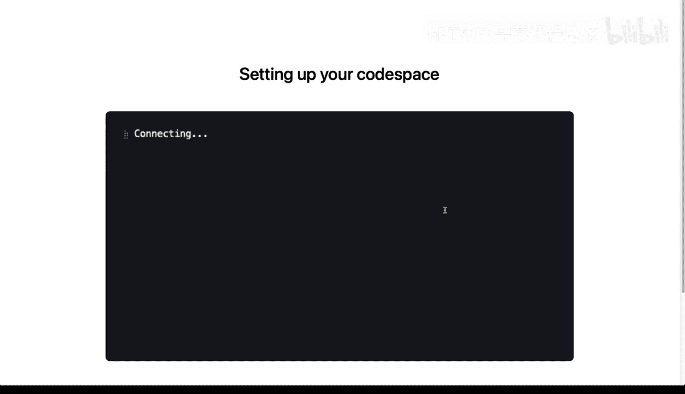

So。What I do is I say get pull。And this gets to the latest changes。 right。

 So now we got the notebook and now， in fact。If I click on it。

 notice that actually you can open up notebooks inside of this environment。

 so that that is actually another option for students is they can run。Jupiter notebooks inside。

 so again， this is why one of those really powerful。

32 core machines might be helpful depending on what kind of problem you're solving。

 But what I was going to show you real quick is to how to create a scaffold name for data science。

 So what we can do is we can do this。 We can say touch。Make file， touch。Requirements that TxT。

And then， we can。Do this， I can grab some stuff from another project I had a while back。

 which is my repo。And let's look at a requirements file， these should probably be similar。

These are where you keep your packages。And so I'm going to go through here and just paste these in。

And then I'm going to go to this make file。And I'm going to grab。The make file， let's go through。

 Let's open up a second project here。 I have one called Github actions that。I have a better。

Make fileile， just grab this one real quick。Put this in here so the idea of a make file is that you can use it to basically test your projects and run things periodically so I have an installation step here so I can just type in make install。

Let's go ahead and try that out。Okay， that looks like it's working well。And then。

Now that that works well。We could basically try a test to test our notebook。

And so how would you do this well， let's look at how I did it before。

 this was a data science project Noah Gft my Repo。Is if I go to this here， I had a test。The did this。

And I'm going to just put this inside of this project under test， I'm going to swap this out。

And what this does is it says use a plugin called NBVal to execute every single cell in my notebook。

And it'll test whether the notebook is actually valid。

 And so I'm going to go through here and I'm going to say make test and it may not work。

 we'll find out so it says。Well， didn't like something， it says。嗯。No。No module name six。

 so what I'm going to do is I'm going to create a Python virtual environment because sometimes that can help things out。

 I typically create one oh we need to use virtual environment for this。And we'll do this。

 do V E and V。😔，And then we can source this。And this is kind of optional。

 but I think if we get this to work， it could be helpful to you。

Is the virtual environment will let you install all the packages into a particular directory？

Which can make things a little bit easier。Because you get there's less weird problems that occur。

And so if we do this， this may。Run a little bit better。Let's go ahead and try this out。😔，Okay。

Here we go， and now if I do make tests。No， okay， so this is good。 This is better。 It's a better sign。

 We have this。're going we're going to give it。The path to this notebook， so how do I grab that？呃。

Rename， that's a good way to grab something。 Okay， we'll grab this。

 and I'm just going to change the make file command to do this。 So run run this notebook basically。

Okay， we's say make tests。And it's going to literally there we go。

 So we know that that's a valid notebook。 So so the reason for this is that you're programmatically testing the notebook for other people so that you know it works。

 Now what we can do， which is pretty cool is I can check all this in so it's a get status。Get add。

And this is where the gett ignore is good because you can just say get a star。Do you get status。

 it's going to check in those two files。We'll go ahead and commit this， adding tests for notebook。

And then we push this and what's nice is I can go back now to the repository and there's something called GiHub actions。

And what actions does， and you can test this out yourself， there's all kinds of good examples here。

 and in fact， they're telling you to use make files as well。

But we're just going to create an empty one。And all I'm going to do is I'm going to copy an old project where I did GitHub actions。

This is hello world Github actions。 And I， and I should just be able to basically。

Copy this inside of here。And it should， for the most part， just work。 I'm going to take out。

Everything but the test though， because all I care about is the test and the installation。

 So what it's going to do is' going to run those same commands。

 install the software and then essentially invoke the notebook over and over again。

Let's go ahead and do this。Let's try it out and now once I do this， it'll show up here。

And what this will do is every time I change my notebook and I push it in。

It'll programmatically test every single cell and validate that that notebook is a valid notebook。

 which。

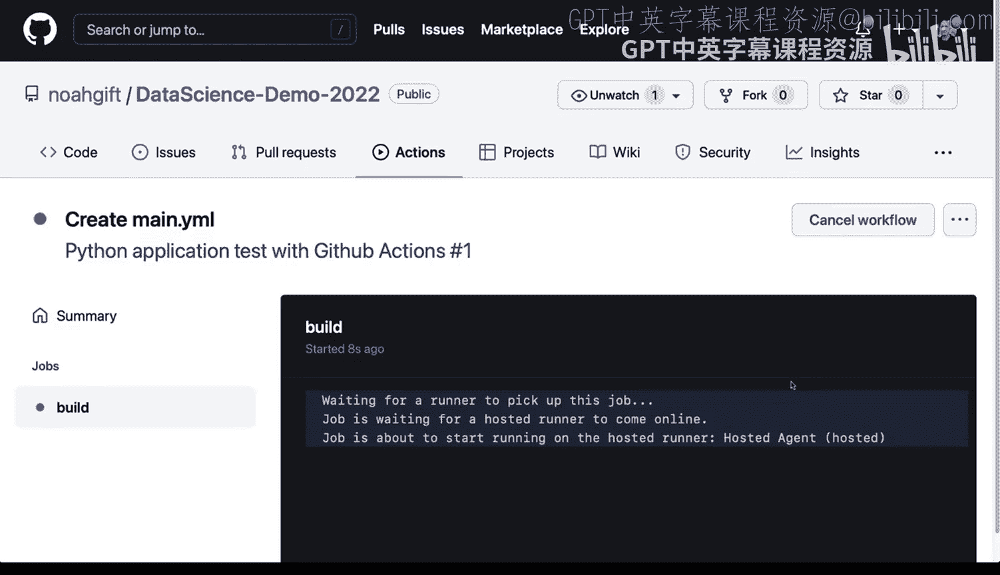

Is very helpful to other people you're working with and just it shows a level of expertise。That's。

 I think， very important to show people that you understand。The concept of testing notebooks。

 and that's just the best practice for machine learning。

 especially if you get into machine learning operations。

 I think it really shows a level of craftsmanship to do this。

 so let's go ahead and make sure this works。And if this works。

 what's cool is this is the first time I've actually ever done。

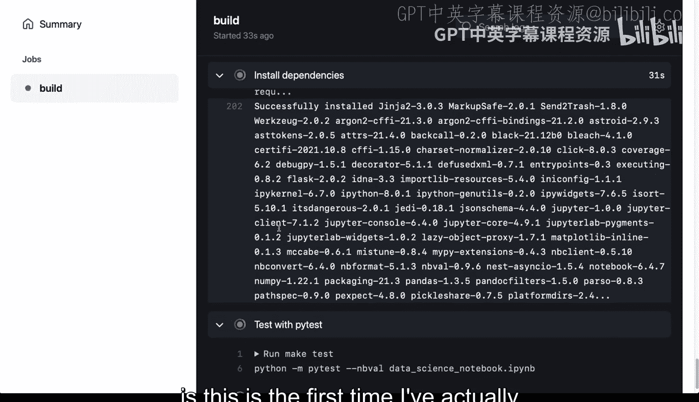

The Github actions version， I've done this a lot locally。

 but I've never used it yet with Github actions。 So there we go。 We know it works。 And in fact。

 I don't think there's many examples of this。

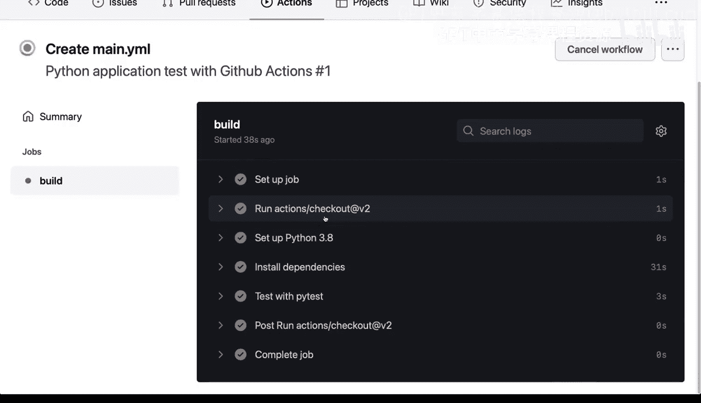

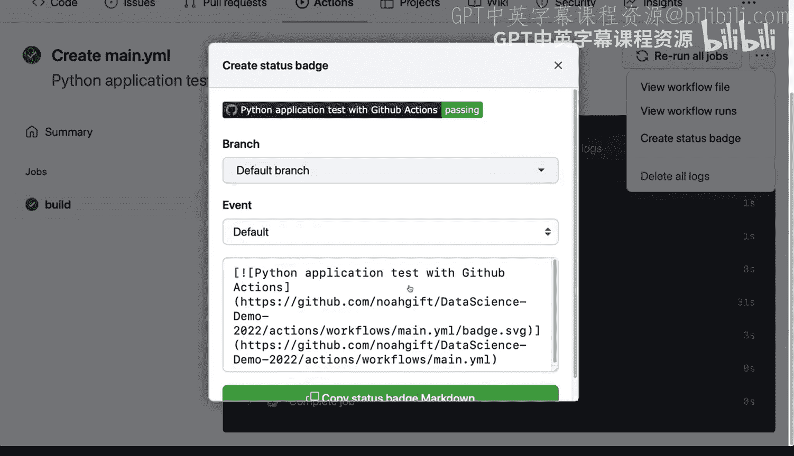

In the wild， so so you may be the first people that have seen something like this in the real world and it's very important actually because。

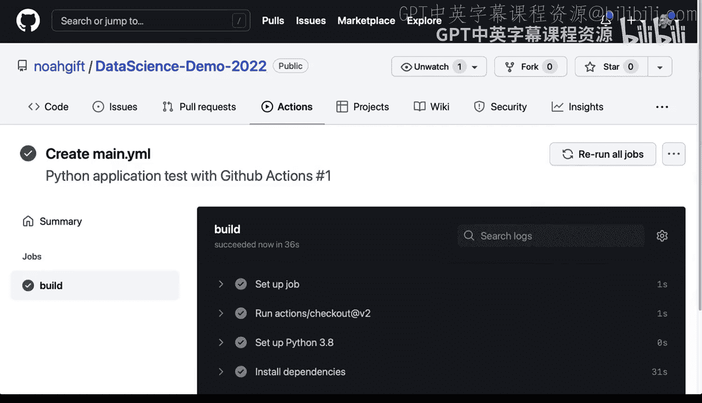

What this does is。It allows someone to look at your project and say。

 not only can I run your notebook， but you are checking your own notebook and executing every single cell。

 I am very confident that I just use your project， it works right。

I think this is a very good structure for students to start with。

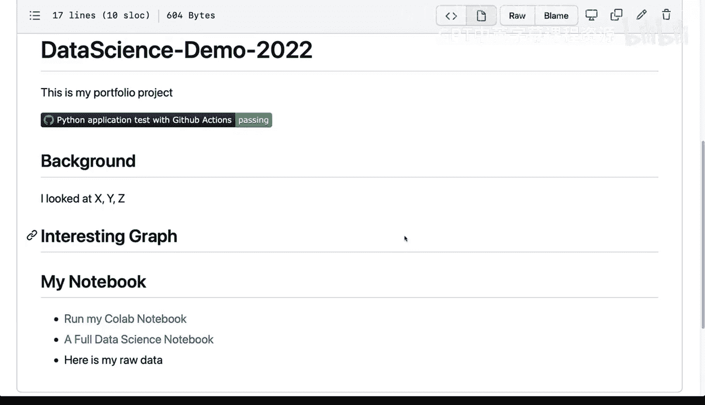