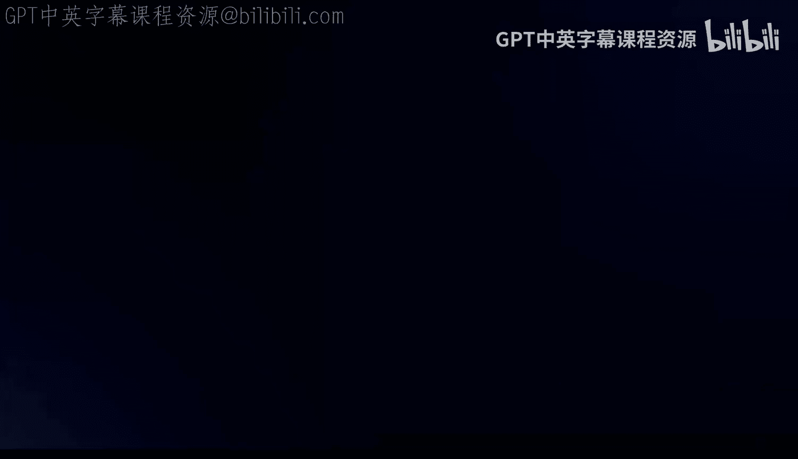
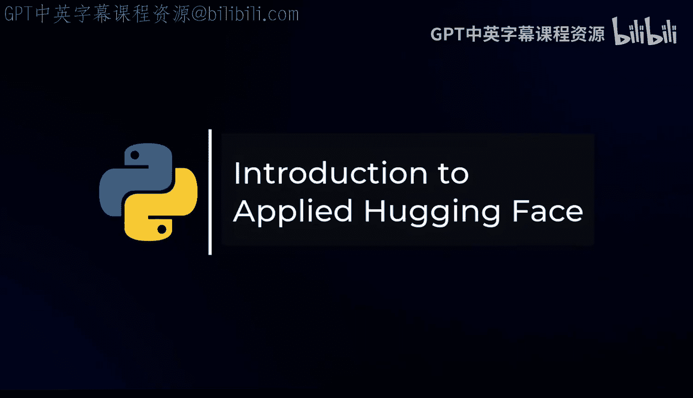

# 杜克大学｜机器学习运维｜DevOps⧸DataOps、Azure、MLFlow和抱脸｜MLOps ｜ Machine Learning Operations p160 19_02_02_应用Hugging-Face入门.zh_en -BV1yE421c7uA_p160-

Hi， my name is Noah Gi and I'm going to introduce you to Hugingface。

 a really popular new platform for dealing with large datasets。

 pretrained models and also demoing those products and what's exciting about this particular course is that we're going to cover three different categories and the first section of the course we're going to talk about how to get data into huggingface how to put models into hugging face and then actually pull that back down inside of development orments like GPU enabled Github codespaces Next in the second section willll cover how to finetune train model So essentially get the latest models from the top brands in the world that are doing AI and MLl take those models for example。

 summarization model finet a little bit with custom data and then take that model and put it back into your hugging face model repository so you can use it in later。

In the future we'll also talk about how you can use the GPUs inside of GiHub code spaces or some other GPU enabled environment to speed up that transfer learning process Finally in the third section we're going to talk about spaces a great way to demo your portfolio of building things with machine learning including streamlit and also radio both of these are great platforms to build products so let's go ahead and get started we have a lot to cover。

