# 杜克大学｜机器学习运维｜DevOps⧸DataOps、Azure、MLFlow和抱脸｜MLOps ｜ Machine Learning Operations p161 20_02_03_使用GPU支持的Codespaces.zh_en -BV1yE421c7uA_p161-

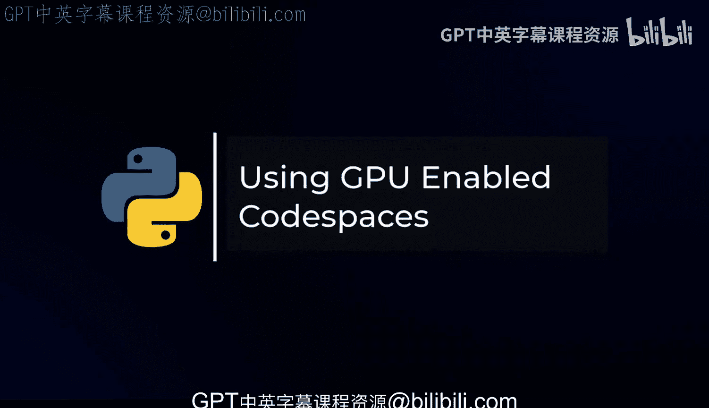

Let's dive into Github codespaces， which happen to be one of the best possible locations for students to use GPU enabled workspaces。

 You can take a look at how this works is that you have this temporary environment that you can actually code in and it actually has in many cases much more power that your laptop and it has the ability to even create prebuilt containers and so those prebuilt images launch up very。

 very quickly and you also are able to use the full power of visual Studio。

 So let's take a look at how I have done this in my classrooms at Duke University I have a organization here and this organization has an MLopps template that I've created。

 so notice that I use this functionality called public template。 And if I select this icon here。

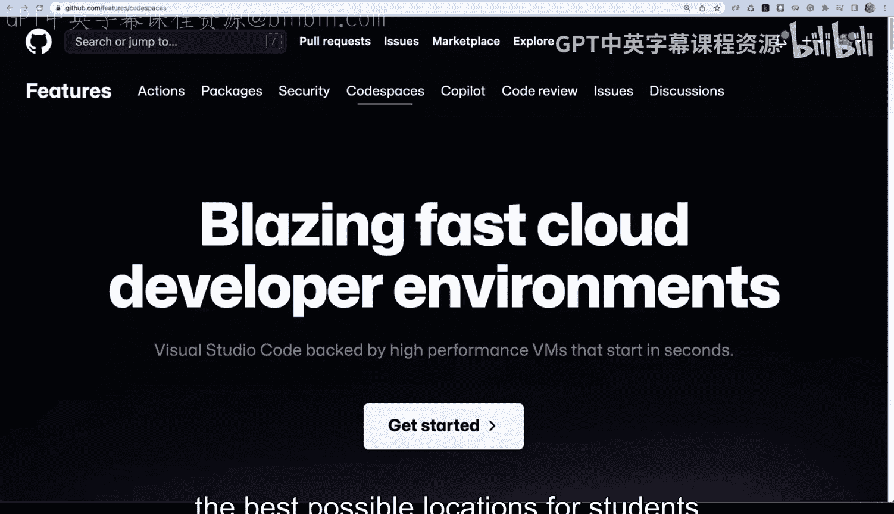

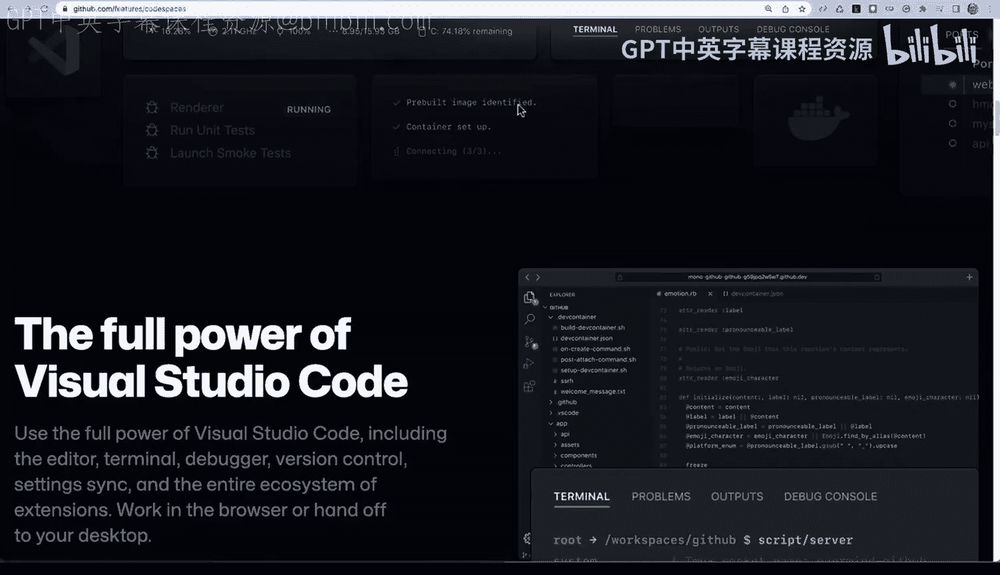

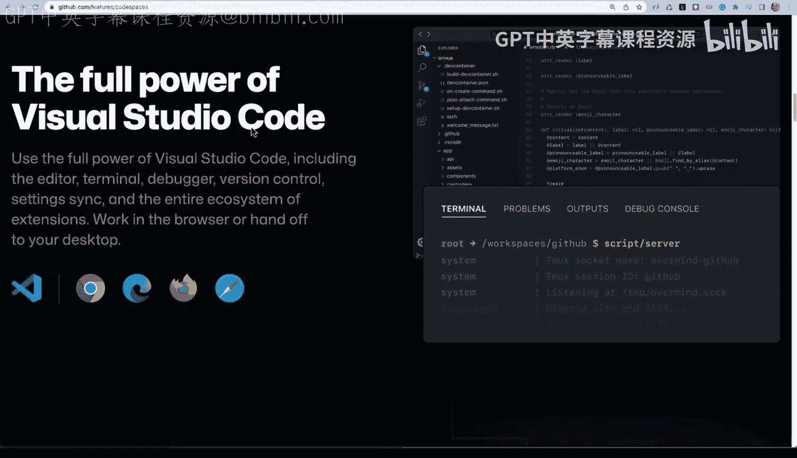

And go to settings。 And if we scroll down here， you can see that I've made this a template repository。

 Now， the reason why this is so powerful is that I've also gone in inside of here and I have a dot dev container environment。

 which allows me to customize this development environment and it will preload whatever I put in this Docker file。

 So I say use the dev container universal build， so use the standard Github container here。

 install some packages like FFM pageg or Python 38 or Gcc。Also。

 go through here and install my packages。 So I use the make file to do a installation。

And then I also am able to actually configure the visual studio code environment as well and enable things like the NviDdia couda drivers so that when I later want to go through and use GPU features I can。

 So once I've got all that setup， then I can actually go through here and launch a new instance or I can use this template to create a new repo。

 let's go ahead and take a look at both。 So first if we go to code here I can actually create a new code space and this would be a new development environment and if I go and I customize this and I select inside of this machine type。

 notice there's a bunch of different options here， including very powerful 16 core machines that are great for CPU task or in this case。

 the thing I want to use for dealing with hugging face is I want to use a。

Core GPU6 core machine with one GPU and 112 gig of RamM and 128 gig of storage。

 So for a university setting， if I want to use pretrain models， do inference， do training。

 do fine tuning， this is really the recommended environment to set up。

 Now once you've gone through that， you can launch it and it'll go ahead and create an environment。

 Now I've gone through and I've used this whole template。

To create a new repo called Huging face tutorials。 And that's what we're going to be covering in this course。

 And in fact， I've already launched this particular environment。

 So I'm going to go ahead and go into this code space here。

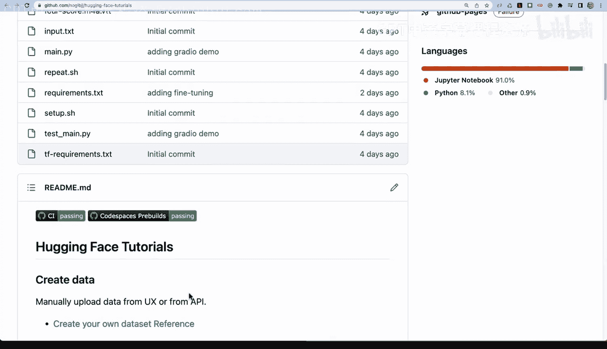

Let's take a look at some of the things that I've done。

 So one of the things that I've done is I have a virtual environment set up。

 and this allows me to have a specific version of Python that is going be targeted towards a installation that I've already got set up。

 so I don't have to install anything。 I've also got all my requirements pinned here。

 So notice here that I have lots of different packages like fast API， I have Jupiter。

 you know I also have， in fact， hugging face data here。 So I have the transformers。

 I have the data set。 I have the tokens I have even accuracy metrics inside of here like the Roe score are all created inside of this pinned environment。

 and finally I have a utilities directory， which allows me to test out the GPU functionality of my machine。

 Now let's go ahead and take a look at this real quick。

Notice I have something called Ver Pytorrch and what this does is it says let's make sure that the GPU KUuda is available。

 basically the SDK for the NviIDdia GPU， so if I type in Python and I type in UTs and verify Pytorrch。

Anybody that uses my template can launch this， and they can see， yes， In fact， this is working。

 We've got this thing enabled。 The other thing that we can do to test things out。

Is that in this utilities directory， I've uploaded a audio file that is a narration of the Gettysburg address。

 and this is a very small file here。 and what I do is I use the whisper tool。

 which is available from opening eye that does automatic speech recognition to transcribe that file。

 So let's go ahead and take a look really quick at what whisper is。

 So if we take a look at whisper this is a open source automatic speech recognition system。

 And in fact， we can see the architecture here。 they have the encoder block， the decoder block。

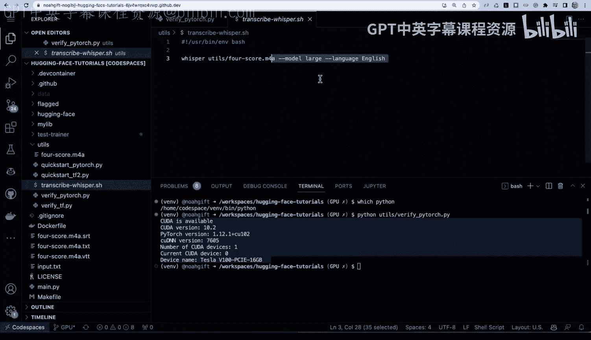

And inside of this， it's able to go through that pipeline and give us these great transcriptions and also transcribe from one language to another it's also available inside of hugging face and we can see here that it's under W large and you can actually import this directly inside of your project by just following these instructions。

 but we can in fact， even more quickly just run the W utility because I've already installed it on this system。

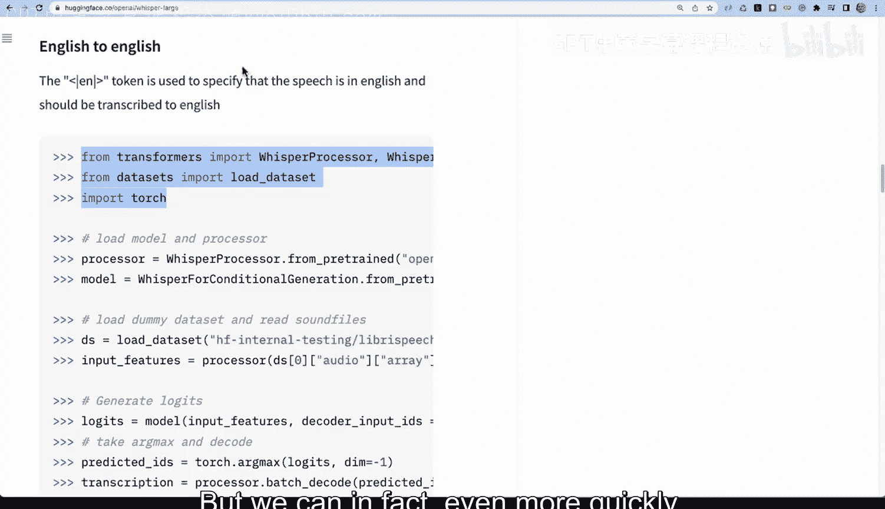

Now let's go ahead and do that。 And if I run this， this is going kick off a whisper job。

 and I can launch。

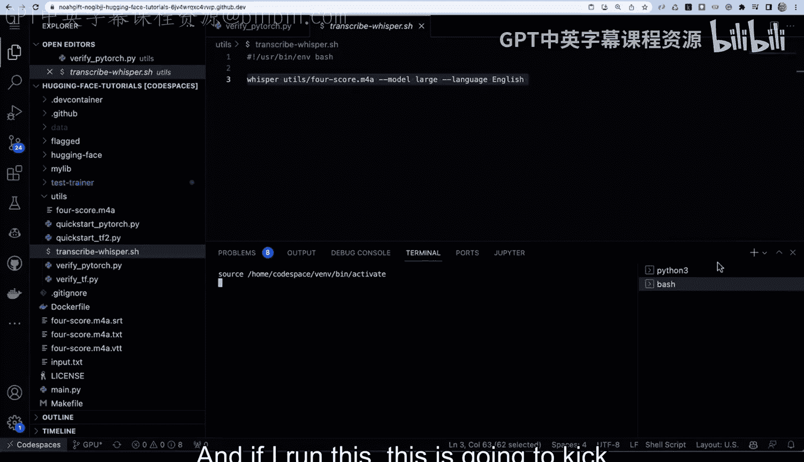

Instead of here， another environment to monitor the GPU。 So if I type in NviDdia。SM I。Dash L 1。

This will actually kick off a monitoring tool that will allow me to view the GPU usage while this is transcribing things。

 and so here we have W loading a very large language model and this language model is going to take that audio file and it's going to convert it to a text format by using the GPU that's enabled on this platform。

 so it takes a little bit of time to ramp everything up。But once it does。

 it will go through here and step by step， transcribe each of the components of this particular project。

Here we go， we see that the GPU has definitely been spiking up and down。

 so it's actually doing some work here， here we go it's spiking again and it's doing this work and we can see that in fact the GPU is being summarized or is using the transcription to take that audio file and convert into a text based format。

And here we go。Working， all the libraries are loaded。And the next step will be to step by step。

 transcribe it and notice how it directly corresponds with the GPU load here once it's done。

 then the GPU load will go back down to zero so really in a nutshell。

 this is one of the advantages of using this GPU based environment is that I can work alongside of the huggingface ecosystem and use pretrained models。

 in fact， if I type in i Python， I also could go back to Open AI here。

 and I could actually just follow the instructions that they're recommending for each of the steps inside of that particular model。

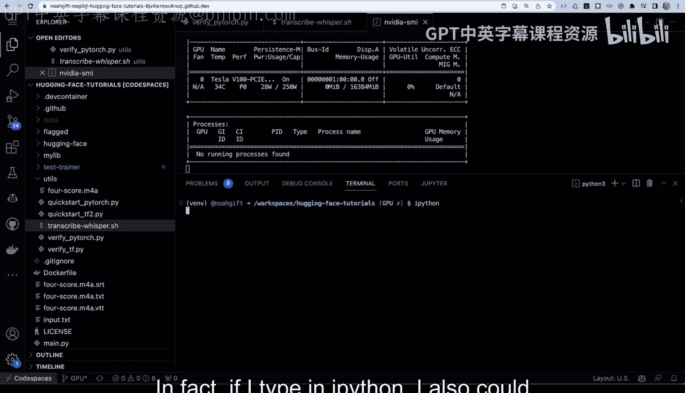

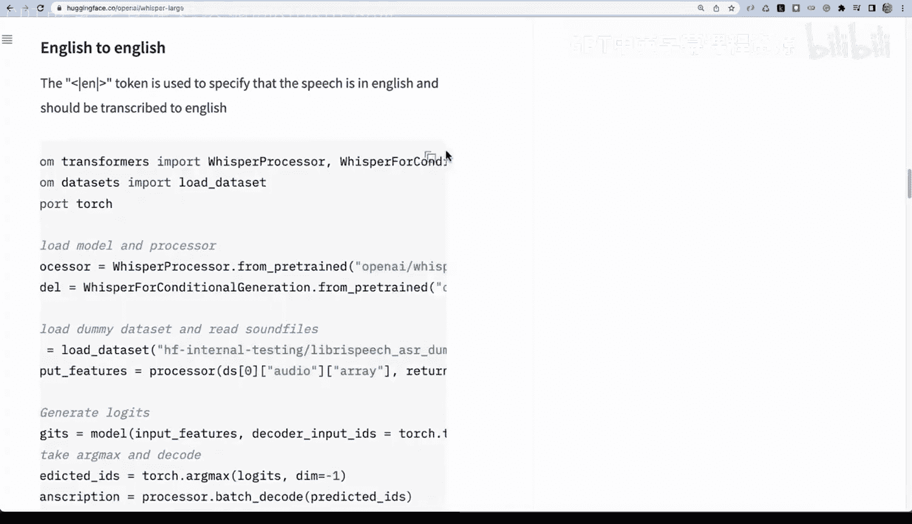

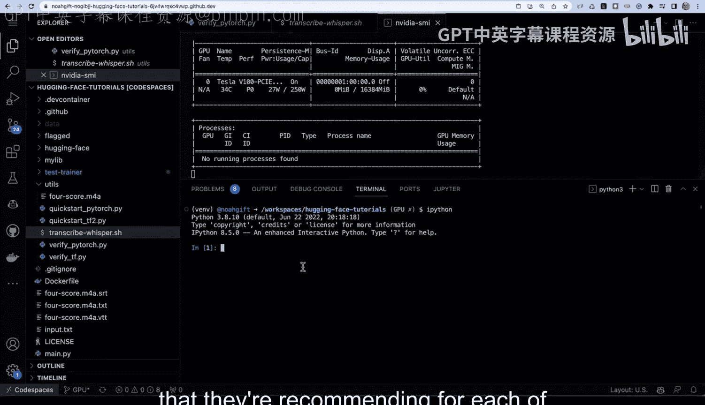