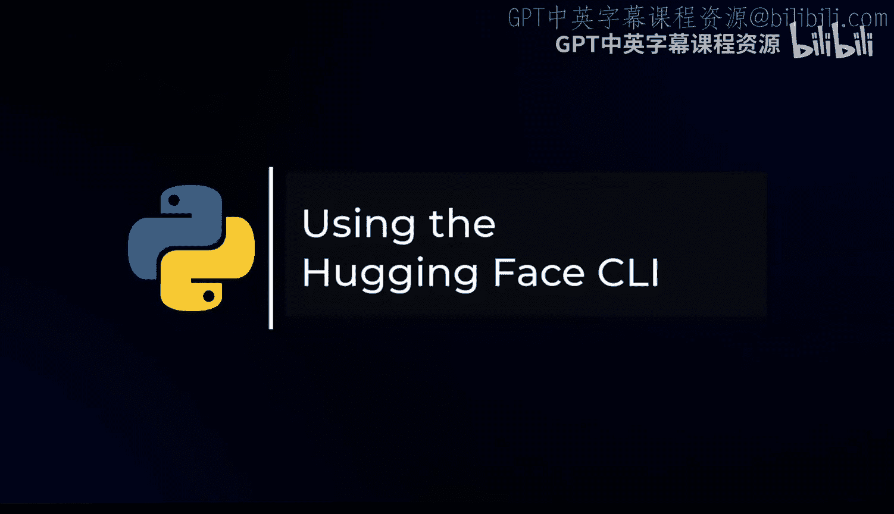
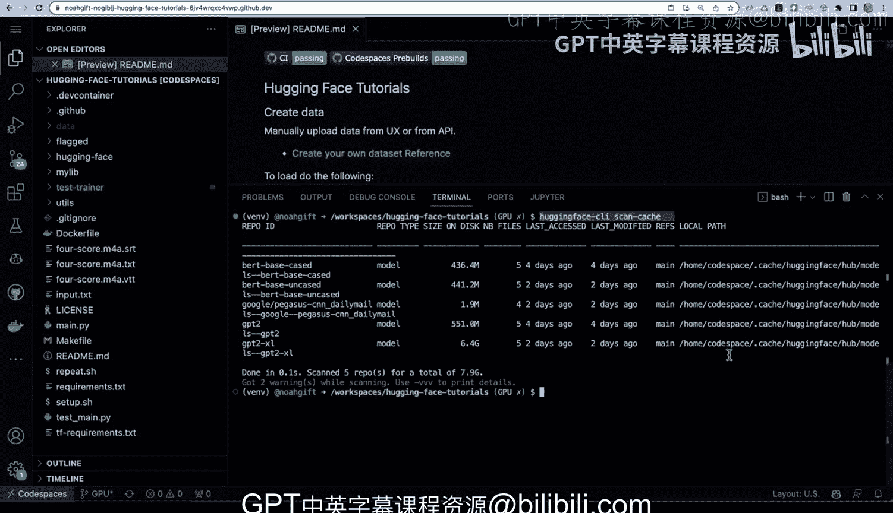

# 杜克大学｜机器学习运维｜DevOps⧸DataOps、Azure、MLFlow和抱脸｜MLOps ｜ Machine Learning Operations p162 21_02_04_使用Hugging-Face命令行工具.zh_en -BV1yE421c7uA_p162-

One of the more powerful ways to get involved with hugging F is to use the Huging face command line interface。

 in general， I'm a huge fan of using command line tools。

 And you can see here we have Huging face CI that's installed。And if you just run it。

 it'll give you a help menu， one of the first things that I would recommend doing is looking at some of the tools that are subcommands。

 So for example， if we go to Huging face log in one of the things that we see here is that you can actually log in by going to the tokens directory and inside of the tokens settings inside of Huging face this will be something you can set up and then pass in and then authenticate now once you've done that。

 Huging face knows who you are when you're developing in a workspace like this。

So what this means is if you go back here and we go to the help menu。

And we take a look at the next command， which is who am I， it'll know who I am。There we go。

 It says no a gift。 That's right。 It shows that I'm a member of two Duke organizations。

 and that's a really useful component of the authenticated experience。 If I wanted to log out。

 I could also go ahead and do a log out command here。And if you look at the help menu。

 it just tells you exactly what the command does and then also reoss right so we could also go through here and go to repo and that would be another command that we could do。

And there's also the integration of large files and multipart upload。

I would say one of the commands that I use quite a bit that's included here is the scan cache。

 and if we go through here and we type in scan cache。

 one of the nice things that happens with this tool is it tells you locally what is actually on your machine and this can be invaluable when you're going to go through and take a look at things like do I need to free up to space or some other utility。

 so definitely take a look at the huggingface CI， make sure you have a token so you can authenticate and then you can actually use it to interface with Huging face Hub。

