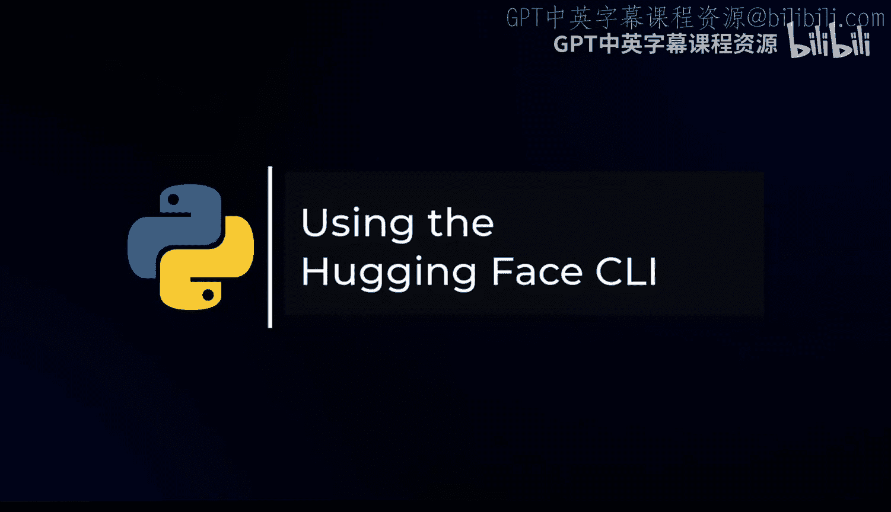
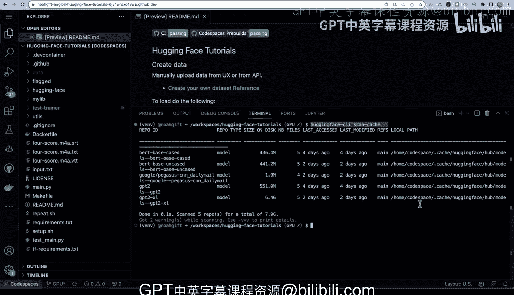

# 杜克大学｜机器学习运维｜MLOps：p162：使用Hugging Face命令行工具 🛠️



在本节课中，我们将要学习如何使用Hugging Face的命令行界面工具。这是一个与Hugging Face平台进行交互的强大方式，尤其适合喜欢在终端中工作的开发者。

## 概述

Hugging Face命令行工具提供了多种功能，包括身份验证、仓库管理以及本地缓存检查等。掌握这个工具能让你更高效地使用Hugging Face生态系统。

## 登录与身份验证

上一节我们介绍了CLI工具的基本概念，本节中我们来看看如何进行身份验证。使用命令行工具的第一步通常是登录你的Hugging Face账户。

要登录，你需要一个访问令牌。你可以在Hugging Face网站的设置中生成此令牌。

以下是登录的具体命令：
```bash
huggingface-cli login
```
运行此命令后，系统会提示你输入令牌。完成此步骤后，CLI工具就能识别你的身份。

## 验证身份与查看信息

登录成功后，你可以验证当前登录的用户是谁。

以下是验证命令：
```bash
huggingface-cli whoami
```
该命令会显示你的用户名以及你所属的组织信息，例如“Duke University”。这对于在团队协作环境中确认权限非常有用。

## 其他常用命令

除了登录和查看身份，Hugging Face CLI还提供了其他实用命令。

以下是几个重要的子命令介绍：
*   **`huggingface-cli logout`**：此命令用于退出当前登录的账户。
*   **`huggingface-cli repo`**：此命令用于与模型和数据集的仓库进行交互，例如创建、克隆或列出仓库。
*   **`huggingface-cli scan-cache`**：此命令会扫描并列出本地机器上所有通过Hugging Face库下载的模型和数据集缓存。这对于管理磁盘空间至关重要。

## 扫描缓存以管理空间

在机器学习项目中，模型和数据集文件通常很大，容易占满磁盘空间。`scan-cache`命令可以帮助你了解本地存储了哪些文件。

运行以下命令来扫描缓存：
```bash
huggingface-cli scan-cache
```
命令执行后，会详细列出每个缓存项目的大小、路径和最后访问时间。你可以根据这些信息决定删除哪些不再需要的文件以释放空间。

## 总结



本节课中我们一起学习了Hugging Face命令行工具的核心用法。我们了解了如何通过`login`命令进行身份验证，使用`whoami`确认身份，并探索了`logout`、`repo`等管理命令。最后，我们重点介绍了`scan-cache`这个在管理本地存储时非常有用的工具。请确保你拥有有效的令牌并完成了身份验证，这样才能充分利用CLI与Hugging Face Hub进行交互。