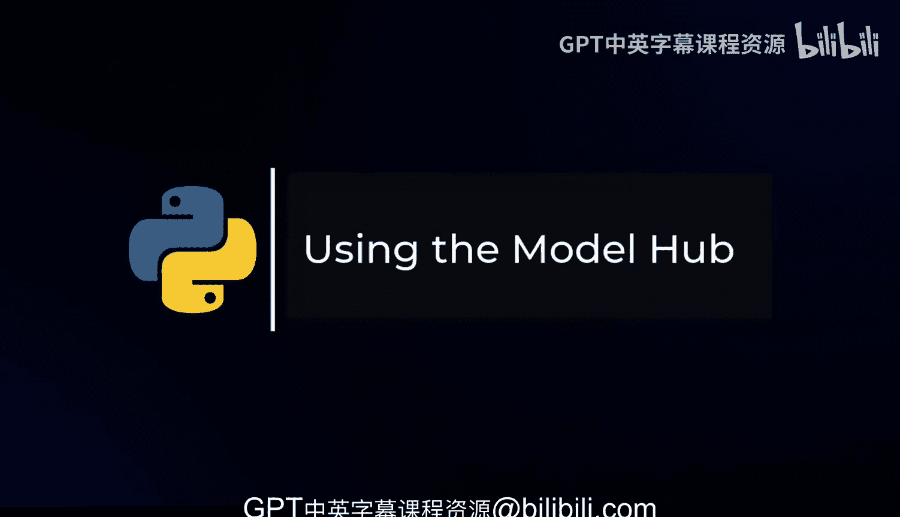
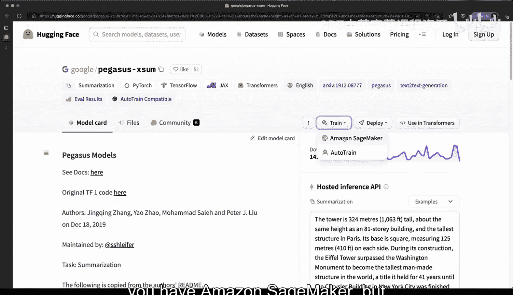
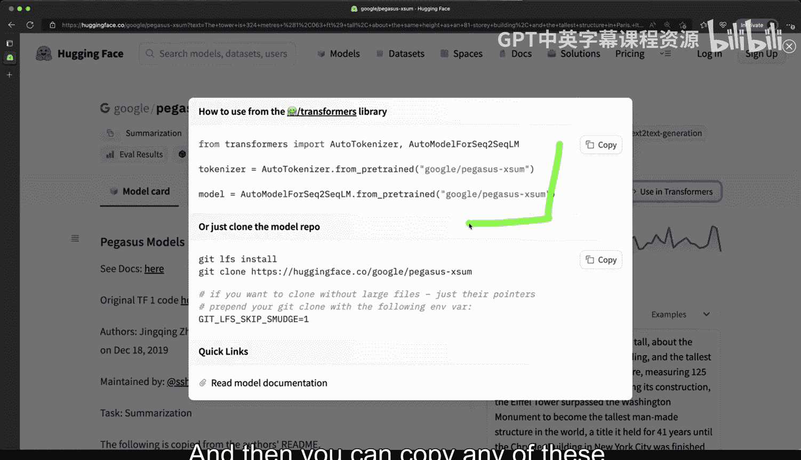
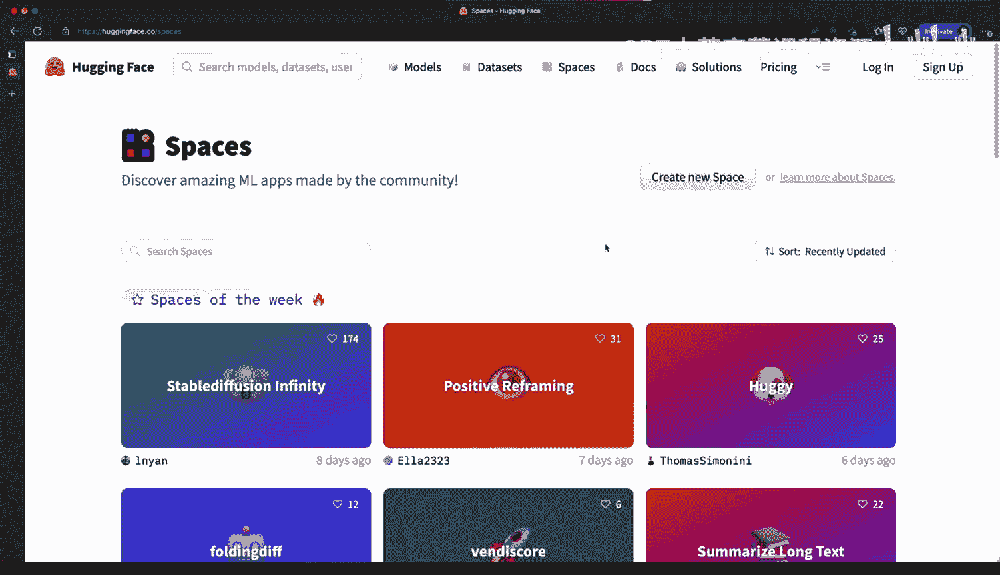
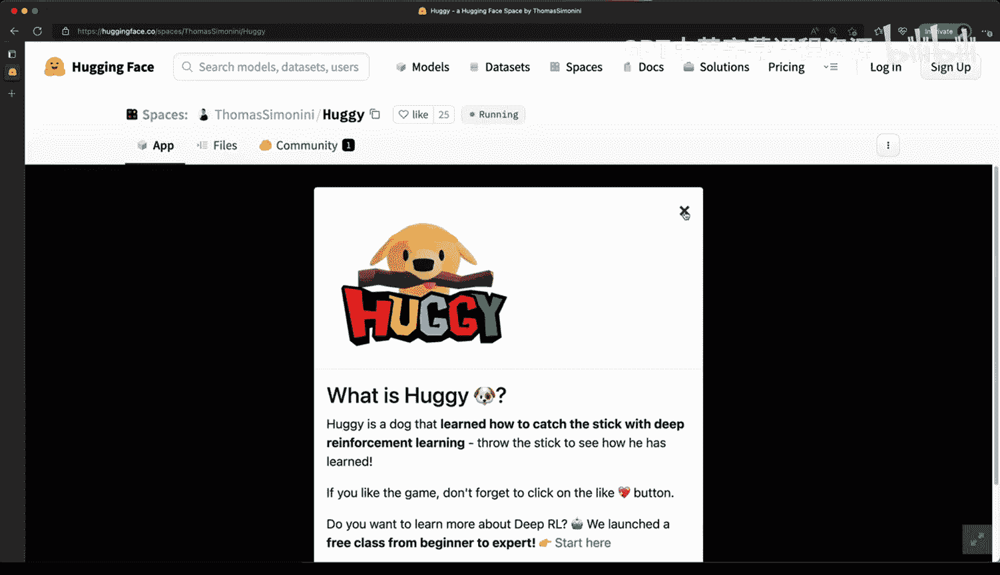
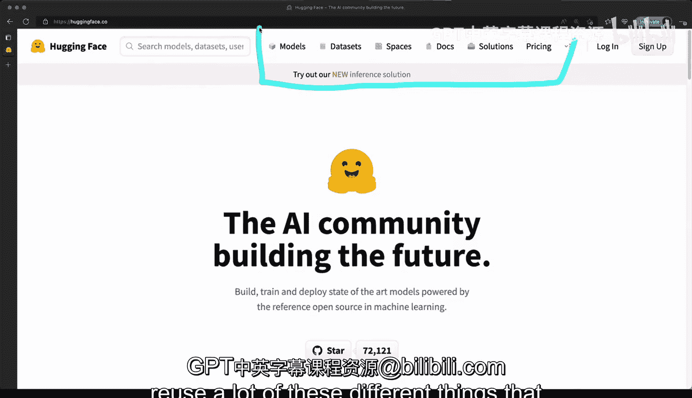

# 杜克大学｜机器学习运维｜DevOps⧸DataOps、Azure、MLFlow和抱脸｜MLOps ｜ Machine Learning Operations p163 22_02_02_使用模型中心.zh_en -BV1yE421c7uA_p163-

Let's do a quick overview of what the model hub is。

 There's more to it than we've already seen reducing models datas and spaces so we've already covered a couple of those things so I think that is a good idea to kind of like give one other quick overview as to what we have here with huggingface I'm going go ahead and start with models and within models if I click here you have a few sections here to the left and primarily tasks。

 library datas and languages all of these are kind of like labels or categorizations that you can see to try to filter out things that you might want to be working with specifically。

For example， if I were to go to the languages section and say for example。

 I want to do something with Spanish which might be interesting to me can click on these and then suddenly all of the models here will start getting a filter so that's a good thing and then you can keep going on to filter filter out so if I want to say I want to do summarization so you can see now summarization and Spanish are now selected and you can see here that summarization only for Spanish will be kind of like what were seen here so you can see here there's to bird share Spanish fine- tune summarization sounds like a pretty interesting and it filters out like I said kind of like the things that we've already looked at so if I click on the X right here then I see all of the other ones that are available for summarization so。

Next I'm going click on one of these models and we can already we've already seen a little bit of what the model card is and the model card allows you to describescribe better but this is up to you the user you have to create a readme that is that makes sense and just like on a Github repository and you have these hosted infer API as you know we've already created a little bit of that but some of these models will have the ability to be interact interact with this so hear summarization so we can say compute and see what happens and there you go well the computation diamond CPU was cache that was why the response was almost immediately because the textt doesn't change all right so summarization pretty cool there。

Next you have the ability to deploy these and for deploy you have Amazon SageMakers or you can use the inference API on your on your own account now the other thing that you can do is that you have examples you have Amazon SageMaker but you can also use it in transformers and I really like these extra documentation because you have ready to use copy copy paste snippets that you can start doing for doing inference in your own code so if you wanted to clone the repo。

 remember everything with h facee especially with models will need LFS so that needs to be enabled and then you can copy you can copy any of these and then start playing around with that。

Allright， so beyond models we have datasets， we've already covered a few of those but let's take a look at some of the interesting task categories here for the datas so let's start for example let's say text generation within text generation say for example you wanted something with wiki textex let's take a look at what we have here now the data preview we do have a data preview and we have the ability to do a splits for test training and validation that is really nifty because sometimes the specific data that you have you want something for testing number one for validation and by the way and we'll cover these a little bit later on the more hands on examples you have access through the datas library in Python and select which one of these or you're going to be working for like are you going to do the test a training the validation and and then create。

Like you can even create a subset as there as well let's take a look at the code data bureau and here you can see a little bit of what is covered so you have tons of different snippets that you can take a look to try to see where。

Where the data is and how it looks， let's take a look at training。

 I'm pretty sure this is going to be more more thorough。

 but here you can see there's tons of information and you start getting like a look and feel of what that is going to be and you have all kinds of different sections here this is a raw V1 I don't know what that exactly means。

 but it's just a different type of subset of the data and then as always as you can poke around the files and you will be this is when you go into the files you'll see that you have the ability to see the commits here there's 11 commits and it's just like a GiHub repository really but you start seeing that there's a readme dataset infos。

 let's take a look at the infos you get to see the description and this is kind of like what。

Hggingface does behind the scenes to try to figure out how to present these best and there's this Python file it seems here to try to do let's see we have citation we have induces the datasets the datasets library over there for a nested class or a channel class do class inherits there with Python so oh you know very good ways you can see here some of the languages。

 he supports the source datasets， what are the source datasets that's always a good idea to take a look so and finally we have models datas spaces and spaces like I said we've already seen some of those and you have the ability to have the ability to play around with radio when I close these but essentially you have the ability to interact with it so you have let's say Beny's score the other was' more interactive with some music even and you can。

Construct this very easily like we've seen before， so again Hiface the hub。

 when you hear what is the Hiface hub it refers to all of these components working together for giving you a one stop shop so you can play around demo。

 interact， contribute and reuse a lot of these different things that are available to you from the platform。

