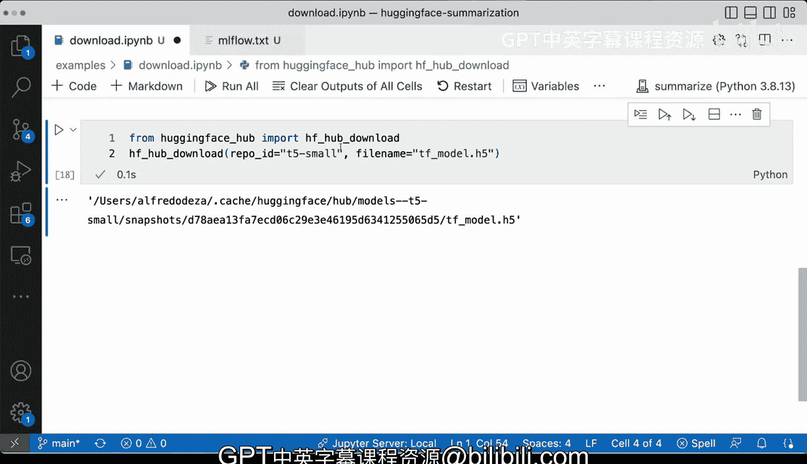

# 杜克大学｜机器学习运维｜DevOps⧸DataOps、Azure、MLFlow和抱脸｜MLOps ｜ Machine Learning Operations p164 23_02_03_下载模型.zh_en -BV1yE421c7uA_p164-

I have a Jupyter notebook here。 We're using Python 38 and I'm going to show you how you can well a couple of ways that you can download models with Huging face。

 usually what you want is everything dynamic。 That's the true nature of hugging face libraries here we've installed transformers the Python library from Huin face and we import the pipeline So we're going to go ahead and get that started It's going to take we was very fast and then we're going to say that we want some summarization we are going to pass in that' the task that we want to complete and we're going to specify that the model is going to be the T5 that's also the model and that organizer and we want truncation and the framework is tensorflow so we're going to run that。

This is going to take a quick second。 So what is going on here behind the scenes is that。

It is getting downloaded locally now it doesn't specify where it is。

 it doesn't matter because what we want to do is to be able to use the model the pipeline allows us is an abstraction for the model and it's a generic it's a generic abstraction so can I can change this to say for example。

 bird case I think it the other one can we can definitely change that。

I think it's birdcased and the way the way to do that by the way is if I go here。

 you can see well that's the T5 small， but if I go to hugging face and I look for there we go Roberta base uncased if I click that one then I will want to use these one and then go back here and then paste that to the model so that's the model ID I am not sure if there's a token nicer for bird basin case but we we can try and see if we get into trouble so there we go it is actually downloading and this is what I wanted to show you because it's downloading the Tf model that H5 you see it's 511 megabytes so it's effectively downloading that for for summarization now you can see you can see that I'm getting into trouble here but because that's necessarily the right model for summarization so let's go back here change these to T5 small。

And run this again。 but I just wanted to show you that so that you could see because I've run these before it was it didn't show the downloading so you can see here there's no download。

 there's no progress being showed at all。 Allright so for summarization I have a filed here called Mflow text it's something that I've used before for doing a little bit of a definition of what Mflow is and it has tons of different text in here。

 I'm going to go back to the U notebook。 I'm going to see how we can do summarization with these pipeline。

 So I'm gonna to run these and it's probably going to get me a single a single line of the summarization using all of the defaults of course it is going to take a quick second let's just wait it out so that took a little bit long in my compute system and I got that big text summarize to use just this cookie cutter template help streamlining lost to data team to。

Focus more on implementation of the model。 So a tool platform manages an life cycle。

 So that's pretty good。 So that is how behind the scenes it is downloaded。

 So we saw how just by calling it you would download why would you want to do that Because when you're building say a container you don't want to necessarily build a container that will take you know5 gigabys that model is tremendously big but what you want is dynamic loading。

 Now what if you really wanted to have that model locally and inspected around。

 So oops sorry for scrolling super fast I'm I'm going show you this if you install the hugging face library。

You you're able to use this HF underscoreco hub download and you need the repository ID and then the file name。

 Let's take a look at what what does this library need。

 So the repoD will be the name of our repositorory。 if I go back to the browser。T 5 small。

 This was bird case， bird base uncased。 T 5 small will be this one， right。

 So this is a repo ID right here。And what we want to understand is what type of file we're going to download。

 So from the repository， we're not be able to download a single file。 we're gonna go to files here。

 and any of these files are going to be fair game are going to be okay to， to use to download。

 So I think， I think I have。I think it's the Pytorch model one that I have。

 but I can you know I could do the Tf underscore model H5 so we can we can change that to download these one。

 So Tf underscore model H5 and when I go back here， I'm going to say。I'm gonna say。

D5 and let's double will check here， Df DF underscore Model H5。

 Df underscore model H5 and I'm going to。Run these and it's going to take is downloading 240 something megabytes worth of a file and then the resulting operation is going to be a path so now this means that I have a cache from hugging face and you can see the models in this case is' t5 small and it's cache in that So whenever I'm using thef underscore model like from T5 small then this will hugging face will use the cache so that I don't have to reddownload these over and over again。

 In fact if I run this again， you'll see that is immediately took that 。

1 second because it's just looking at the cache。One last one last way that I want to show you for downloading。

For downloading files from the hub is by using I'm gonna to show you this piece of documentation here on the website I'm going to hit over to my browser。

 open a new tab when I want to show you here is the huginface documentation on how to download documents but this is using Git so for doing these I'm going to scroll down here you're going to have to use two things Git LFs install so make sure you have LF the ability to do LFs large file file system install and then Git clone the model URL which ones the model URL well let's take a look at B based uncase the model URL would be let me see I think it would be this one right here so in that case you will go in and and get those get those get those files because this is effectively a repository if I go here to files you can see here。

In a way to contribute， you have the ability to download all of these files using Git so if I go back here to the documentation。

 that's the model URL， that's where you will be effectively using to do the Clning so that's it that's how you download models locally from HiF I show you like a few different ways actually three different ways。

 one is the dynamic one using the libraries and the R1 was let's say from using pipeline which is the regular way we use the libraries from HiF then with it the HF high inpha hub download and the R1 using Git with Git LFS installed and enabled。

