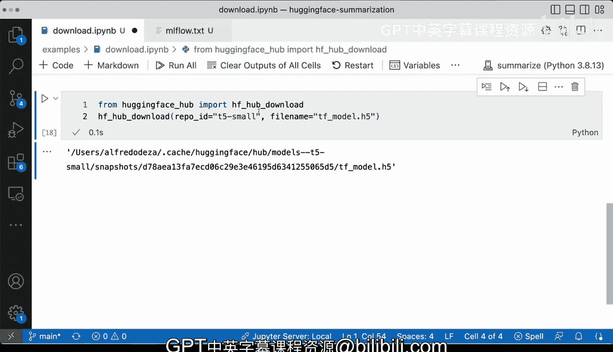

# 机器学习运维：第164课：从Hugging Face下载模型的三种方法 🚀


在本节课中，我们将学习如何从Hugging Face平台下载预训练模型。我们将介绍三种不同的下载方法，从最常用的动态加载到手动下载模型文件，帮助你理解在不同场景下如何灵活获取和使用模型。

## 概述

Hugging Face是一个流行的机器学习模型库和社区。通常，我们希望以动态方式加载模型，这是Hugging Face库的核心特性。首先，我们需要安装并导入必要的库。

```python
# 安装transformers库
# pip install transformers

# 导入pipeline
from transformers import pipeline
```

## 方法一：使用Pipeline动态下载与加载 🔄

上一节我们安装了必要的库，本节中我们来看看如何使用`pipeline`抽象层来动态下载和加载模型。`pipeline`是Hugging Face提供的一个通用抽象，它简化了模型的使用过程。

以下是使用`pipeline`进行文本摘要任务的步骤：

1.  指定任务类型为`summarization`。
2.  指定要使用的模型，例如`t5-small`。
3.  设置其他参数，如`truncation=True`和框架`framework=“tensorflow”`。

```python
summarizer = pipeline(task=“summarization”, model=“t5-small”, truncation=True, framework=“tensorflow”)
```

执行这行代码时，Hugging Face会在后台自动将指定的`t5-small`模型下载到本地缓存中。下载完成后，我们可以直接使用这个`summarizer`对象来处理文本。

例如，我们可以对一个描述MLflow的文本进行摘要：

```python
with open(‘mlflow_text.txt’, ‘r’) as file:
    text_to_summarize = file.read()

summary = summarizer(text_to_summarize)
print(summary)
```

这种方法的好处是简单快捷，模型在需要时自动下载，非常适合开发和实验。在构建容器化应用时，这种方式可以实现模型的动态加载，避免将大型模型直接打包进容器，从而节省存储空间。

## 方法二：使用`huggingface_hub`下载特定文件 📥

虽然动态加载很方便，但有时我们可能需要将模型文件明确下载到本地进行查看或离线使用。这时，我们可以使用`huggingface_hub`库来下载仓库中的特定文件。

首先，确保安装了该库：

```python
# pip install huggingface_hub
```

以下是下载模型文件的核心步骤：

1.  从Hugging Face网站找到目标模型的仓库ID（Repo ID）和想要下载的具体文件名。
2.  使用`hf_hub_download`函数并传入仓库ID和文件名。

例如，我们要下载`t5-small`模型的TensorFlow权重文件（`tf_model.h5`）：

```python
from huggingface_hub import hf_hub_download

model_path = hf_hub_download(repo_id=“t5-small”, filename=“tf_model.h5”)
print(f“模型已下载到：{model_path}”)
```

运行后，文件会被下载到Hugging Face的本地缓存目录（例如`~/.cache/huggingface/hub`）。再次运行相同的下载命令时，库会直接使用缓存的文件，而无需重新下载。这种方式让你能精确控制下载哪个文件，并获取其在本地磁盘上的路径。

## 方法三：使用Git和Git LFS克隆仓库 🛠️

最后一种方法是将整个模型仓库视为一个代码仓库，使用Git和Git LFS（大文件存储）工具进行克隆。这对于需要获取仓库内所有文件，或者希望以版本控制方式管理模型的场景非常有用。

以下是操作步骤：

1.  **安装Git LFS**：确保你的系统已安装并初始化了Git LFS。
2.  **获取模型URL**：在Hugging Face模型页面的“Files”选项卡旁，可以找到用于克隆的仓库地址。
3.  **执行克隆命令**：在终端中使用`git clone`命令。

例如，克隆`bert-base-uncased`模型仓库：

```bash
git clone https://huggingface.co/bert-base-uncased
```

这样，你就会在本地获得一个包含该模型所有配置、权重和说明文件的文件夹。这种方法最彻底，让你能完全访问仓库的所有内容。

## 总结

本节课中我们一起学习了从Hugging Face下载模型的三种主要方法：
1.  **使用`pipeline`动态加载**：最简单直接，适合大多数开发场景，实现按需下载。
2.  **使用`huggingface_hub`下载文件**：更灵活，可以下载特定模型文件并获取本地路径，便于离线使用或集成。
3.  **使用Git LFS克隆仓库**：最彻底的方式，获取模型的完整仓库，适合需要全部文件或进行版本管理的场景。



你可以根据实际需求，如网络环境、存储限制和自动化流程的要求，选择最合适的方法来获取和使用Hugging Face上的强大模型。